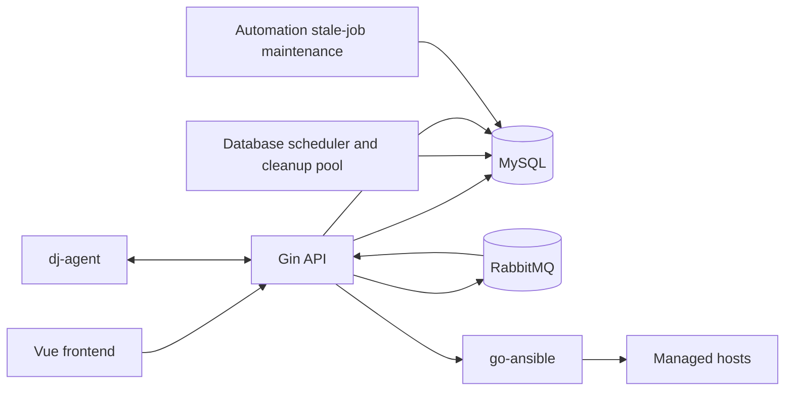

# Architecture

## Process model

One binary exposes independently deployable roles:

- `api`: Gin HTTP API, authentication, validation and domain services.
- `scheduler`: scans persisted schedules, atomically creates due execution records, and directly executes database cleanup with bounded concurrency. robfig/cron/v3 calculates future schedule times.
- `worker`: retains automation stale-job reconciliation; it does not consume scheduled-task messages.
- `migrate`: applies schema migrations (the Django baseline handoff is complete; schema is defined by `db/schema` + `db/migrations`).

Scheduler scanning and cleanup execution are separate loops. The database is the source of truth for schedule progress and execution requests; API manual runs create durable requests through the same path. Cleanup is database-only and does not require a message outbox.

## Boundaries

Each domain follows `handler -> service -> repository`. Handlers own HTTP decoding and the legacy response envelope. Services own authorization-sensitive business rules and transactions. Repositories contain handwritten SQL through generated sqlc interfaces.

Infrastructure packages must not import HTTP handlers. Domain packages may depend on small interfaces implemented by MySQL, RabbitMQ, robfig/cron, Ansible or the agent gateway.

## Job reliability

- Scheduled cleanup uses durable database execution records, not RabbitMQ. Multiple scheduler instances coordinate through database locks.
- Missed automatic schedules coalesce into one run; disabling or changing a schedule cancels old pending requests, without forcibly terminating an active cleanup.
- RabbitMQ messages and queues for log-collection batches are durable; consumers use explicit acknowledgements.
- Invalid schema versions and malformed messages go directly to the dead-letter queue.
- Database-only cleanup and its successful completion record commit atomically, so a process crash rolls back uncommitted cleanup rather than losing an in-memory trigger.
- RabbitMQ log-collection handlers acknowledge after handling succeeds; failures are dead-lettered and existing reconciliation handles lost jobs.

Scheduler behavior and failure semantics are defined in [the scheduler architecture](../../docs/architecture/SCHEDULER_ARCHITECTURE.md).

## Time and security

- Store and exchange timestamps in UTC; convert only at the frontend boundary using the user's timezone.
- Never put credential secrets, private keys or sudo passwords in RabbitMQ messages or logs. Messages carry database identifiers and immutable execution ids.
- Encrypt sensitive credential columns before the assets domain is migrated.
- Ansible runs as an external process. The Go binary remains CGO-free. The executing process needs `ansible-core` and Python unless bundled; `make build` bundles CPython + ansible-core into the binary by default (after `make ansible-embed`); set `ANSIBLE_EMBED=` to disable (see `docs/architecture/AGENT_INSTALL_UPDATE.md`).

## Agent channel

Live gRPC agent sessions are held in process memory, so they are owned by exactly one process role (the api role, see `internal/agent/gateway.go`). Automation, inspection, monitoring installation, WebSSH and file transfer all route through that gateway; do not reproduce hidden process-local coupling elsewhere.