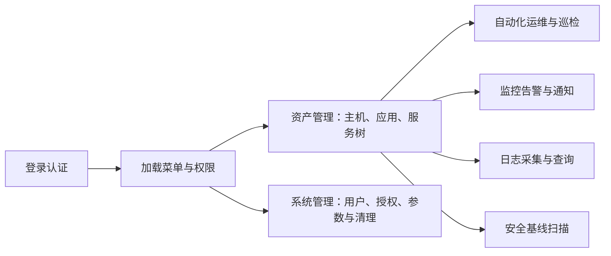

# 文档中心

> **按系统菜单找模块，先看重点和流程图，再查操作与排障。这里描述当前实现，不展示旧计划和历史流水账。**

## 先看全局流程

## 按菜单阅读

| 系统入口 | 模块手册 | 最需要关注 |
|---|---|---|
| 公共基础 | [登录认证与权限](architecture/modules/ACCESS.md) | 登录与鉴权流程、权限快照、失效边界 |
| 首页 | [首页](architecture/modules/HOME.md) | 当前能力及导航，不假设存在统计大屏 |
| 资产管理 | [资产管理](architecture/modules/ASSETS.md) | 主机/Agent、项目、环境、凭据、应用、服务树与删除 |
| 自动化运维 | [模板、Inventory、任务与运行记录](architecture/modules/AUTOMATION.md) | 提交与成功的区别、执行位置、取消边界 |
| 自动化运维 → 巡检中心 | [巡检中心](architecture/modules/INSPECTION.md) | 采集 → OPA → 断言 → 报告，失败与错误的区别 |
| 监控中心 → 监控告警 / 通知管理 | [监控告警与通知](architecture/modules/MONITORING.md) | 指标、告警摄取和通知分发分别排查 |
| 监控中心 → 日志管理 | [日志管理](architecture/modules/LOGGING.md) | 配置 → Filebeat → ES，停止、换档与删除的区别 |
| 安全中心 → 基线扫描 | [基线扫描](architecture/modules/SECURITY.md) | OS 合规检查，不是漏洞扫描或自动修复 |
| 系统管理 | [系统管理](architecture/modules/SYSTEM.md) | 用户/组/角色、菜单、参数、调度与审计 |
| 右上角用户菜单 | [个人中心](architecture/modules/PROFILE.md) | 密码、时区与通知收件绑定 |
| 文档中心 | [阅读与维护说明](architecture/modules/DOCUMENTATION.md) | 目录、章节、流程图与发布边界 |

## 阅读方法

**复杂流程直达：** [逻辑服务删除全流程](architecture/modules/ASSETS.md#service-deletion)
集中展示删除主流程、失败重试、同编码重建及数据影响范围。

每份模块手册使用相同顺序：**重点 → 菜单入口/操作 → 流程图 → 判断与失败路径 → 技术细节**。
同一模块的菜单跳到对应章节，不复制重复手册；菜单是否可操作仍由实际角色权限决定。

流程图中的“提交”“等待”“执行”“成功”含义不同，不能用一个成功提示代替整个后台流程。
涉及删除、凭据、认证和配置下发时，优先阅读醒目提示及失败边界。

## 开发参考

模块手册是日常第一入口；底层数据结构和执行约束按需查阅：

- [项目与进程边界](overview/PROJECT_CONTEXT.md)、[开发与 API 约定](architecture/CONVENTIONS.md)、[SQL 设计](architecture/SQL_DESIGN.md)。
- 构建与运行：[后端](../autoadmin/README.md)、[前端](../fronted/README.md)、[Agent](../dj_agent/README.md)。
- 部署：[后端](../autoadmin/deploy/README.md)、[Agent](../dj_agent/deploy/README.md)。

**维护要求：** 功能变更必须同步模块说明和流程图；不将未上线设计、旧实现说明或临时修复记录混入模块手册。
仓库保留的计划与历史仅用于追溯，不随系统阅读目录发布。
