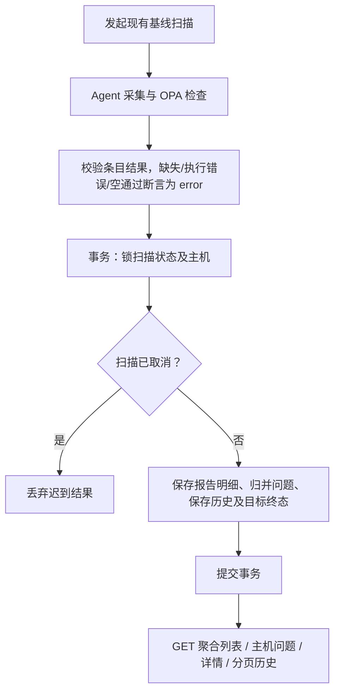

# 安全问题台账

## 入口与边界

菜单 **安全中心 → 安全问题**，默认按风险聚合，可切换按主机查看并打开独立问题详情。
这是跨扫描的风险台账，不是一次扫描报告的副本；原报告保持当时结果，不因后续修复而改写。

数据仅来自启用模块后的新基线扫描，不回填旧报告。不包含账号权限盘点、
定期扫描计划、负责人、整改期限、人工状态修改、豁免及自动修复。
页面仅供读取，不能通过问题页面执行命令或发起扫描。
没有问题记录不代表已检查或安全；台账不是全资产检查覆盖率报表。

## 数据流

### 规则身份

每台主机每个稳定策略 ID 仅有一条问题，不将规则内的多个违规账号拆成多个问题。
稳定策略 ID 使用 `baseline_item.id`，编辑内容不改变它；删除重建获得新 ID，不按名称合并。
`rule_key` 是条目 ID 的小写十六进制、左侧补零到 64 位，仅用于聚合及 URL 筛选，
不包含可编辑配置。主机或规则删除不自动关闭问题。

`rule_version` 为条目 ID 与规范化执行配置的 SHA-256，排除修复建议；
名称、类目、排序、风险级别不改变版本，采集/策略/执行用户等配置变化产生新内容版本。
版本仅标识内容不同，不判断是纠错、标准放宽还是标准收紧；不自动将新版本视为等价旧标准。
报告与每条问题历史保存各自版本和原始证据，历史策略文本、结果、消息、修复建议不随编辑重写。

数据库以 `(host_id, item_id)` 唯一约束防止重复问题，
以 `(issue_id, scan_id)` 唯一约束防止重复历史。
启用模块前的扫描明细 `rule_version` 为 NULL，不参与归并。

### 状态与验证

| 观察结果 | 问题处理 |
|---|---|
| 首次 fail | 新建 open 问题，记录首次发现及证据 |
| 持续 fail | 更新最近发现，不重复创建 |
| closed 后再次 fail | 重新打开，复发次数加一 |
| 原规则版本有效 pass | 关闭已有问题，关闭依据为 `verified`（复查通过）；不单独创建“通过问题” |
| 不同规则版本有效 pass | 关闭同一问题，记录 `closed_rule_changed` 历史及 `rule_changed` 关闭依据，显示“规则变更后通过” |
| error、未知状态、缺失结果 | 不创建违规问题；已有问题保持开关状态，最近检查标为 error |
| Agent 离线或请求失败 | 已有对应问题记检查异常，不能当作通过 |
| 本轮未覆盖的主机/规则 | 不更新问题，更不能因“没查到”而关闭 |

通过结果必须包含非空断言明细，且每条 `successful=true`。
采集/求值错误不再映射成 fail；扫描详情将执行异常单独展示、筛选，不纳入不符合数量。
目标符合率分母包含本轮全部条目，因此异常不会抬高通过率；离线目标仍是 skipped。
已关闭问题随后遇到 error 时仍保留已有关闭结论，但显式展示当前无法验证，不宣称新一轮通过。
只有编辑规则、尚未有效复查时不改变问题状态。`last_rule_version` 是最近生效检查版本，
`failure_rule_version` 是最近生效不符合的版本；异常不会覆盖后者。
关闭时比较本次通过版本与不符合版本，区分两种关闭依据；后续普通通过不改写原关闭原因，
复发则清空原原因。任何自动关闭都只证明当前标准下通过，不证明执行过修复；
尤其“规则变更后通过”可能来自策略纠错或标准调整，页面要求对比历史证据。

### 并发、乱序与失败

以扫描创建时间（UTC）及扫描 ID 排序，不以回包/入库先后决定新旧。
详情历史的“扫描发起时间”表示扫描创建时间，不是 Agent 实际采集时刻。
问题详情默认仅展示关键事件：生效的首次发现、复发重开、验证关闭和规则变更后通过，
以及每轮最后一条持续不符合（若该轮仅有首次发现或复发则不重复显示）。
最近生效检查为异常时单独列出；历史异常、迟到结果和关闭后的普通通过可在独立的“检查记录”页查看。
服务端从单问题的全部历史中筛选关键事件后再分页。此视图不影响归并、计数或证据留存。
两种视图都展示单次扫描的证据摘要，其中“不符合”项数来自该扫描的失败断言，不是问题累计不符合次数。
展开历史行可对照检查项的实际值与期望值（不符合时只列失败项），并查看修复建议、检查消息、规则版本和原始证据。
检查异常不统计部分断言，只提示无法验证并保留原始证据供排查。
较早结果迟到时保留历史，但不覆盖较新的状态；较早失败可补全首次/最近发现时间。
“生效的不符合次数”和复发次数只计算按时序生效的观察，不把迟到旧结果算成新复发。

尚无问题记录时的 pass 仍保存在扫描明细。较早首次 fail 迟到时，归并会跨内容版本读取同一稳定条目最新明细，
在同一事务中补入较新的通过/异常证据，避免将已经通过的主机误标为未解决。
从未失败的正常规则不创建问题，也不创建问题历史。

持久化先对扫描父行取共享锁，允许不同主机并发提交，并与取消的排他锁互斥；
再锁主机行，串行化同一主机不同扫描的归并，不依赖不存在问题行的间隙锁。
报告明细、问题、历史、目标终态同事务提交，不存在提交报告后进程退出而漏建问题的异步窗口。
目标已提交终态则重复处理不再写入；事务最多尝试三次，最终失败记录服务日志并将尚未结束的目标标为
“扫描结果与安全问题保存失败，请重新扫描”，不提示成功。进程在提交前终止时事务回滚，
本模块不增加扫描进程重启恢复或周期补扫能力。

## 查询与展示

所有接口使用 GET，无请求体，无 POST 查询分支，均要求独立权限 `security:issues:view`：

| 接口 | 内容 |
|---|---|
| `/sys/security/issues/` | 按主机的问题明细列表 |
| `/sys/security/issues/groups/` | 按 `rule_key` 聚合，含主机数、未解决/已关闭及最近检查异常数 |
| `/sys/security/issues/:id/` | 问题概要 |
| `/sys/security/issues/:id/history/` | 分页发现与复查历史，含预期、实际、消息和修复建议快照；`scope=all`（默认）返回完整历史，`scope=milestones` 仅返回关键事件；其他值返回参数错误 |

列表支持 `status=open/closed`、`severity=high/medium/low`、`host_id`、`rule_key`、
`environment_id`、`search`（问题/主机名/IP）、`page`、`page_size`。
`environment_id` 为正整数时按主机当前所属环境筛选，`unassigned` 表示未设置环境，
不传表示全部环境；其他值明确报参数错误。环境条件在数据库分页和聚合前应用，
问题总数、风险组总数及组内主机数/状态计数均使用相同条件，不能只过滤当前页。
缺省分页为 1/10，每页最多 100 条，非法过滤/分页返回明确参数错误。
分页按现有统一信封返回 `results/count/pageNumber/pageSize/totalPages/next/previous`。
聚合和明细使用同一筛选条件，默认页面筛选未解决；
聚合中的计数是筛选后数量，不是与筛选无关的全局指标，各风险主机数不可相加作为资产总数。
聚合标题取同策略成员快照的最大文本值，级别取筛选后成员的最高风险级别，
避免级别调整期间按字符串排序低估风险；两者均不参与身份或授权判断。

环境唯一来源为查询时 `assets_host.environment_id` 与环境名称的左关联，不使用应用服务环境
或历史扫描范围快照。问题列表和详情附加 `environment_id`（可空）与 `environment_name`；
每台主机只有零个或一个当前环境，修改归属或环境名称后刷新即更新，不改写问题状态和历史证据。
主机不存在或环境未设置时，问题仍保留，并归入“未设置环境”；
有环境 ID 但名称不可用时展示 ID 和“已删除或不可用”。

聚合和明细的分页响应额外返回 `environments: [{id,name}]`，候选来自全部台账主机当前环境，
不依赖当前页或当前筛选；`id=null` 对应未设置环境。候选与列表均在原安全问题权限下查询，
不要求额外资产查看权限，也不暴露无台账主机的环境清单。候选查询失败返回明确错误，
前端不将缺失候选当作成功的空筛选列表。

从聚合进入主机视角保留环境、风险、级别和状态筛选，切换视角可清除风险范围但保留环境。
选择环境或清除条件时回到第一页；按主机查看增加环境列，详情明确标识当前环境。
表格分页在服务端完成，过期请求不得覆盖新页；失败显式展示错误且不保留伪成功旧数据。
操作列固定右侧并支持横向滚动，历史操作 Tooltip 在顶部显示。
时间使用用户当前时区；主机名/IP 为检查时快照，不冒充实时资产。
主机列表显示关闭依据；详情显示稳定策略 ID、最近检查版本及最近生效不符合版本，
历史可展开查看当次版本及完整证据；只有另具 `baseline:view` 才提供原扫描报告跳转链接。

## 存储、授权与升级

当前存储（MySQL/PostgreSQL）：

- `security_issue`：独立问题台账、稳定身份、检查/不符合内容版本、关闭依据及状态/时间索引。
- `security_issue_history`：每次问题观察的内容版本与证据快照，外键仅指向问题。
- `baseline_scan_result.rule_version` 可空列及 `(host_id, item_id, scan_id)` 索引。
- “安全中心 → 安全问题”菜单及 `security:issues:view` 权限。

不回填模块启用前的报告。问题与历史不通过外键关联主机、条目或扫描，
删除这些源对象不级联清除台账；原扫描报告可能已不存在，历史证据仍可读。
首版不提供问题删除及留存清理接口，应根据扫描频率评估历史增长。
证据可能含敏感配置，问题查看权限应独立审慎授予，不按既有基线查看权限自动补授。
迁移仅给 admin 角色补菜单权限，其他角色需管理员显式选择页面及父目录授权。

部署必须先暂停扫描并停止旧 API 写入，备份 `security_issue`、`security_issue_history`、
`baseline_scan_result`，再应用迁移并运行新 API，随后部署前端。新装按顺序执行全部迁移；
已有 `000066` 的环境执行 `000067_stable_security_issue_identity`，不得重写已部署的 `000066`。

`000067` 将原内容哈希保留为版本，扫描明细列重命名为 `rule_version`，
将同一主机/条目的旧版本问题合并到最小问题 ID，全部历史迁至保留 ID，历史 ID、扫描链接与证据不变。
重复问题头被删除，其旧详情 URL 不再存在；最早问题（如原始发现记录）的 URL 保留。
迁移前应导出重复 ID 与保留 ID 的对应关系，供外部链接人工更新；不增加旧身份兼容查询分支。
首次发现取最早时间、最近发现取最晚时间；最近检查及快照按时间/扫描 ID 选取，
开关状态按最近一次明确通过/不符合观察决定，检查错误不能消除其他版本遗留的不符合。
关闭依据比较该通过版本与最近不符合版本。迁移前的生效次数/复发次数按旧记录求和，
历史转换标签和 `applied` 原样保留，不伪造按新身份重新执行过的历史；
迁移后的新观察按统一身份计数。异常的同扫描重复历史由唯一约束显式阻止迁移，不丢弃证据。
迁移不执行主机检查，也不因当前编辑后的配置重新判定旧证据，已有问题需新复查确认当前标准。

合并无法无损拆回旧问题头，`000067` 的 Down 显式拒绝回退；
需要回退时恢复停写备份与匹配代码，不能直接执行旧 API。MySQL DDL 非事务性，
失败需保持停写、检查迁移 dirty 状态并从备份恢复后重试，不可强制标记成功。
初次安装后用户重新登录获取菜单，非 admin 权限仍需显式授予。

## 回归

- `cd autoadmin && make vet && make test`
- PostgreSQL：`make vet-postgres`；`make test TESTFLAGS='-tags postgres'`
- 前端：`cd fronted && npm run test:run -- src/api/securityIssues.spec.js src/views/security/issues/index.spec.js src/views/security/baseline/scanDetail.spec.js`
- 前端构建：`npm run build`；规则检查：`npm run check:ui-rules`

迁移数据回归：设置 `SECURITY_ISSUE_MIGRATION_MYSQL_DSN` 或
`SECURITY_ISSUE_MIGRATION_POSTGRES_DSN`，执行
`cd autoadmin && make test TESTFLAGS='-run TestSecurityIssueIdentityMigration -v'`。
测试仅在专属连接上创建随机命名临时表，不读取或修改已有业务表；
未提供相应 DSN 的方言测试显式跳过，不代表已通过真库数据迁移验证。

在迁移后的测试环境，连续两轮扫描同一失败规则应只有一条问题；
修复后复查通过应关闭，恢复违规应重开；离线/采集错误只能变为无法验证。
编辑同一策略不新增问题，通过后应显示“规则变更后通过”，并可对照修改前后版本证据；
删除重建条目才会产生新身份。迁移回归需包含旧版本重复记录、跨版本异常、
原历史证据完整保留及空台账。
其他角色仅有 `baseline:view` 时安全问题接口必须拒绝，
独立授予 `security:issues:view` 后可读取，但不能因此发起扫描或执行修复。
