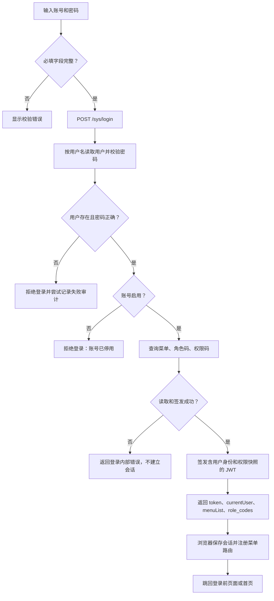
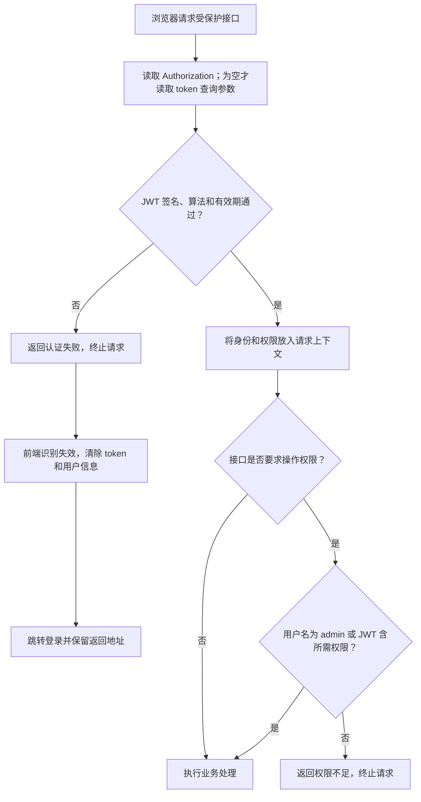
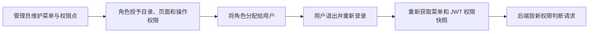

# 登录认证与权限

> **先记住三点：登录成功不等于拥有所有操作权限；隐藏菜单不等于后端鉴权；改角色后需要重新登录更新权限。**

## 入口与职责

| 入口 | 用途 |
|---|---|
| 登录页 | 输入账号、密码，获取用户会话 |
| 系统管理 → 用户、角色、菜单 | 配置账号状态、角色归属、菜单和操作权限 |
| 个人中心 | 修改个人资料、密码和时区 |

这是所有菜单共用的基础流程，不是一项可独立授权的业务操作。
浏览器登录使用 JWT；Agent 的握手密钥不是浏览器登录令牌，两者不能混用。

## 登录流程

**密码不是明文比对。** 后端解析 `pbkdf2_sha256$迭代次数$盐$摘要`，计算 PBKDF2-SHA256，
再做常量时间比较；新密码使用随机盐和 870000 次迭代。密码校验格式不支持时按校验失败处理。
JWT 使用 HS256，必须有过期时间；有效期来自后端配置，不能把“记住密码 30 天”理解成 JWT 有效 30 天。

### 记住密码与会话失效

勾选“记住密码”并成功登录后，前端将账号、加密后的密码及勾选状态写入名为 `user` 的 Cookie，
有效期为该次登录起 30 天。登录页读取这份记录回填账号、密码与勾选状态；它不会自动提交登录。
未勾选时成功登录会删除该记录。Cookie 按浏览器和主机隔离；记录已过期或不存在时不能恢复原密码。

会话与记住密码使用不同存储：Token 和当前用户资料保存在 `localStorage`，
认证失效只清除 `token` 与 `currentUser`，不删除记住密码 Cookie。
个人中心保存手机号、时区只更新当前用户资料并发送时区变更事件，也不改写记住密码记录。
因此有效的记住密码记录应在时区保存、Token 过期和登录跳转后继续回填。

登录审计会尝试写入成功、密码错误、停用等结果。**当前审计写入失败不会阻止登录**，
因此不能把“没有审计行”当作“没有发生登录”的充分证据。

## 每次请求怎样鉴权

请求封装发送的是已保存的原始 token；后端解析原始 JWT，不能自行在文档示例中加上未支持的 `Bearer ` 前缀。
WebSocket 等连接可通过 `token` 查询参数传递；常规 HTTP 优先使用请求头，不把令牌放进可分享链接。

## 菜单权限与操作权限的区别

| 层次 | 决定什么 | 不能保证什么 |
|---|---|---|
| 用户关联角色 | 用户归属哪些角色 | 不等于已拥有每个按钮 |
| 角色关联菜单、权限点 | 登录返回哪些菜单和权限码 | 不会自动刷新已签发 JWT |
| 前端菜单与按钮显示 | 用户能看见哪些入口 | 不能代替后端权限检查 |
| 后端 `RequirePermission` | 请求是否允许继续 | 不重新查询当前数据库中的角色配置 |

**当前权限是登录时快照。** 普通受保护请求不会每次重新读取用户状态或角色。
停用账号、改角色、改密码、退出浏览器，不等于服务端立即撤销已经签发的所有 JWT；
现有中间件没有逐请求查库撤销机制。不要把界面“安全退出”描述成全端会话失效。

## 授权操作流程

目录也需要授权；只授权子页面而缺少父目录，菜单树可能无法展示对应入口。
用户组用于通知收件范围，不是角色权限的替代品。

## 常见问题

| 现象 | 优先检查 |
|---|---|
| 账号密码正确仍不能登录 | 账号是否停用、数据库查询或令牌签发是否报错 |
| 能看页面但操作提示无权限 | 对应操作权限码，而不只是页面菜单权限 |
| 授权后没有变化 | 退出并重新登录，刷新菜单和 JWT |
| 经常跳回登录 | token 是否过期、服务端密钥是否变化、请求是否带正确 token |
| 停用账号后旧会话仍能请求 | 当前 JWT 快照与撤销边界，不要误判为逐请求查用户状态 |

## 实现依据

后端：`identity.Service.Login`、`VerifyPassword`、`TokenManager`、
`middleware.Authenticate`、`middleware.RequirePermission`。
前端：登录页、用户会话存储与统一请求拦截器。未改变任何认证或权限行为。
接口信封见 [开发约定](../CONVENTIONS.md#api-contract)。
