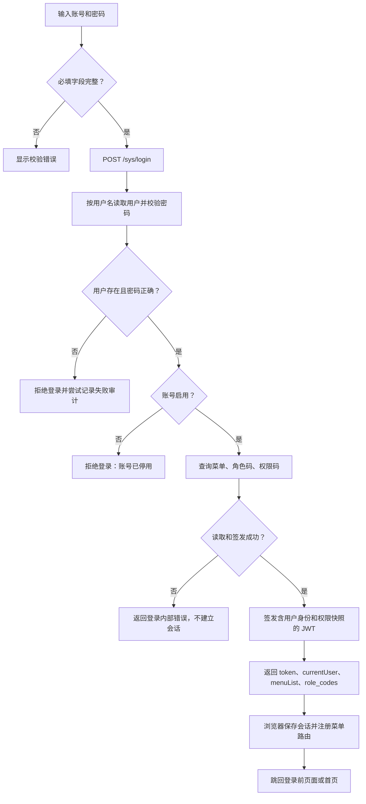
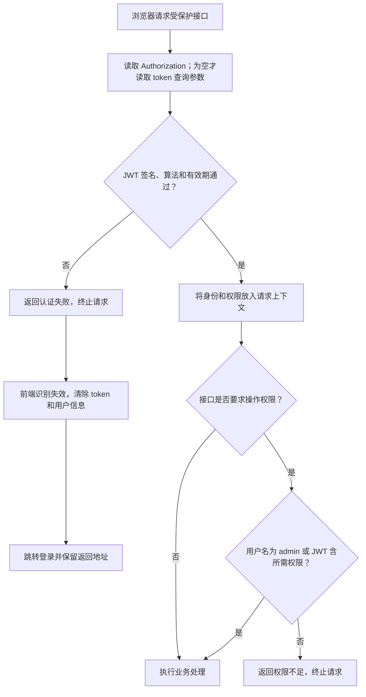

# 登录认证与权限

> **先记住三点：登录成功不等于拥有所有操作权限；隐藏菜单不等于后端鉴权；改角色后需要重新登录更新权限。**

## 入口与职责

| 入口 | 用途 |
|---|---|
| 登录页 | 输入账号、密码，获取用户会话 |
| 系统管理 → 用户、角色、菜单 | 配置账号状态、角色归属、菜单和操作权限 |
| 个人中心 | 修改个人资料、密码和时区 |

这是所有菜单共用的基础流程，不是一项可独立授权的业务操作。
浏览器登录使用 JWT；Agent 的握手密钥不是浏览器登录令牌，两者不能混用。

## 登录流程

**密码不是明文比对。** 后端解析 `pbkdf2_sha256$迭代次数$盐$摘要`，计算 PBKDF2-SHA256，
再做常量时间比较；新密码使用随机盐和 870000 次迭代。密码校验格式不支持时按校验失败处理。
JWT 使用 HS256，必须有过期时间；有效期来自后端配置，不能把“记住密码 30 天”理解成 JWT 有效 30 天。

### 记住密码与会话失效

勾选“记住密码”并成功登录后，前端将账号、加密后的密码及勾选状态写入名为 `user` 的 Cookie，
有效期为该次登录起 30 天。登录页读取这份记录回填账号、密码与勾选状态；它不会自动提交登录。
未勾选时成功登录会删除该记录。Cookie 按浏览器和主机隔离；记录已过期或不存在时不能恢复原密码。

会话与记住密码使用不同存储：Token 和当前用户资料保存在 `localStorage`，
认证失效只清除 `token` 与 `currentUser`，不删除记住密码 Cookie。
个人中心保存手机号、时区只更新当前用户资料并发送时区变更事件，也不改写记住密码记录。
因此有效的记住密码记录应在时区保存、Token 过期和登录跳转后继续回填。

登录审计会尝试写入成功、密码错误、停用等结果。**当前审计写入失败不会阻止登录**，
因此不能把“没有审计行”当作“没有发生登录”的充分证据。

## 每次请求怎样鉴权

请求封装发送的是已保存的原始 token；后端解析原始 JWT，不能自行在文档示例中加上未支持的 `Bearer ` 前缀。
WebSocket 等连接可通过 `token` 查询参数传递；常规 HTTP 优先使用请求头，不把令牌放进可分享链接。

## 菜单权限与操作权限的区别

| 层次 | 决定什么 | 不能保证什么 |
|---|---|---|
| 用户关联角色 | 用户归属哪些角色 | 不等于已拥有每个按钮 |
| 角色关联菜单、权限点 | 登录返回哪些菜单和权限码 | 不会自动刷新已签发 JWT |
| 前端菜单与按钮显示 | 用户能看见哪些入口 | 不能代替后端权限检查 |
| 后端 `RequirePermission` | 请求是否允许继续 | 不重新查询当前数据库中的角色配置 |

**当前权限是登录时快照。** 普通受保护请求不会每次重新读取用户状态或角色。
停用账号、改角色、改密码、退出浏览器，不等于服务端立即撤销已经签发的所有 JWT；
现有中间件没有逐请求查库撤销机制。不要把界面“安全退出”描述成全端会话失效。

## 授权操作流程

目录也需要授权；只授权子页面而缺少父目录，菜单树可能无法展示对应入口。
用户组用于通知收件范围，不是角色权限的替代品。

## 只读与动作权限矩阵

只读角色仅选择目录、页面及 `:view` / `:list` 权限点，不选择新增、编辑、删除、管理、
执行等权限。后端不按 `readonly` 角色名特判；同一账号如果再分配写权限角色，权限会合并，
便不再是只读账号。`admin` 用户不用于验证普通角色的权限边界。

| 功能 | 查看 | 修改或管理 | 执行或破坏性动作 |
|---|---|---|---|
| 主机 | `assets:hosts:view` | CRUD 沿用对应 `create/update/delete` | 两个 WebSSH 入口使用 `assets:hosts:execute`；文件写仍需 `assets:hosts:update` |
| 调度 | `system:scheduler:view` | Cron、启停及全局调度开关用 `system:scheduler:update` | 立即运行用 `system:scheduler:execute` |
| 系统参数 | `sys:config:list`（含按 key 读取） | 更新、按 key 更新、恢复默认均用 `sys:config:update` | 不因已登录而允许修改全局参数 |
| 基线与扫描记录 | `baseline:view` | 标准、类目、策略写入用 `baseline:manage` | 发起/取消扫描用 `baseline:scan` |
| 监控与日志配置资源 | `monitor:view` | 新增 `monitor:create`、修改/上传/同步 `monitor:update`、删除 `monitor:delete` | 测试通知、连接探测、安装重试、取消、启停用 `monitor:execute` |
| 监控目标 | `monitor:view` | 编辑用 `monitor:update` | 新建同时需 `monitor:create` + `monitor:execute`；删除同时需 `monitor:delete` + `monitor:execute` |
| 日志采集 | `monitor:view` + `monitor:log_collect:view` | 纳管还需 `monitor:log_collect:create` + `monitor:log_collect:execute` | 安装、重试、取消、启停、配置下发用 `monitor:log_collect:execute`；删除另需 `monitor:log_collect:delete` |
| 日志数据清理 | `monitor:view` 只能检索/查看 | 不沿用普通配置删除权限 | 两个清理入口均另需 `monitor:logs:delete` |

监控及日志采集的动作权限保留上述查看权限作为共同前提，多码必须全部具备。
配置预览、状态观测、日志查询和实时文件查看不提供启动终端或下发配置能力。
用户的自助资料、头像、旧密码验证后的改密和自身通知绑定不属于全局管理权限；
内容校验及不发布的 Pipeline 模拟也不作为业务写动作。后端拒绝未授权请求，
前端同步控制行内开关、批量按钮、上传、弹窗与跨页面动作，不能仅隐藏导航。

### 升级与授权

迁移 `000061_readonly_permissions` 注册动作权限点并把基线页面查看改为 `baseline:view`；
原基线管理角色仅补相应读取能力。迁移不按已有 `view/list` 给普通角色补授写/执行权限，
管理员需按职责重新勾选动作权限。两侧数据库均通过同一权限码授权，不新增业务表/列。
升级必须先验证数据库迁移，再部署 API 和前端；只升级菜单或前端不能修复旧 API 的授权边界。
旧 JWT 内的查看码在新 API 上也不能满足新增动作权限；角色授权变化仍需重新登录才能取得新码。
数据库迁移回滚只用于回到对应旧版本程序，不作为恢复旧只读安全性的手段。

回归使用非 admin 用户：读取成功；写入、执行及两个终端入口只带查看码时返回权限拒绝；
完整动作码可进入参数/业务校验，缺少任意必需码仍拒绝。后端全路由守卫遍历业务写路由，
只允许逐入口登记的自助/校验例外，防止新增模块再次把查看权限用作写权限。

## 常见问题

| 现象 | 优先检查 |
|---|---|
| 账号密码正确仍不能登录 | 账号是否停用、数据库查询或令牌签发是否报错 |
| 能看页面但操作提示无权限 | 对应操作权限码，而不只是页面菜单权限 |
| 授权后没有变化 | 退出并重新登录，刷新菜单和 JWT |
| 经常跳回登录 | token 是否过期、服务端密钥是否变化、请求是否带正确 token |
| 停用账号后旧会话仍能请求 | 当前 JWT 快照与撤销边界，不要误判为逐请求查用户状态 |

## 实现依据

后端：`identity.Service.Login`、`VerifyPassword`、`TokenManager`、
`middleware.Authenticate`、`middleware.RequirePermission`。
前端：登录页、用户会话存储、统一请求拦截器及各页面动作权限门禁。
接口信封见 [开发约定](../CONVENTIONS.md#api-contract)。
