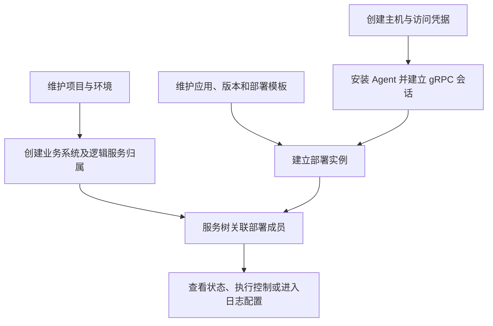
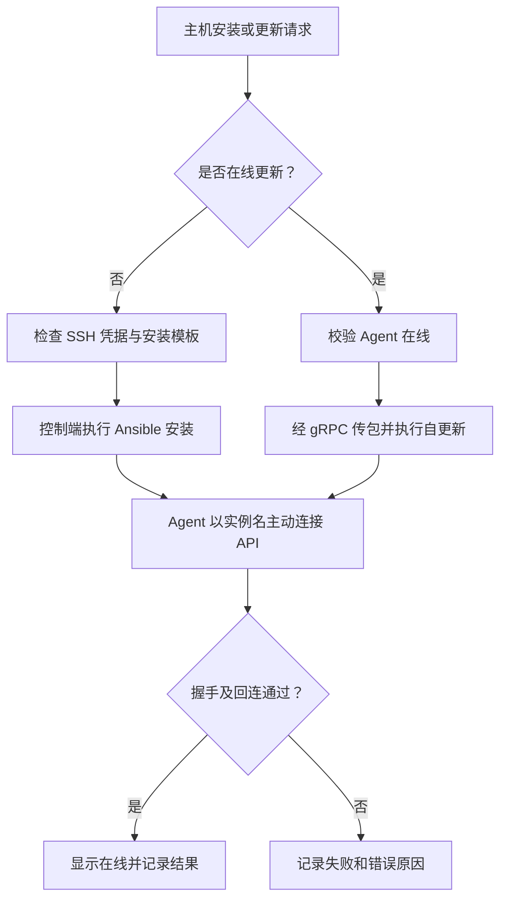
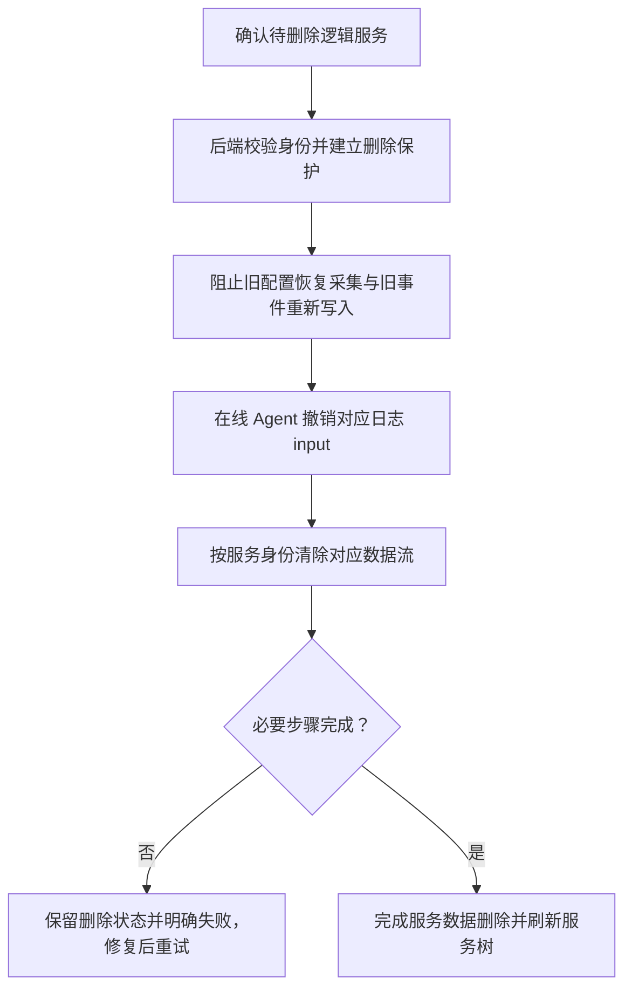

# 资产管理

> **主机是运行载体，应用是定义，逻辑服务是业务身份，部署实例把应用落到主机。不要把几者混作同一条记录。**

## 模块流程

## 主机管理与 Agent

**入口：资产管理 → 主机管理。** 创建主机时正确填写实例名、IP 和环境；
实例名与 IP 要求非空且全局唯一。Agent 用实例名定位主机，不是用显示名称或独立 agent ID。

1. 创建主机，选择安装所需 SSH 凭据。
2. 安装 Agent；已有在线 Agent 的升级走在线更新，不重复走 SSH 安装。
3. 到运行记录中心查看安装日志，确认主机已建立在线会话。
4. 再执行资产采集、WebSSH、文件管理、巡检等操作。

**在线的依据是 API 进程持有的实时 gRPC 会话**，不是数据库里“安装成功”的旧记录。
主机详情「服务树归属」用于查看和定位，不用于绑定、解绑或改环境。

## 项目管理

维护项目及关联业务系统；服务树按项目 → 业务系统 → 环境 → 逻辑服务 → 部署实例定位。
先确认组织归属，再创建服务，避免将项目当作某一台主机或某一份部署模板。

## 环境管理

维护环境字典。主机环境用于归属判断；不能通过某个服务的环境反推、覆盖主机环境。
发现主机与服务环境不一致时先修正配置，不把异常关联当作正常归属。

## 凭据管理

维护密码或 SSH 私钥访问凭据。安装 Agent 时选择已有凭据；
凭据存在不代表目标主机可访问，用户名、端口、密钥及 sudo 权限仍需正确。
不要把私钥、密码复制到日志、文档或普通任务参数说明中。

## 应用管理

按应用维护版本、集群模型与部署模板。模板描述部署和控制方法，部署实例描述主机上的实际落点。
内置 HA 模型不可编辑、删除；自定义模型按页面能力维护。
模板数量和部署数量是不同口径，部署统计按关联实例去重。

## 服务树管理

从项目逐层定位逻辑服务，核对部署成员、环境、应用与日志配置。
复制服务会打开预填的新增表单，不立即落库；新服务需独立名称/编码和成员，默认关闭日志采集。

### 删除服务：这是破坏性操作

**删除不只是删配置，也会删除该服务范围内的日志数据流。**
不会停止其他服务的 Filebeat，也不会删除主机上的源日志文件。
不要扩大成按主机、实例名或整个索引前缀删除。离线、ES 错误和历史身份边界见下方技术说明。

## 排障重点

| 问题 | 检查顺序 |
|---|---|
| Agent 安装失败 | 凭据 → 安装模板 → 运行日志 → gRPC 可达地址 → 实例名 |
| 已安装但离线 | Agent 进程与 API gRPC 会话，不只看安装结果 |
| 树上找不到部署 | 项目/环境范围 → 服务成员关联 → 异常归属 |
| 删除后报错 | 删除记录和保护状态 → Agent 撤销 → ES 删除结果；不要跳过保护直接改库 |

## 技术细节

[资产与服务树数据模型](../ASSET_CATALOG.md) · [Agent 通信及安装](../DJ_AGENT_ARCHITECTURE.md) ·
[逻辑服务删除与日志撤销](../LOG_COLLECTION_ARCHITECTURE.md#逻辑服务删除与日志撤销)
