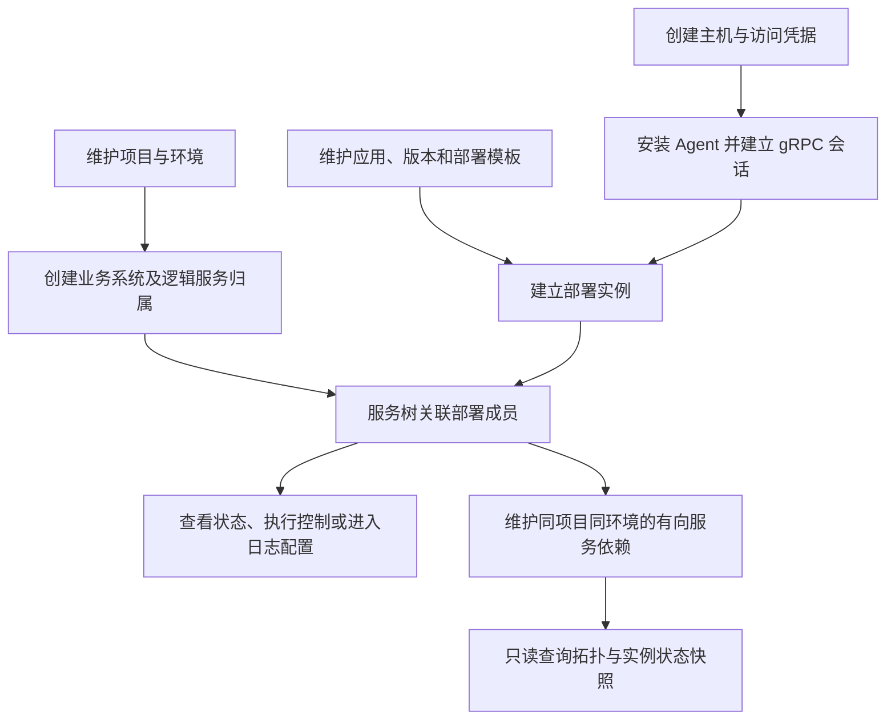
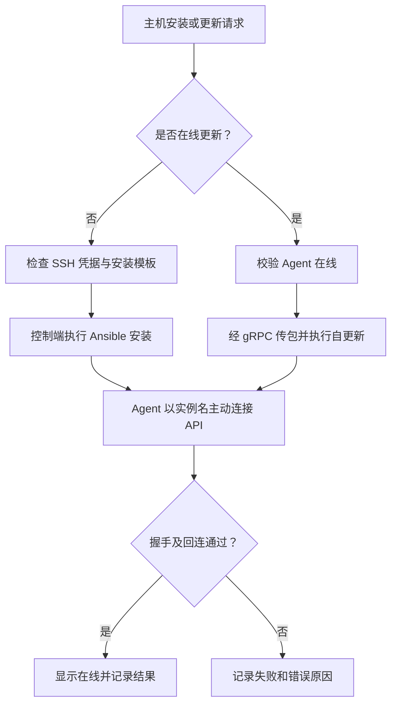
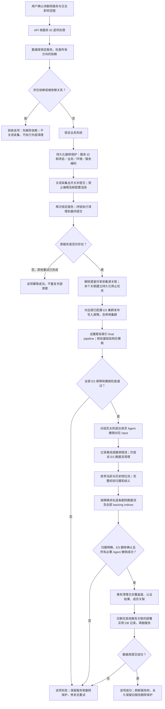
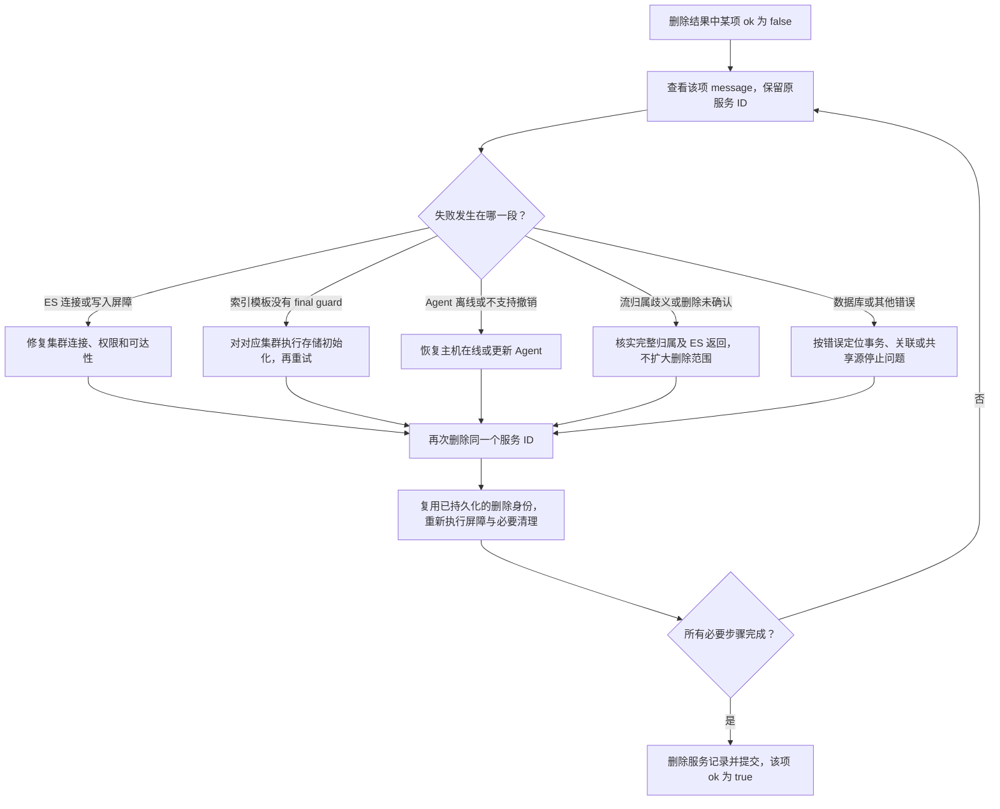
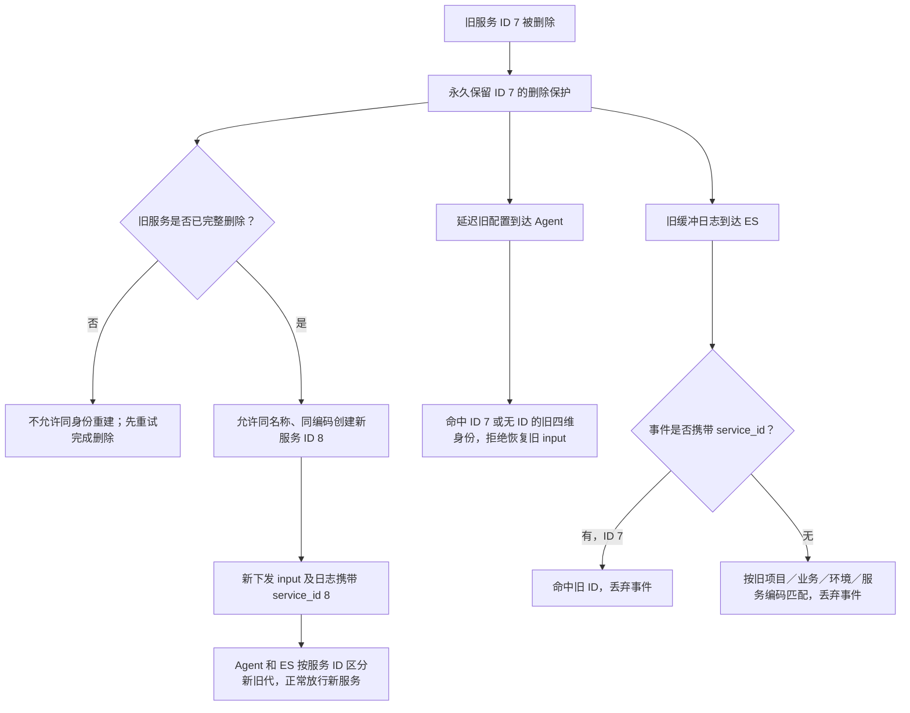

# 资产管理

> **主机是运行载体，应用是定义，逻辑服务是业务身份，部署实例把应用落到主机。不要把几者混作同一条记录。**

## 模块流程

## 主机管理与 Agent

**入口：资产管理 → 主机管理。** 创建主机时正确填写实例名、IP 和环境；
实例名与 IP 要求非空且全局唯一。Agent 用实例名定位主机，不是用显示名称或独立 agent ID。

1. 创建主机，选择安装所需 SSH 凭据。
2. 安装 Agent；已有在线 Agent 的升级走在线更新，不重复走 SSH 安装。
3. 到运行记录中心查看安装日志，确认主机已建立在线会话。
4. 再执行资产采集、WebSSH、文件管理、巡检等操作。

**在线的依据是 API 进程持有的实时 gRPC 会话**，不是数据库里“安装成功”的旧记录。
主机详情「服务树归属」用于查看和定位，不用于绑定、解绑或改环境。

### 主机分组

主机分组只有一层，每组独立维护名称和备注，名称全局唯一；不设父级、子分组或最大层级。
主机管理左侧提供「全部分组」和可搜索的平铺列表，数量只统计直接归属该组的主机；
分组为空或搜索无匹配时使用 Ant Design Vue 默认空状态展示「暂无分组」，加载期间不展示空状态。
主机表单使用普通分组下拉框，未分组仍合法。分组支持右键新增、编辑、删除。
分组 ID 是归属标识，修改名称不改变主机、Inventory 中的既有引用。
左右面板之间提供与 WebSSH 同样式的 18px 竖条箭头，默认展开，箭头在竖条中居中：
「◀」收起主机分组，收起后列表左侧保留「▶」以便展开；顶部 Tooltip 提示对应动作。
收起后分组不占宽度，右侧主机列表填满竖条以外的可用空间。面板只隐藏、不卸载，切换不重新查询，
保留选中分组、分组搜索、主机搜索、分页及勾选；收起状态仅保留在当前页面实例内。
向下滚动主机列表时，左侧分组使用 `sticky` 停留在视口顶部 12px 处，不跟随长列表滚出视口。
左侧列不随右侧列表等高拉伸；分组卡片高度最多为视口高度减 24px。
分组较多时仅分组清单内部滚动，分组标题、搜索和「全部分组」入口保持可见，不新增主机列表内部滚动容器。

有主机的分组不可删除：需先移动或解除主机归属，再通过公共删除确认弹窗删除空组。
后端在删除时重新校验引用，批量删除逐项返回结果；不级联删除主机。
Inventory 中保留「分组 → 主机」的选择结构，但分组之间不再嵌套；
监控纳管与日志采集使用同一层分组选项，按精确分组 ID 筛选，不展开后代。
数据模型及迁移限制见[主机分组模型](../ASSET_CATALOG.md#主机分组模型)。

### 主机查看与终端权限

主机终端不是查看功能：主机列表及详情的终端入口、两个后端 WebSSH 路由都要求
`assets:hosts:execute`；只授予 `assets:hosts:view` 的用户不能建立交互终端。
文件浏览/下载仍用查看权限，上传、重命名、删除和建目录用 `assets:hosts:update`。
完整只读边界见 [登录认证与权限](ACCESS.md#只读与动作权限矩阵)。

## 项目管理

维护项目及关联业务系统；服务树按项目 → 业务系统 → 环境 → 逻辑服务 → 部署实例定位。
先确认组织归属，再创建服务，避免将项目当作某一台主机或某一份部署模板。

## 环境管理

维护环境字典。主机环境用于归属判断；不能通过某个服务的环境反推、覆盖主机环境。
发现主机与服务环境不一致时先修正配置，不把异常关联当作正常归属。

## 凭据管理

维护密码或 SSH 私钥访问凭据。安装 Agent 时选择已有凭据；
凭据存在不代表目标主机可访问，用户名、端口、密钥及 sudo 权限仍需正确。
不要把私钥、密码复制到日志、文档或普通任务参数说明中。

## 应用管理

按应用维护版本、集群模型与部署模板。模板描述部署和控制方法，部署实例描述主机上的实际落点。
内置 HA 模型不可编辑、删除；自定义模型按页面能力维护。
模板数量和部署数量是不同口径，部署统计按关联实例去重。
模板的「端口」在创建、编辑、复制时可填写 `1–65535` 或 `${PORT}` 形式的完整宏表达式。
保存和模板回显保留宏，不替换为 0。服务树监听端口显示模板默认值和服务宏覆盖后的配置端口，
Tooltip 可查看原宏；实例覆盖使结果不同时逐实例展示全部成员端口。
未定义、循环引用或越界会明确提示，不代表主机上的实时监听探测结果。
已被保存为 0 的值无法还原原宏，需重新填写；部署需先执行端口表达式迁移
至 `000057_template_port_legacy_check`（56 转换字段、57 清理历史整数检查），见 [资产目录](../ASSET_CATALOG.md)。

## 服务树管理

从项目逐层定位逻辑服务，核对部署成员、环境、应用与日志配置。
复制服务会打开预填的新增表单，不立即落库；新服务需独立名称/编码和成员，默认关闭日志采集。

### 服务依赖与架构图

归属树与依赖分别维护。`A → B` 表示 A 依赖 B；允许同项目同环境跨业务关系，
双向按两条关系分别设置强/弱/待确认及功能范围。交互类型支持字典管理和停用，
故障影响及处理说明选填，不执行自动降级或启停。
拓扑 API 返回节点、关系、启用实例及其运行/停止/检查异常/未知计数和检查时间，
不执行状态脚本、不把检查异常等同服务停止、不把运行状态等同业务健康。
入口为服务树右侧「依赖关系」页签，与「服务信息」详情共用左侧范围；
项目/环境不明确时显式选择，服务/部署节点从业务解析项目，不猜测环境。
环境下拉仅显示当前项目及选中业务/服务实际关联的启用环境，
不展示全局字典的其他环境；切换范围会清理失效的旧环境选择，空范围与目录读取失败明确提示。
工作台使用同一份项目环境快照维护关系和展示架构，支持强弱与类型过滤、
单向/双向新增、单方向编辑、公共确认批删，以及交互类型自定义和停用。
Vue Flow + ELK 自动布局保留孤立服务、环与平行边，跨范围直接邻居不丢失；
可拖动节点或关系标签；拖动标签时连线随之弯曲，两端仍连接原服务，不改变依赖关系。
点击标签仍查看详情，拖动不误触详情；「保存布局」同时保存节点和标签，支持未保存提示及刷新恢复。
手动标签相对连线中点保存，移动节点时跟随；重新布局恢复当前可见关系的自动走线，
需再次保存才覆盖。支持适应画布、全屏显示/退出及导出当前坐标与路径 SVG/PNG，不接入 AI。
画布底部不显示长段帮助说明，工具栏保留线条图例；HTTP 图片复制弹窗保留必要的操作指引。
「复制图片」复制完整图的 PNG，可粘贴到支持图片的微信聊天框或 Word；
HTTPS（证书受信任）/localhost 且浏览器支持图片剪贴板时一键复制，权限拒绝时明确提示；
普通 HTTP 则弹出 PNG 图片，在图片上右键选择「复制图片」（不是「复制图片地址」）后粘贴，
弹出预览不代表已复制。浏览器未提供该菜单时可使用 PNG 下载；关闭或离开页面释放预览资源。
「保存布局」按项目、环境及查看范围将坐标保存到当前浏览器，刷新或重新进入时恢复；
不跨浏览器共享、不写后端。重新布局后需再次保存才覆盖原布局，存储失败显式提示。
全屏支持 Esc 退出，保留原节点位置及详情弹窗，画布随模式切换自动适配尺寸。
点击节点核对实例检查时间和输出，刷新只读已有状态；切到依赖页会卸载原详情，
不会在隐藏页继续状态检查。范围切换隔离旧请求，读失败显式重试，
写入后刷新失败明确区分于保存失败，批删检查每项结果。
接口、快照和迁移边界见 [逻辑服务依赖与拓扑 API](../ASSET_CATALOG.md#逻辑服务依赖与拓扑-api)。

## 逻辑服务删除全流程

> **删除逻辑服务会永久删除其归属范围内的 ES 日志数据流及全部 backing indices，不只是从服务树移除一行。删除未完成时保留服务与删除保护，修复原因后对原服务重试；完整成功后允许用相同名称和编码重建。**

**入口：服务树中的逻辑服务删除操作。** 下文集中展示 API、数据库、ES、Agent 的协作流程，
以及失败重试与同编码重建的边界。日志管理中的删除说明也以本节为操作入口。

### 一、删除主流程：先阻断旧采集，再清理数据

批量入口为 `POST /assets/application-services/batch-delete/`，单条删除也传 `{"ids":[服务ID]}`。
各服务独立执行，必须检查返回的 `results` 中每项 `ok`，不能把 HTTP 200 当作全部删除成功。

**注意：外部清理不是可整体回滚的数据库事务。** 某台主机已撤销或某条数据流已删除后，
后续步骤失败不会恢复它们。保留服务记录是为了沿原身份重试，不代表日志仍完整，也不代表仍在采集。
图中的失败节点同样适用于数据库、共享源解除、Agent 调用及 ES 请求的显式错误。
没有成员主机时无需 Agent 操作；没有数据流时视为已清理，但不能跳过 ES 写入屏障校验。

### 二、失败与重试：沿原服务继续，不清空删除保护

| 状态或现象 | 含义与处理 |
|---|---|
| 请求返回 HTTP 200，但某项 `ok=false` | 该服务未完整删除，以该项错误为准；其他项可能已成功 |
| 主机离线 | ES 屏障及数据流删除可能已经完成，但该服务仍失败；恢复在线后重试 |
| ES 不可达或模板保护缺失 | 不绕过屏障、不完成服务删除；修复连接或执行存储初始化后重试 |
| 删除中又编辑、或用相同编码新建 | 不允许借此恢复采集或绕过失败，先完成原服务删除 |
| 原服务已完整删除，再次删除同 ID | 幂等结束，不再次清理可能已被新服务使用的数据流 |

**禁止通过清空删除保护表、删除 Agent 撤销标记、放宽 ES 屏障或直接改库来“修好”失败。**
这些保护承担旧任务延迟到达、主机离线回连和旧缓冲补发时的隔离职责。

### 三、同编码重建：名称可复用，服务 ID 不复用

“旧配置”是删除前生成但可能延迟到达主机的采集配置；
“缓冲日志”是 Filebeat 已读取、尚未成功发送到 ES 的事件。两者都不能在删除后恢复旧服务的采集。

新服务仍需重新配置成员、日志设置并下发，不自动恢复旧服务的配置、认证结果或已删除日志。
启用同编码重建需同步更新 API 和 Agent，并对全部已配置 ES 集群执行存储初始化，
刷新 final guard 与索引模板；只替换 API 不能消除旧 Agent 或旧 ES 规则对新服务的拦截。

### 四、影响范围：哪些删除，哪些保留

| 对象 | 最终处理 |
|---|---|
| 逻辑服务及其宏值、日志覆盖值、认证结果、额外处理器 | 必要外部清理成功后删除 |
| 服务成员关联 | 删除 |
| 部署实例数据库记录 | 仅当无其他服务关联时删除；共享实例保留 |
| 归属明确的服务级 ES 数据流 | 覆盖当前、历史、停用和已移除档位，删除数据流及全部 backing indices |
| Agent 上对应的托管采集 input | 撤销并移除；持久化标记阻止旧配置恢复 |
| 数据库墓碑、Agent 撤销标记、ES 旧身份屏障 | 保留，用于拦截旧任务和旧缓冲，不永久占用服务编码 |
| 主机、原始日志文件、业务程序、其他服务的 Filebeat input | 保留；撤销不调用应用或 Filebeat 的启停、重启、卸载 |
| 公共应用、版本、部署模板、处理规则 | 保留 |

**历史范围不是无限追溯。** 删除范围由墓碑记录的项目、业务、环境、服务编码及当前已配置的
ES 集群和索引前缀确定。此前改名、换过集群地址或索引前缀且没有归属记录的日志，
不能仅凭当前服务可靠识别；无服务维度的旧流和普通索引也不属于本流程。
有连字符造成前缀重叠时，归属不明确就报错，不按主机、实例名或整个索引前缀猜测删除。
遗留共享流如需显式清理，还必须核对其他关联服务的影响，不能当作单服务独占数据。

实现细节见 [删除屏障与失败语义](../LOG_COLLECTION_ARCHITECTURE.md#逻辑服务删除与日志撤销)、
[Agent 撤销归属校验](../DJ_AGENT_ARCHITECTURE.md#逻辑服务日志撤销)。

## 排障重点

| 问题 | 检查顺序 |
|---|---|
| Agent 安装失败 | 凭据 → 安装模板 → 运行日志 → gRPC 可达地址 → 实例名 |
| 已安装但离线 | Agent 进程与 API gRPC 会话，不只看安装结果 |
| 树上找不到部署 | 项目/环境范围 → 服务成员关联 → 异常归属 |
| 删除后报错 | 删除记录和保护状态 → Agent 撤销 → ES 删除结果；不要跳过保护直接改库 |

## 技术细节

[资产与服务树数据模型](../ASSET_CATALOG.md) · [Agent 通信及安装](../DJ_AGENT_ARCHITECTURE.md) ·
[逻辑服务删除与日志撤销](../LOG_COLLECTION_ARCHITECTURE.md#逻辑服务删除与日志撤销)
