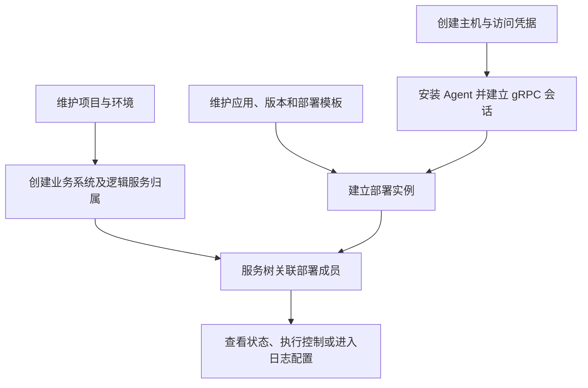
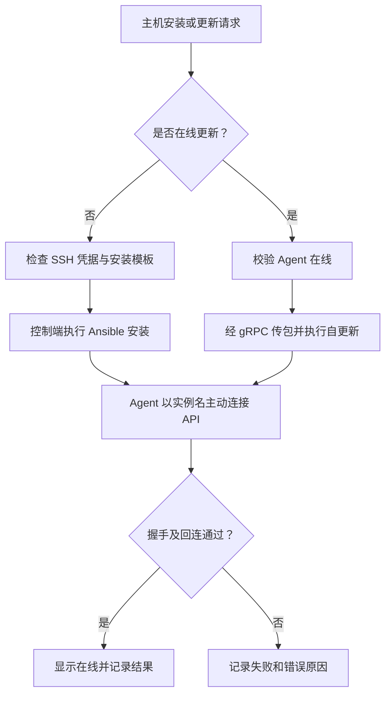
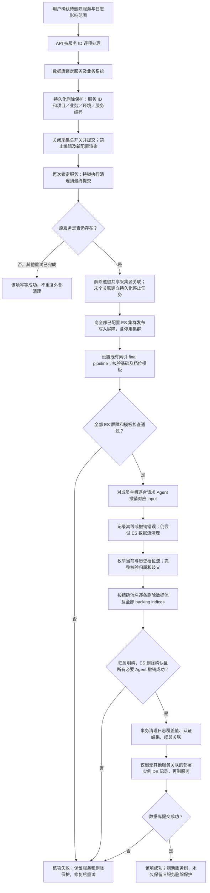
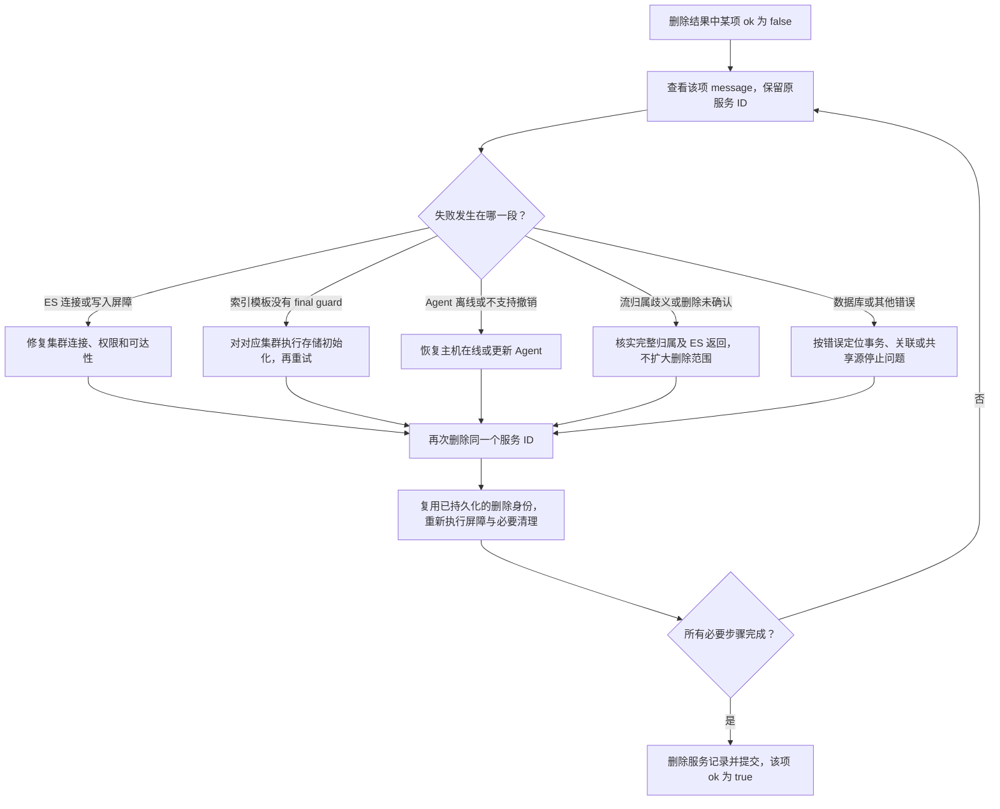
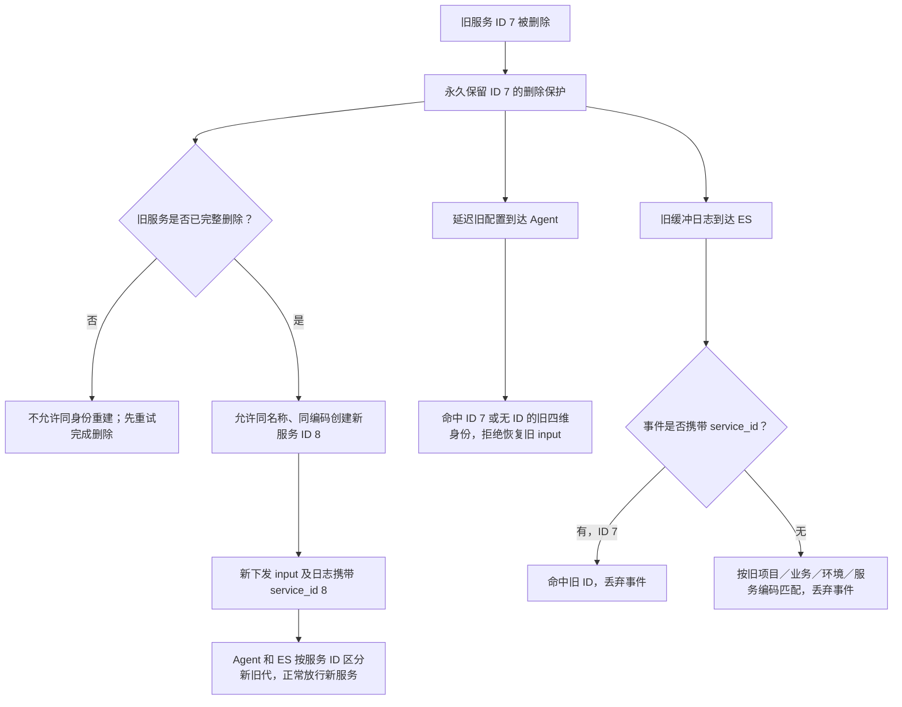

# 资产管理

> **主机是运行载体，应用是定义，逻辑服务是业务身份，部署实例把应用落到主机。不要把几者混作同一条记录。**

## 模块流程

## 主机管理与 Agent

**入口：资产管理 → 主机管理。** 创建主机时正确填写实例名、IP 和环境；
实例名与 IP 要求非空且全局唯一。Agent 用实例名定位主机，不是用显示名称或独立 agent ID。

1. 创建主机，选择安装所需 SSH 凭据。
2. 安装 Agent；已有在线 Agent 的升级走在线更新，不重复走 SSH 安装。
3. 到运行记录中心查看安装日志，确认主机已建立在线会话。
4. 再执行资产采集、WebSSH、文件管理、巡检等操作。

**在线的依据是 API 进程持有的实时 gRPC 会话**，不是数据库里“安装成功”的旧记录。
主机详情「服务树归属」用于查看和定位，不用于绑定、解绑或改环境。

## 项目管理

维护项目及关联业务系统；服务树按项目 → 业务系统 → 环境 → 逻辑服务 → 部署实例定位。
先确认组织归属，再创建服务，避免将项目当作某一台主机或某一份部署模板。

## 环境管理

维护环境字典。主机环境用于归属判断；不能通过某个服务的环境反推、覆盖主机环境。
发现主机与服务环境不一致时先修正配置，不把异常关联当作正常归属。

## 凭据管理

维护密码或 SSH 私钥访问凭据。安装 Agent 时选择已有凭据；
凭据存在不代表目标主机可访问，用户名、端口、密钥及 sudo 权限仍需正确。
不要把私钥、密码复制到日志、文档或普通任务参数说明中。

## 应用管理

按应用维护版本、集群模型与部署模板。模板描述部署和控制方法，部署实例描述主机上的实际落点。
内置 HA 模型不可编辑、删除；自定义模型按页面能力维护。
模板数量和部署数量是不同口径，部署统计按关联实例去重。

## 服务树管理

从项目逐层定位逻辑服务，核对部署成员、环境、应用与日志配置。
复制服务会打开预填的新增表单，不立即落库；新服务需独立名称/编码和成员，默认关闭日志采集。

## 逻辑服务删除全流程

> **删除逻辑服务会永久删除其归属范围内的 ES 日志数据流及全部 backing indices，不只是从服务树移除一行。删除未完成时保留服务与删除保护，修复原因后对原服务重试；完整成功后允许用相同名称和编码重建。**

**入口：服务树中的逻辑服务删除操作。** 下文集中展示 API、数据库、ES、Agent 的协作流程，
以及失败重试与同编码重建的边界。日志管理中的删除说明也以本节为操作入口。

### 一、删除主流程：先阻断旧采集，再清理数据

批量入口为 `POST /assets/application-services/batch-delete/`，单条删除也传 `{"ids":[服务ID]}`。
各服务独立执行，必须检查返回的 `results` 中每项 `ok`，不能把 HTTP 200 当作全部删除成功。

**注意：外部清理不是可整体回滚的数据库事务。** 某台主机已撤销或某条数据流已删除后，
后续步骤失败不会恢复它们。保留服务记录是为了沿原身份重试，不代表日志仍完整，也不代表仍在采集。
图中的失败节点同样适用于数据库、共享源解除、Agent 调用及 ES 请求的显式错误。
没有成员主机时无需 Agent 操作；没有数据流时视为已清理，但不能跳过 ES 写入屏障校验。

### 二、失败与重试：沿原服务继续，不清空删除保护

| 状态或现象 | 含义与处理 |
|---|---|
| 请求返回 HTTP 200，但某项 `ok=false` | 该服务未完整删除，以该项错误为准；其他项可能已成功 |
| 主机离线 | ES 屏障及数据流删除可能已经完成，但该服务仍失败；恢复在线后重试 |
| ES 不可达或模板保护缺失 | 不绕过屏障、不完成服务删除；修复连接或执行存储初始化后重试 |
| 删除中又编辑、或用相同编码新建 | 不允许借此恢复采集或绕过失败，先完成原服务删除 |
| 原服务已完整删除，再次删除同 ID | 幂等结束，不再次清理可能已被新服务使用的数据流 |

**禁止通过清空删除保护表、删除 Agent 撤销标记、放宽 ES 屏障或直接改库来“修好”失败。**
这些保护承担旧任务延迟到达、主机离线回连和旧缓冲补发时的隔离职责。

### 三、同编码重建：名称可复用，服务 ID 不复用

“旧配置”是删除前生成但可能延迟到达主机的采集配置；
“缓冲日志”是 Filebeat 已读取、尚未成功发送到 ES 的事件。两者都不能在删除后恢复旧服务的采集。

新服务仍需重新配置成员、日志设置并下发，不自动恢复旧服务的配置、认证结果或已删除日志。
启用同编码重建需同步更新 API 和 Agent，并对全部已配置 ES 集群执行存储初始化，
刷新 final guard 与索引模板；只替换 API 不能消除旧 Agent 或旧 ES 规则对新服务的拦截。

### 四、影响范围：哪些删除，哪些保留

| 对象 | 最终处理 |
|---|---|
| 逻辑服务及其宏值、日志覆盖值、认证结果、额外处理器 | 必要外部清理成功后删除 |
| 服务成员关联 | 删除 |
| 部署实例数据库记录 | 仅当无其他服务关联时删除；共享实例保留 |
| 归属明确的服务级 ES 数据流 | 覆盖当前、历史、停用和已移除档位，删除数据流及全部 backing indices |
| Agent 上对应的托管采集 input | 撤销并移除；持久化标记阻止旧配置恢复 |
| 数据库墓碑、Agent 撤销标记、ES 旧身份屏障 | 保留，用于拦截旧任务和旧缓冲，不永久占用服务编码 |
| 主机、原始日志文件、业务程序、其他服务的 Filebeat input | 保留；撤销不调用应用或 Filebeat 的启停、重启、卸载 |
| 公共应用、版本、部署模板、处理规则 | 保留 |

**历史范围不是无限追溯。** 删除范围由墓碑记录的项目、业务、环境、服务编码及当前已配置的
ES 集群和索引前缀确定。此前改名、换过集群地址或索引前缀且没有归属记录的日志，
不能仅凭当前服务可靠识别；无服务维度的旧流和普通索引也不属于本流程。
有连字符造成前缀重叠时，归属不明确就报错，不按主机、实例名或整个索引前缀猜测删除。
遗留共享流如需显式清理，还必须核对其他关联服务的影响，不能当作单服务独占数据。

实现细节见 [删除屏障与失败语义](../LOG_COLLECTION_ARCHITECTURE.md#逻辑服务删除与日志撤销)、
[Agent 撤销归属校验](../DJ_AGENT_ARCHITECTURE.md#逻辑服务日志撤销)。

## 排障重点

| 问题 | 检查顺序 |
|---|---|
| Agent 安装失败 | 凭据 → 安装模板 → 运行日志 → gRPC 可达地址 → 实例名 |
| 已安装但离线 | Agent 进程与 API gRPC 会话，不只看安装结果 |
| 树上找不到部署 | 项目/环境范围 → 服务成员关联 → 异常归属 |
| 删除后报错 | 删除记录和保护状态 → Agent 撤销 → ES 删除结果；不要跳过保护直接改库 |

## 技术细节

[资产与服务树数据模型](../ASSET_CATALOG.md) · [Agent 通信及安装](../DJ_AGENT_ARCHITECTURE.md) ·
[逻辑服务删除与日志撤销](../LOG_COLLECTION_ARCHITECTURE.md#逻辑服务删除与日志撤销)
