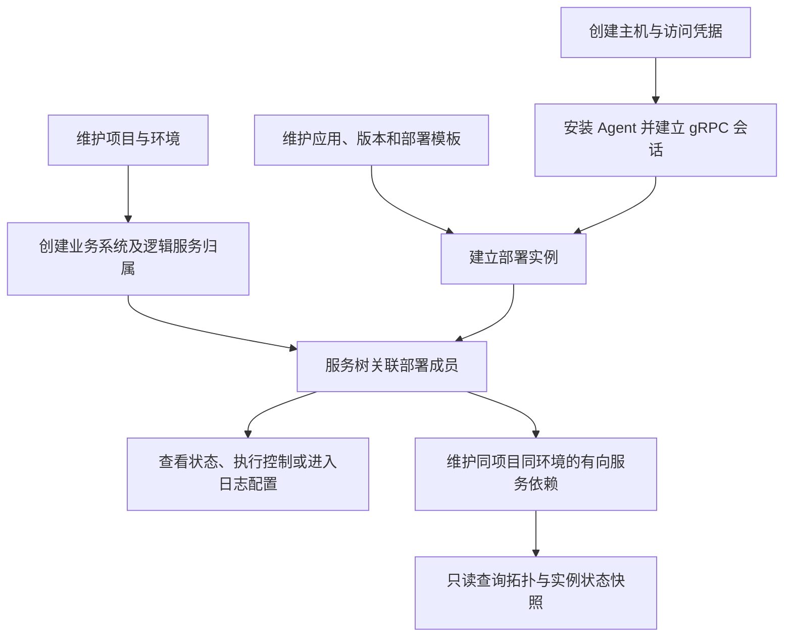
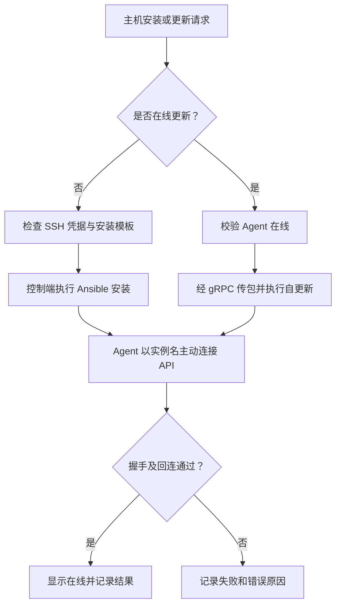
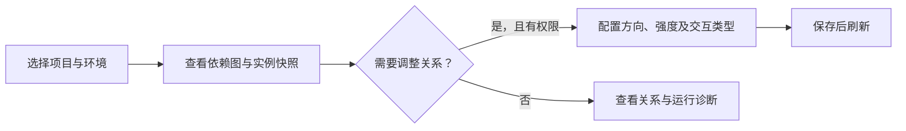
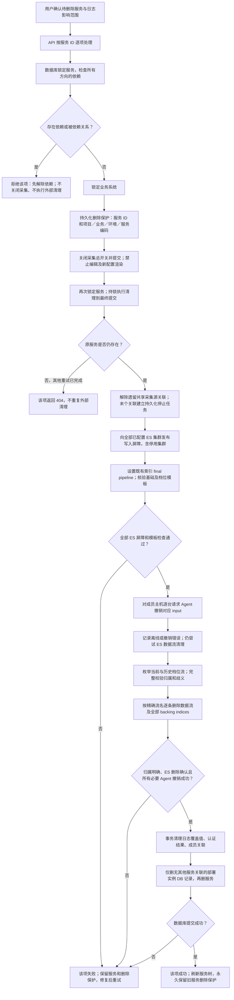
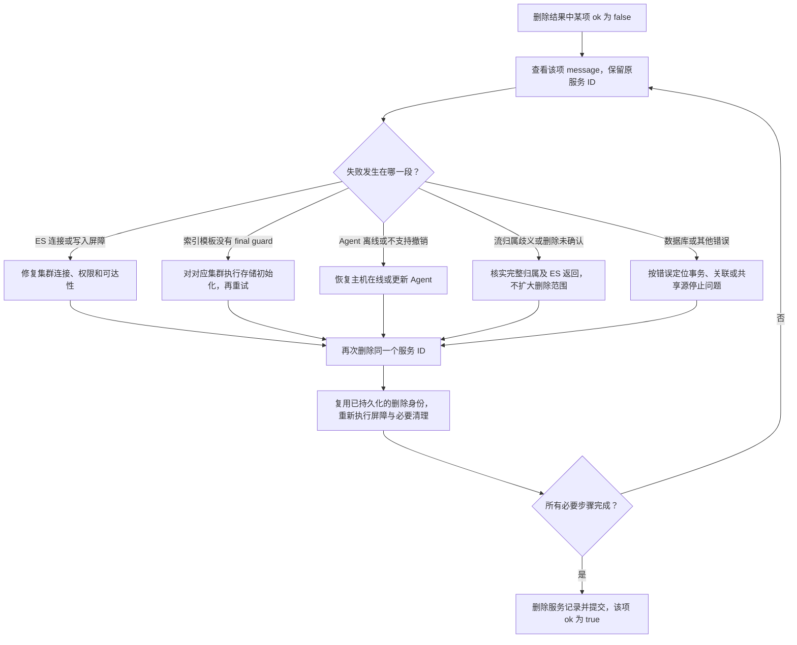
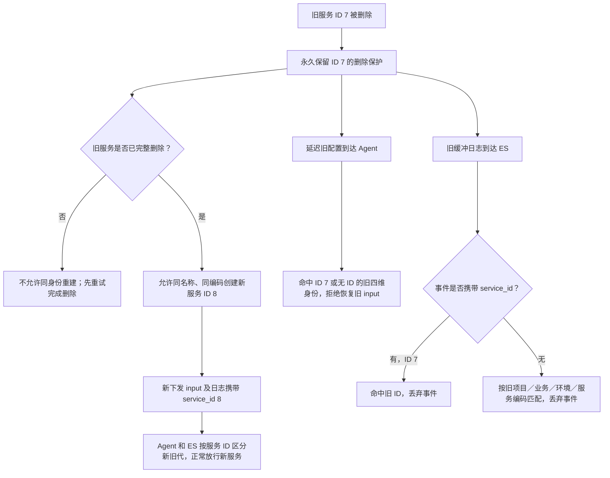

# 资产管理

> **主机是运行载体，应用是定义，逻辑服务是业务身份，部署实例把应用落到主机。不要把几者混作同一条记录。**

## 模块流程

## 批量写入结果

应用、项目、业务系统、环境、版本、模型、分组、模板、服务、部署实例、依赖与 Agent 包按 ID 独立删除。
`data.count` 只统计实际删除项；未命中记录返回 404，混合成功与失败返回业务码 10001，`data.results` 保留各项结果。
主机和凭证删除按 ID 去重后使用整批事务：任一项失败时全部回滚，`count=0`；原因记录在失败项，其余项标记未提交。

凭证 CSV（`POST /assets/credentials/batch-create/`）先校验全部记录再整批写入，数据库错误同样不留下部分凭证。
文件或表头无效时返回请求错误；记录级结果以 CSV 记录序号为 `id`（表头为 1），只有成功提交才返回 `detail.credential_id`，不回显凭证内容。

## 应用弹窗生命周期

项目、环境、应用、模型、模板及实例使用查看／编辑表单。仅查看权限或不可编辑的内置模型只能查看；新增、修改、删除和启停分别鉴权。只读逻辑服务可核对已关联实例，但不能修改成员或保存。

[弹窗生命周期和只读边界](../ASSET_CATALOG.md#应用弹窗生命周期)

## 保存错误提示

| 配置 | 重点 |
|---|---|
| 排除目录 | 支持逐层通配及宏，不支持 `**`；按目录排除 |
| 排除文件名 | 使用 RE2 正则匹配完整路径，不展开宏 |
| 宏与端口 | 实际展开时未定义、空值或循环引用会提示；端口须为 1–65535 |
| 命令行控制 | 状态命令必填，其他控制命令选填 |

模板及逻辑服务通过自身校验后可先保存，再补全宏或修正日志配置；实际检查和下发仍会校验展开结果。保存失败保留输入并显示原因。
[校验、宏解析和迁移细节](../ASSET_CATALOG.md#保存错误提示)

## 主机管理与 Agent

**入口：资产管理 → 主机管理。** 创建主机时正确填写实例名、IP 和环境；
实例名与 IP 要求非空且全局唯一。Agent 用实例名定位主机，不是用显示名称或独立 agent ID。

主机新增、编辑和克隆表单只维护主机属性、归属、WebSSH 用户及备注，不提供监控设置，
不加载监控软件包，也不提交 `monitors` 或通过主机保存触发监控安装、卸载与删除。
监控目标在独立监控管理入口维护；已有监控记录及主机详情的监控观测不受影响。

1. 创建主机，选择安装所需 SSH 凭据。
2. 安装 Agent；已有在线 Agent 的升级走在线更新，不重复走 SSH 安装。
3. 到运行记录中心查看安装日志，确认主机已建立在线会话。
4. 再执行资产采集、WebSSH、文件管理、巡检等操作。

**在线的依据是 API 进程持有的实时 gRPC 会话**，不是数据库里“安装成功”的旧记录。
主机详情「服务树归属」用于查看和定位，不用于绑定、解绑或改环境。
Agent 安装包信息仅在打开安装/更新或包管理弹窗时加载，主机列表挂载时不预取管理数据，
避免只有主机查看权限的用户触发要求 `assets:hosts:update` 的包管理查询。

### 主机分组

分组为单层字典，主机可不分组；在主机列表选择分组可筛选直接归属的主机。「全部分组」清除筛选。

| 操作 | 边界 |
|---|---|
| 查看 / 编辑 | 分别需要 `assets:hostgroups:view` / `assets:hostgroups:update` |
| 删除 | 先移走或解除全部主机归属；删除空组不会删除主机 |
| 修改名称 | 分组 ID 不变，既有主机和 Inventory 引用保留 |

[分组交互与模型](../ASSET_CATALOG.md#主机分组) · [数据库迁移](../ASSET_CATALOG.md#主机分组模型)

### 主机查看与终端权限

实例名和配置按钮打开同一张最新主机配置表单。`assets:hosts:view` 可查看，另有 `assets:hosts:update` 时显示「编辑」。
两种模式均展示实例名、IP、分组、环境、WebSSH 默认用户和可选用户、备注。查看使用详情返回的组名和环境名，
不查询编辑候选，不增删登录用户，也不能提交。「详情」另行展示在线信息、指标和服务归属等运维诊断；克隆、安装和删除独立鉴权。

主机终端不是查看功能：主机列表及详情的终端入口、两个后端 WebSSH 路由都要求
`assets:hosts:execute`；只授予 `assets:hosts:view` 的用户不能建立交互终端。
列表和详情的刷新会向 Agent 读取当前主机事实并保存观察结果，使用 `assets:hosts:view`。
只读用户可以打开详情并刷新，也可以在列表看到当前 CPU、内存和系统信息；这不授予修改主机、安装 Agent 或连接终端的权限。
文件浏览/下载仍用查看权限，上传、重命名、删除和建目录用 `assets:hosts:update`。
完整只读边界见 [登录认证与权限](ACCESS.md#只读与动作权限矩阵)。

主机列表操作 Tooltip 统一使用 Ant Design Vue 默认弹层容器，详情与终端不单独挂到按钮父节点。
配置查看与运维详情分别提供入口；下拉选择仍使用公共上下文容器解析器。
缓存切换回归覆盖只读和多动作权限下的详情提示可见性、顶部 placement、点击导航及组件实例复用。

## 项目管理

维护项目及关联业务系统；服务树按项目 → 业务系统 → 环境 → 逻辑服务 → 部署实例定位。
先确认组织归属，再创建服务，避免将项目当作某一台主机或某一份部署模板。

## 环境管理

维护环境字典。主机环境用于归属判断；不能通过某个服务的环境反推、覆盖主机环境。
发现主机与服务环境不一致时先修正配置，不把异常关联当作正常归属。

## 凭据管理

维护密码或 SSH 私钥访问凭据。安装 Agent 时选择已有凭据；
凭据存在不代表目标主机可访问，用户名、端口、密钥及 sudo 权限仍需正确。
不要把私钥、密码复制到日志、文档或普通任务参数说明中。

凭证名称与操作列打开同一张最新详情表单，展示名称、认证类型、用户名、端口、对应认证材料和备注。
`assets:credentials:view` 可查看，另有 `assets:credentials:update` 时显示「编辑」而非「查看」。
列表与详情接口均不返回已保存的密码或私钥。已配置的材料回显 `******`，编辑时原样提交该掩码表示保留原值。
查看时不能切换认证类型、显示密码或保存，底部只有「关闭」。

## 应用管理

按应用维护版本、集群模型与部署模板。模板描述部署和控制方法，部署实例描述主机上的实际落点。
内置 HA 模型不可编辑、删除；自定义模型按页面能力维护。
模板数量和部署数量是不同口径，部署统计按关联实例去重。
模板的「端口」在创建、编辑、复制时可填写 `1–65535` 或 `${PORT}` 形式的完整宏表达式。
保存和模板回显保留宏，不替换为 0。服务树监听端口显示模板默认值和服务宏覆盖后的配置端口，
Tooltip 可查看原宏；实例覆盖使结果不同时逐实例展示全部成员端口。
未定义、循环引用或越界会明确提示，不代表主机上的实时监听探测结果。
已被保存为 0 的值无法还原原宏，需重新填写；部署需先执行端口表达式迁移
至 `000057_template_port_legacy_check`（56 转换字段、57 清理历史整数检查），见 [资产目录](../ASSET_CATALOG.md)。

## 服务树管理

从项目逐层定位逻辑服务，核对部署成员、环境、应用与日志配置。
业务系统或逻辑服务的名称、操作列和节点标题旁的配置按钮打开同一张应用表单；箭头、行和左侧树仍用于定位节点。
查看业务系统需要 `assets:service-tree:view`，编辑还需 `assets:service-tree:manage`。
查看逻辑服务需要 `assets:applications:view`，树上的编辑还需同时具有 `assets:service-tree:manage` 和 `assets:applications:update`。
查看时，共享 Dialog 使用 `read-only` 模式回显已关联配置，不提供保存或嵌套写操作。节点概览与运行诊断保持独立。

左侧项目、环境查询筛选包含启用和停用记录，停用选项标注“已停用”，仍可搜索与选择；
环境候选继续按所选项目的实际服务归属联动。树中的项目、环境节点保留并标注自身的停用状态，
不影响节点点击定位，也不表示下级服务已停止。此查询展示不改变新建配置候选及实际运行控制。
进入根节点、项目、业务系统、环境、逻辑服务或单实例节点时，先展示已有快照，再自动检查当前查询范围内的启用实例，
并每 15 秒轮询。根节点遵循项目/环境筛选，单实例只检查自身，不扩大到同服务其他实例。
检查通过 `GET /assets/application-deployments/refresh-runtime-status/?ids=...` 在主机执行并回写 `runtime_status`，
要求 `assets:applications:update`；只有查看权限时不自动检查，展示最近一次已落库状态。
前端按实例复用跨节点在途检查，每批最多 8 个、串行派发，完成一批立即合并该批状态；
后端去重、最多 8 并发。Agent 命令执行上限 120 秒，后端等待回包上限 125 秒，前端单请求超时 150 秒，
避免多轮排队挤占同一个 HTTP 超时预算；已完成批次不因后续批次失败而丢失。
结果只合并运行状态、诊断和检查时间，不重新加载详情；逐实例检查失败明确展示，不能把旧的运行中状态当作检查成功。
切换节点或页面失活后停止派发旧范围尚未发出的批次，旧响应不能覆盖当前页面，
新范围不会等待旧范围未派发的批次；恢复激活时重新读取快照并检查。
各层级统计区的“异常实例”数字是唯一明细入口；存在异常时，顶部不重复展示异常数量标签。
明细与当前节点、项目/环境筛选共用同一实例集合，
仅包含 `stopped`（已停止）和 `error`（检查失败），不将未知状态计为异常，也不将已停止直接解释为业务故障。
列表展示实例、当前范围内的项目/业务系统/环境/服务关联、主机地址、状态、用户时区下的检查时间及完整诊断输出；
项目归属按各服务的业务系统元数据解析，不以当前筛选项目或业务系统同名推断；跨项目共享实例分别展示各条归属，
跳转时携带所选关联的项目 ID 与名称。
共享实例只计一行，服务关联分别提供定位入口。点击实例或关联可跳转对应实例节点。
明细读取现有结果，不额外执行状态检查或要求执行权限；无诊断输出、无检查时间明确提示，
切换节点或离开页面时关闭明细。环境节点按服务与部署的关联筛选实例，不依赖部署记录携带环境字段。
复制服务会打开预填的新增表单，不立即落库；新服务需独立名称/编码和成员，默认关闭日志采集。

### 服务依赖与架构图

归属树与依赖关系分别维护；`A → B` 表示 A 依赖 B，不会自动触发降级或启停。

- 依赖工作台支持关系筛选、节点及连线布局、图片导出；保存的布局仅在当前浏览器和范围内恢复。
- 图中运行状态来自检查快照，不等于业务健康；检查异常也不等于服务停止。
- 写入后刷新失败与保存失败会分别提示；删除关系前核对影响。

[工作台操作与布局细节](../ASSET_CATALOG.md#服务依赖与架构图) · [拓扑 API](../ASSET_CATALOG.md#逻辑服务依赖与拓扑-api)

## 逻辑服务删除全流程

> **删除逻辑服务会永久删除其归属范围内的 ES 日志数据流及全部 backing indices，不只是从服务树移除一行。删除未完成时保留服务与删除保护，修复原因后对原服务重试；完整成功后允许用相同名称和编码重建。**

**入口：服务树中的逻辑服务删除操作。** 下文集中展示 API、数据库、ES、Agent 的协作流程，
以及失败重试与同编码重建的边界。日志管理中的删除说明也以本节为操作入口。

### 一、删除主流程：先阻断旧采集，再清理数据

批量入口为 `POST /assets/application-services/batch-delete/`，单条删除也传 `{"ids":[服务ID]}`。
各服务独立执行，存在失败时顶层业务码非 200，`data.results` 保留每项结果和错误码；不能把 HTTP 200 当作全部删除成功。

**注意：外部清理不是可整体回滚的数据库事务。** 某台主机已撤销或某条数据流已删除后，
后续步骤失败不会恢复它们。保留服务记录是为了沿原身份重试，不代表日志仍完整，也不代表仍在采集。
图中的失败节点同样适用于数据库、共享源解除、Agent 调用及 ES 请求的显式错误。
没有成员主机时无需 Agent 操作；没有数据流时视为已清理，但不能跳过 ES 写入屏障校验。

### 二、失败与重试：沿原服务继续，不清空删除保护

| 状态或现象                             | 含义与处理                                                      |
| -------------------------------------- | --------------------------------------------------------------- |
| 请求返回 HTTP 200，但某项 `ok=false` | 该服务未完整删除，以该项错误为准；其他项可能已成功              |
| 主机离线                               | ES 屏障及数据流删除可能已经完成，但该服务仍失败；恢复在线后重试 |
| ES 不可达或模板保护缺失                | 不绕过屏障、不完成服务删除；修复连接或执行存储初始化后重试      |
| 删除中又编辑、或用相同编码新建         | 不允许借此恢复采集或绕过失败，先完成原服务删除                  |
| 原服务已完整删除，再次删除同 ID        | 返回 404，不计入成功数，不再次清理可能已被新服务使用的数据流     |

**禁止通过清空删除保护表、删除 Agent 撤销标记、放宽 ES 屏障或直接改库来“修好”失败。**
这些保护承担旧任务延迟到达、主机离线回连和旧缓冲补发时的隔离职责。

### 三、同编码重建：名称可复用，服务 ID 不复用

“旧配置”是删除前生成但可能延迟到达主机的采集配置；
“缓冲日志”是 Filebeat 已读取、尚未成功发送到 ES 的事件。两者都不能在删除后恢复旧服务的采集。

新服务仍需重新配置成员、日志设置并下发，不自动恢复旧服务的配置、认证结果或已删除日志。
启用同编码重建需同步更新 API 和 Agent，并对全部已配置 ES 集群执行存储初始化，
刷新 final guard 与索引模板；只替换 API 不能消除旧 Agent 或旧 ES 规则对新服务的拦截。

### 四、影响范围：哪些删除，哪些保留

| 对象                                                    | 最终处理                                                           |
| ------------------------------------------------------- | ------------------------------------------------------------------ |
| 逻辑服务及其宏值、日志覆盖值、认证结果、额外处理器      | 必要外部清理成功后删除                                             |
| 服务成员关联                                            | 删除                                                               |
| 部署实例数据库记录                                      | 仅当无其他服务关联时删除；共享实例保留                             |
| 归属明确的服务级 ES 数据流                              | 覆盖当前、历史、停用和已移除档位，删除数据流及全部 backing indices |
| Agent 上对应的托管采集 input                            | 撤销并移除；持久化标记阻止旧配置恢复                               |
| 数据库墓碑、Agent 撤销标记、ES 旧身份屏障               | 保留，用于拦截旧任务和旧缓冲，不永久占用服务编码                   |
| 主机、原始日志文件、业务程序、其他服务的 Filebeat input | 保留；撤销不调用应用或 Filebeat 的启停、重启、卸载                 |
| 公共应用、版本、部署模板、处理规则                      | 保留                                                               |

**历史范围不是无限追溯。** 删除范围由墓碑记录的项目、业务、环境、服务编码及当前已配置的
ES 集群和索引前缀确定。此前改名、换过集群地址或索引前缀且没有归属记录的日志，
不能仅凭当前服务可靠识别；无服务维度的旧流和普通索引也不属于本流程。
有连字符造成前缀重叠时，归属不明确就报错，不按主机、实例名或整个索引前缀猜测删除。
遗留共享流如需显式清理，还必须核对其他关联服务的影响，不能当作单服务独占数据。

实现细节见 [删除屏障与失败语义](../LOG_COLLECTION_ARCHITECTURE.md#逻辑服务删除与日志撤销)、
[Agent 撤销归属校验](../DJ_AGENT_ARCHITECTURE.md#逻辑服务日志撤销)。

## 排障重点

| 问题           | 检查顺序                                                              |
| -------------- | --------------------------------------------------------------------- |
| Agent 安装失败 | 凭据 → 安装模板 → 运行日志 → gRPC 可达地址 → 实例名               |
| 已安装但离线   | Agent 进程与 API gRPC 会话，不只看安装结果                            |
| 树上找不到部署 | 项目/环境范围 → 服务成员关联 → 异常归属                             |
| 删除后报错     | 删除记录和保护状态 → Agent 撤销 → ES 删除结果；不要跳过保护直接改库 |

## 技术细节

[资产与服务树数据模型](../ASSET_CATALOG.md) · [Agent 通信及安装](../DJ_AGENT_ARCHITECTURE.md) ·
[逻辑服务删除与日志撤销](../LOG_COLLECTION_ARCHITECTURE.md#逻辑服务删除与日志撤销)
