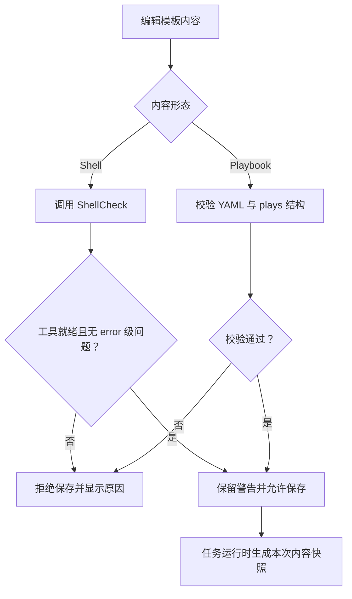
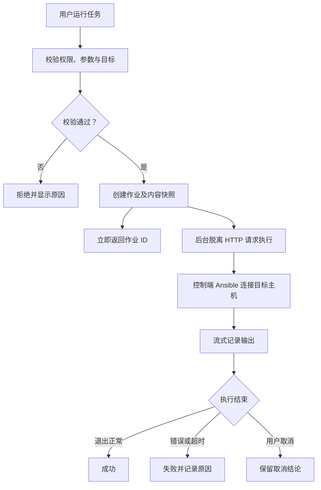
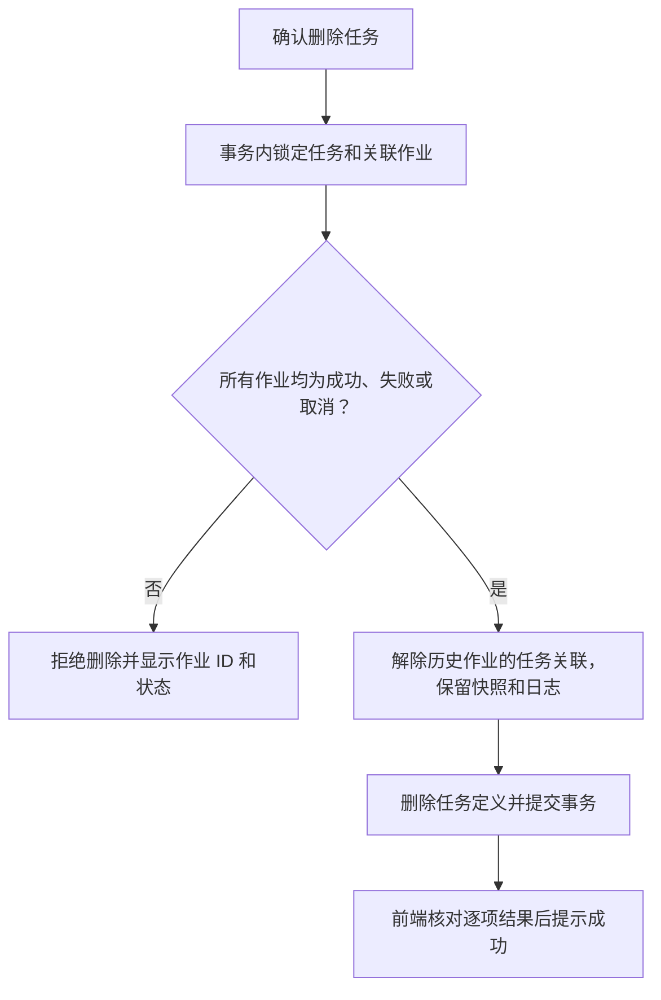
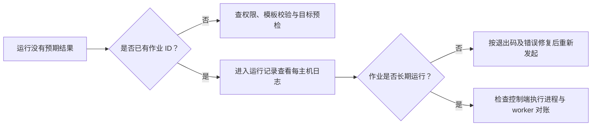

# 自动化运维

> **模板定义“做什么”，Inventory 定义目标集合，任务定义运行参数，作业记录“这一次执行”。已提交不等于成功。**

## 模板

**入口：自动化运维 → 模板。** 保存 Playbook YAML 或 Shell 原文；
任务仅选择通用模板，安装 Agent 和监控组件的专用模板由对应业务流程使用。

ShellCheck 不可用时不能把校验当作成功。警告不一定阻止保存，但必须阅读；
修改模板不会把新内容注入已有在途作业。

## Inventory 管理

维护目标主机集合，执行前预检范围与 limit。**Inventory 是否必填按任务页面语义，不作全局必填要求。**
更新只提交的字段，启用状态切换不会要求重填名称；缓存时间 `0` 是有效值，不等于未配置。
预检“没有目标”时先检查范围、筛选和主机可见性，不直接启动空作业。

## 自动化任务

1. 选择通用模板，填写执行参数、目标范围和超时。
2. 预检最终主机集合，确认运行身份和影响范围。
3. 点击运行后进入运行记录中心，按这次作业 ID 跟踪。

**普通自动化任务在控制端执行 Ansible，不是将 Playbook 直接发给 Agent 执行。**
关闭浏览器、关闭标签不等于取消后台执行。

### 删除任务

删除仅移除任务定义，**保留执行历史、内容快照和日志**。成功、失败、取消的作业解除任务关联，
仍可在运行记录中心按名称或作业 ID 查询；删除后不能再按原任务 ID 筛选这些历史。
存在等待、运行或其他未结束状态的作业时拒绝删除，需等待结束或取消后重试。
取消仅改变作业记录状态，不保证终止远端命令，删除任务也不会终止或回滚外部操作。

批量删除逐条提交，失败项不会阻止其余项；页面必须检查 `results[].ok`，不能只看 HTTP 成功。

## 运行记录中心

按来源区分普通任务、Agent 安装、监控安装；同一页面查看状态、逐主机输出和执行结果。
纳管目标「查看日志」通过关联作业 ID 跳转到这里，不另维护一套安装执行日志。

| 状态/动作 | 重点 |
|---|---|
| 等待/运行中 | 请求提交成功不能作为业务成功结论 |
| failed | 检查退出码、stderr、超时及主机明细 |
| cancelled | 当前取消主要改变记录状态，不保证已经杀掉远端副作用 |
| 长期 running | 执行进程可能失联；worker 对账按任务超时加余量收敛 |

**取消不是回滚。** 已经执行的命令或外部变更不会自动撤销；取消后迟到的收尾不能覆盖取消状态。

## 故障检查

## 技术细节

[作业执行、超时及 Inventory](../AUTOMATION_JOB_EXECUTION.md) ·
[巡检中心](INSPECTION.md)。
仓库中的 Workflow 专题描述前端契约，不能据此推断当前后端已提供完整 Workflow 执行服务。
