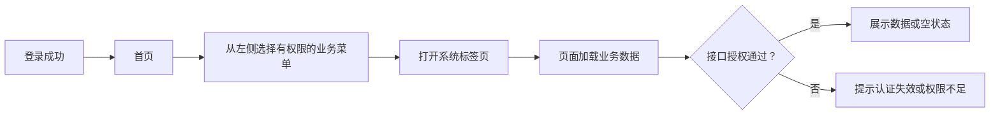

# 首页

> **当前首页是入口占位页，不是资产、告警或作业统计大屏。**

## 菜单入口

顶级「首页」，路由 `/index`。登录默认进入首页；页面当前只展示“首页”文字。
不要根据计划或截图将未实现的汇总指标当作现成功能。

## 导航流程

## 使用重点

- 找主机去「资产管理」，找执行结果去「运行记录中心」。
- 告警、通知和日志在「监控中心」按子目录分开。
- 标签页可以切换与关闭；关闭标签不等于取消后台作业。
- 文档中心是公共入口，但阅读操作说明不会授予对应业务权限。

## 进一步了解

[登录认证与权限](ACCESS.md) · [文档中心](DOCUMENTATION.md) · [前端标签页实现](../FRONTEND_TABS_CACHE.md)
