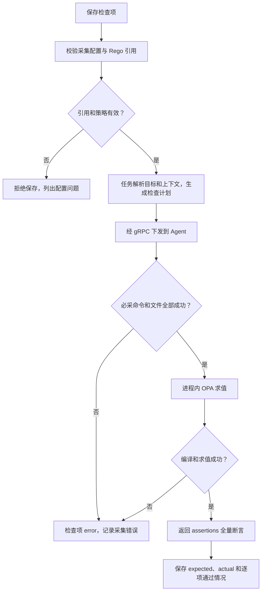

# 巡检中心

> **检查项唯一执行方式是 Agent 上的 OPA/Rego。采集失败是 error，不是不合规，也不能被当作通过。**

## 菜单入口与步骤

自动化运维 → 巡检中心。按页面的巡检组、任务和执行记录组织操作：

1. 巡检组维护分类、检查项、采集命令/文件与 Rego 策略。
2. 将任务关联到业务挂载范围，确认主机及应用上下文变量。
3. 执行后查看目标主机、逐项断言和错误详情，不只看总状态。

## 执行流程

## 判读重点

| 结果 | 含义 | 行动 |
|---|---|---|
| pass | 断言通过；空断言集当前也按通过处理 | 检查策略是否确实覆盖预期场景 |
| fail / 不符合 | 采集成功，断言不满足预期 | 对照 expected/actual 排查业务配置 |
| error | 采集、编译或求值失败 | 先修复执行条件，再重新巡检 |

策略使用 `package baseline` 和 OPA v1 的 `assertions contains ... if ...`。
`input.<key>` 必须对应已声明的采集 key；变量在采集命令/路径中展开，**不替换 Rego 代码**。
不要将检查项误写成“无效输入也得到空断言”，空集通过不等于数据已经完整采到。

## 与基线扫描的区别

巡检面向业务挂载与应用上下文；安全中心的基线扫描面向 OS 合规。
两者复用 OPA 内核和 Agent 通道，但结果记录与聚合口径独立；巡检结果不自动进入 Prometheus 告警历史。

## 技术细节

[巡检计划、挂载点及结果](../INSPECTION_ARCHITECTURE.md) · [基线扫描](SECURITY.md)
