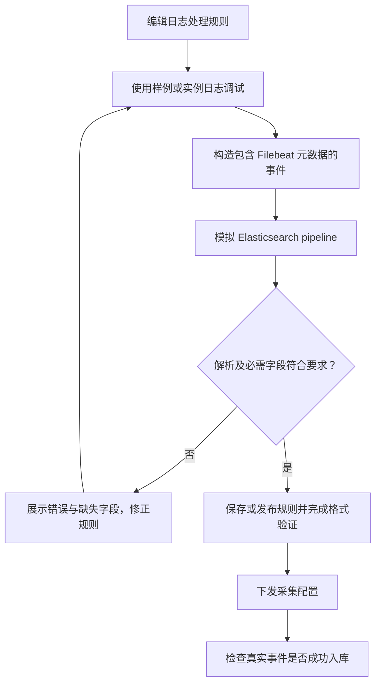
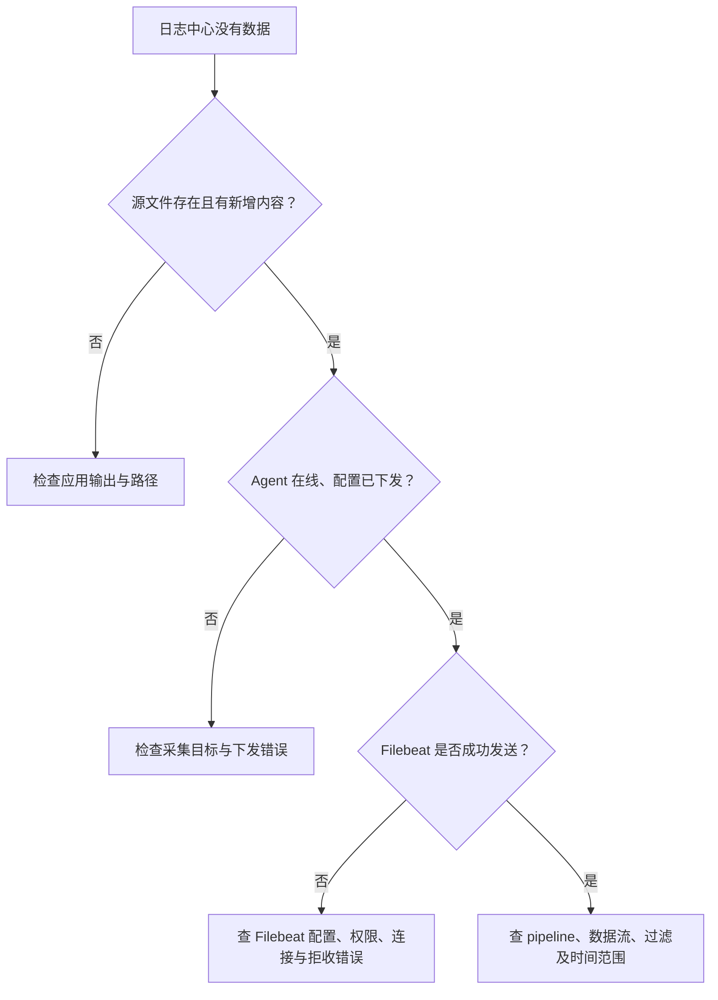
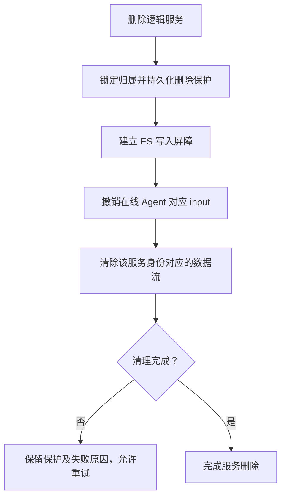

# 监控中心：日志管理

> **Agent 管配置，Filebeat 读文件并发送事件，Elasticsearch 存储与检索。配置下发成功不等于日志已经入库。**

## 总体流程

## 日志采集

**入口：监控中心 → 日志管理 → 日志采集。**
纳管 Filebeat，执行安装、启停、状态查询及配置下发。
前置条件是目标主机 Agent 在线，安装所需软件包、模板及配置有效。

1. 确认目标主机和软件状态。
2. 配置逻辑服务的日志定义与采集开关。
3. 下发配置后查看期望/已下发状态与安装或执行日志。
4. 去日志中心验证实际事件，不以“已下发”结束验收。

日志批量动作经 RabbitMQ 由 **api 角色**消费，因为 Agent 会话在该进程。
不能把这些动作转给没有实时会话的 scheduler 或 worker。

## 日志存储

配置 Elasticsearch 集群连接与索引相关参数；检查连接、模板、pipeline 和 ILM 状态。
后端管理存储对象，Filebeat 直接向 Elasticsearch 发事件，日志正文不经过 RabbitMQ 搬运。

## 日志处理规则

规则用于多行、解析或字段处理。调试必须使用真实 Filebeat 事件形状，不能只造一条简化 JSON 就宣告链路通过。

**`message` 是原始日志文本，`log` 是元数据对象，不能用 `log` 覆盖 `message`。**
对 ES 字段类型的错误会导致拒收；必须看 Filebeat 错误与实际入库量。

## 日志保留档位

为服务选择保留策略，后端管理对应 ILM 与索引模板。
换档位会改变当前目标数据流，不意味着旧流立即消失；
非当前档位流由 API 的历史流回收维护检查，空流可立即回收，非空流等待原保留期满足。
回收不能绕过“停止旧写入、配置状态和归属检查”的保护。

## 日志中心

按服务树选择范围，在页面内查看存储、查询和配置等能力。
左侧树面板与资产服务树使用同一套交互：顶部可放大 / 还原、收起 / 展开，
两栏间分隔条可拖动调宽。收起不会清空节点选择、搜索、筛选或展开状态，也不会重置右侧查询与页签；
面板宽度仅在当前页面实例内保留。窄屏自动上下排列，长列表在宽屏滚动时左侧树面板保持可见。
右侧日志趋势图与存储水位饼图随面板尺寸变化重新适配宽度，不重新发起查询。
**先确认服务及时间范围，再判断“查不到日志”。**

## 删除与停止：必须分清

| 动作 | 采集与数据影响 |
|---|---|
| 关闭采集 | 停止对应配置的采集；不是立即删除历史数据 |
| 修改保留档位 | 写入当前档位；旧流按回收保护及原保留期限处理 |
| 删除逻辑服务 | 先建立撤销和写入屏障，再删除服务范围内数据流并完成业务删除 |

不会为删一个服务停掉其他服务的 Filebeat，不会删主机源日志；不可通过“整机清空索引”代替服务归属校验。
离线节点依靠持久化撤销保护与写入屏障防止旧数据恢复写入，不把“暂时离线”当作安全完成证明。

## 技术细节

[日志全链路、配置状态及删除边界](../LOG_COLLECTION_ARCHITECTURE.md) ·
[服务树操作](ASSETS.md#service-tree)
