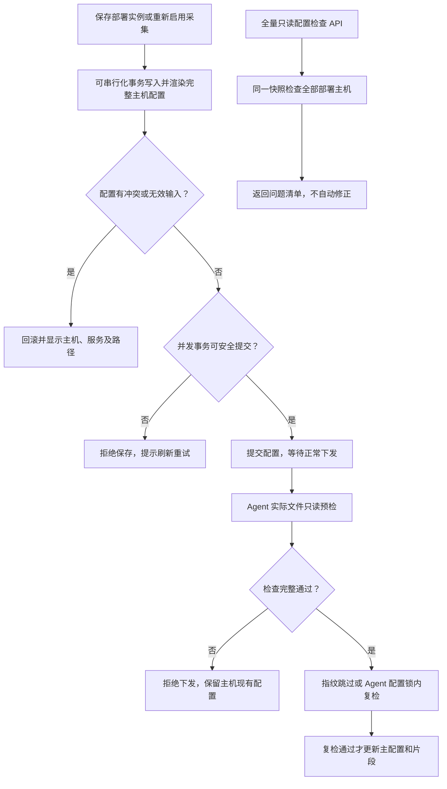
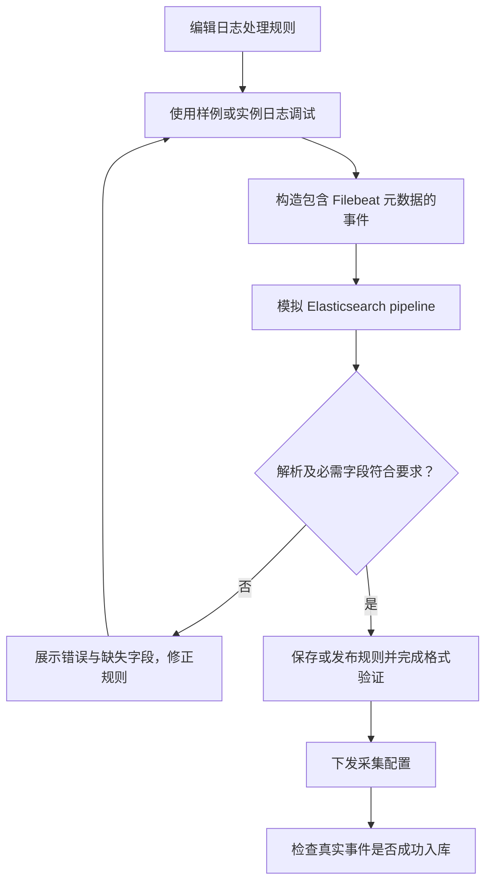
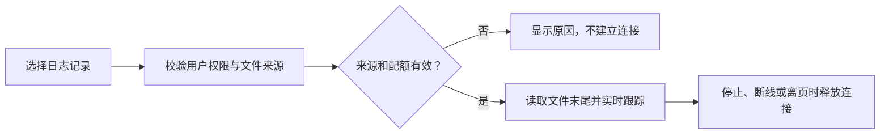
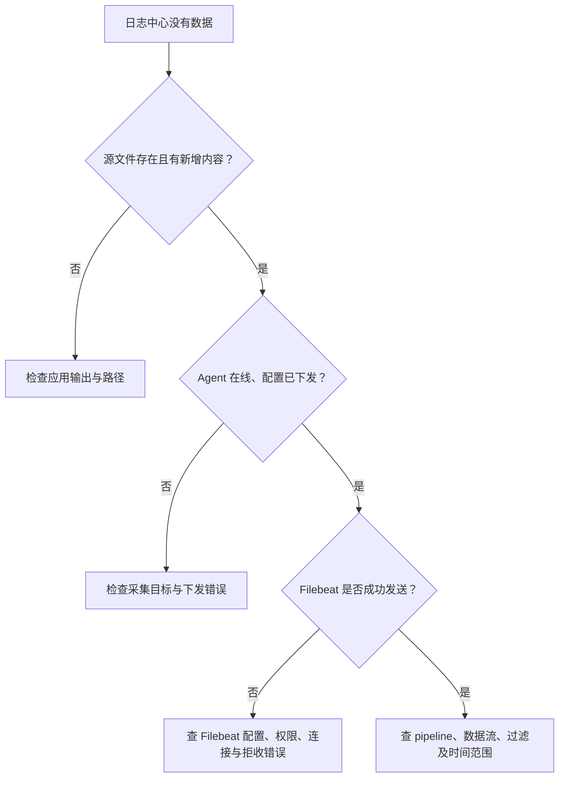
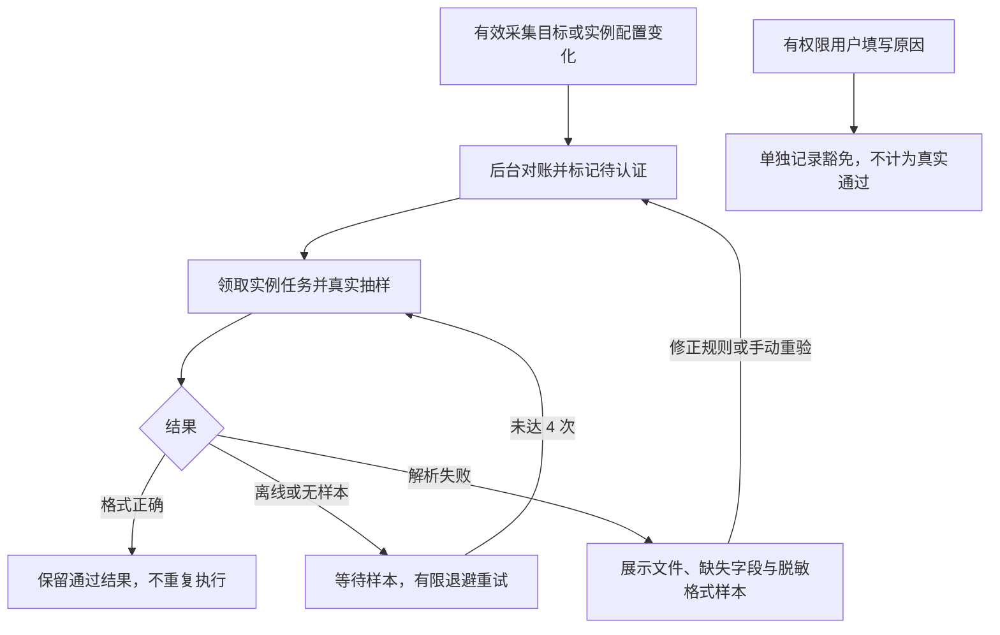
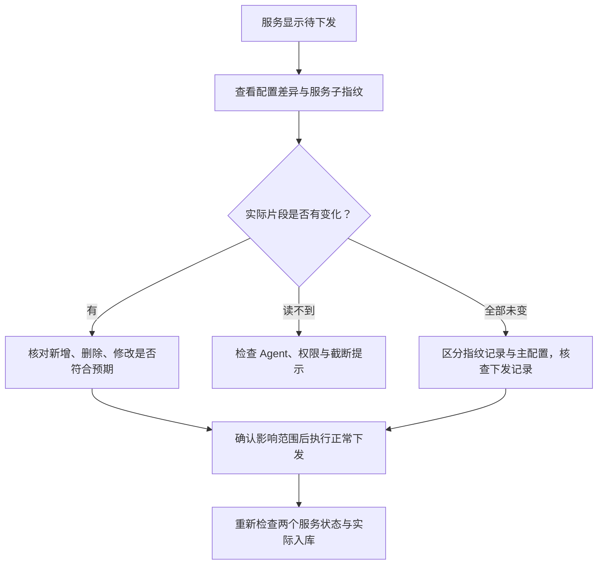

# 监控中心：日志管理

> **Agent 管配置，Filebeat 读文件并发送事件，Elasticsearch 存储与检索。配置下发成功不等于日志已经入库。**

## 总体流程

## 日志采集

**入口：监控中心 → 日志管理 → 日志采集。**
纳管 Filebeat，执行安装、启停、状态查询及配置下发。
前置条件是目标主机 Agent 在线，安装所需软件包、模板及配置有效。

1. 确认目标主机和软件状态。
2. 配置逻辑服务的日志定义与采集开关。
3. 下发配置后查看期望/已下发状态与安装或执行日志。
4. 去日志中心验证实际事件，不以“已下发”结束验收。

日志批量动作经 RabbitMQ 由 **api 角色**消费，因为 Agent 会话在该进程。
不能把这些动作转给没有实时会话的 scheduler 或 worker。

`log-targets/batch-create/` 逐台创建目标，仅为新建目标投递安装作业。指定 `install_now` 时，
`ok` 是创建且安装作业已受理，不是安装完成；后续通过 `install_batch.id` 查看逐台执行进度。
即使返回部分失败业务码，仍可能包含可跟踪的 `install_batch`。入队失败时保留已创建目标：
对应项 `detail.created=true`、`detail.target_id`、`detail.install_accepted=false`，已建作业则保留
`detail.job_id`，失败原因见 `message` 与 `install_error`。页面刷新后应对已有目标重试安装，不能重复纳管。
`log-targets/batch-start-service/`、`log-targets/batch-stop-service/` 的成功表示同步执行成功；
结果以目标 ID 标识，保留主机标签、Agent 作业号与执行失败原因。批量请求的 `count` 只计完整成功项。

### 防止重复采集

同一主机上宏展开后的相同路径只能有一个启用的采集输入。
调整部署实例，以及重新开启服务或日志项采集等写入时，
后端在可串行化事务提交前检查整台主机的配置；冲突直接拒绝保存并回滚。
保存服务和部署模板只校验各自业务配置，关联主机的日志路径在后续检查与下发时校验。
并发保存若被数据库中止，提示刷新后重试，不把未完成的保存报告为成功。

存量配置可通过 `GET /monitor/log-targets/config-audit/` 全量检查，
覆盖已绑定实例但未纳管采集的主机，结果列出问题主机、冲突服务/实例及路径。
这是只读 API，没有新增页面按钮，不会自动关闭任何服务或修改主机配置。
检查失败不返回部分通过结果；修正后仍需正常下发，才能改变主机上正在运行的配置。
通配符交叉匹配、软硬链接等实际文件重叠不在数据库检查范围内。

**下发前还有 Agent 实际文件检查。** 后端将完整主机片段交给 Agent，
按物理文件身份检测不同 input 经通配符、软硬链接命中同一文件；检查失败、
Agent 离线或旧版本不支持检查时都禁止下发，不覆盖主机现有配置。
检查通过后，在实际写配置之前还会再次检查；主配置和片段统一应用，不单独先改 output。
数据库指纹相同也不能跳过文件检查。

允许离线编辑服务和模板。日志文件尚未产生或通配路径零匹配时，允许下发但显式提示未匹配；
权限错误、扫描超限、不支持的 `**` 递归通配、损坏链接等检查错误则拒绝下发。
该检查仅覆盖当时已存在文件，不能保证未来新增日志或链接变化不会形成重叠，也不会自动停采。
后端与 Agent 需配套升级，升级前已有 Filebeat 继续运行，但不能绕过检查下发新配置。

接口字段、并发失败语义和验证命令见 [日志采集架构](../LOG_COLLECTION_ARCHITECTURE.md#全量配置检查-api)。

## 日志存储

配置 Elasticsearch 集群连接与索引相关参数；检查连接、模板、pipeline 和 ILM 状态。
后端管理存储对象，Filebeat 直接向 Elasticsearch 发事件，日志正文不经过 RabbitMQ 搬运。
Filebeat 进程状态通过 `GET /monitor/log-targets/:id/check-status/` 观测，
集群连通性通过 `GET /monitor/elasticsearch-clusters/:id/test-connection/` 检查；
两者只刷新观测结果，不启停进程、不修改存储配置，返回 `Cache-Control: no-store`，
且保留各自原权限条件。只有 GET 入口，不提供 POST 查询兼容。

## 日志处理规则

规则用于多行、解析或字段处理。调试必须使用真实 Filebeat 事件形状，不能只造一条简化 JSON 就宣告链路通过。
解析规则操作列使用「解析试算」与试验图标，不使用代表任务执行的「运行」或播放图标。
试算弹窗与结果统一使用试算文案，并明确说明只对当前样例调用 Elasticsearch `_simulate`：
不保存或发布规则、不下发配置、不写入日志索引。没有当前规则修改权限的用户，发送前处理配置以正常文字
展示，Pipeline JSON 只读但允许选中复制；名称、说明、所属应用、日志格式、多行合并及相关参数均不可修改。
只读用户仅可切换样例格式和输入日志样例，不提供附加条件处理器输入，试算请求也不携带附加处理器，
且不显示发布入口。保存或发布仍按新增/修改动作权限校验，有修改权限的用户保留完整编辑和试算能力。
试算入口打开的弹窗标题不冒充编辑模式。
试算接口保留 POST，用请求体提交 Pipeline 和日志样例，这是内容运算而非已有资源查询，
不把完整日志或代码转移到 URL，也不为了减少审计记录而改写请求方法。

**`message` 是原始日志文本，`log` 是元数据对象，不能用 `log` 覆盖 `message`。**
对 ES 字段类型的错误会导致拒收；必须看 Filebeat 错误与实际入库量。

## 日志保留档位

为服务选择保留策略，后端管理对应 ILM 与索引模板。
列表操作列为具有 `monitor:view` 权限的用户提供「查看详情」入口，使用统一详情图标和顶部提示。
详情直接展示列表返回的档位配置：编码、名称、每天写入量、带单位的保留期、预计占用、
滚动时长及主分片大小、启用和默认状态、引用服务数、备注。内容以正常文字展示，支持多行备注，
不提供输入框或保存入口；启停状态使用统一的只读文字开关，不调用写入接口。编辑与删除仍分别要求对应动作权限。
操作列固定右侧并预留三个动作的宽度，表格启用横向滚动；编辑表单的保留期单位下拉复用弹层容器工具。
日志有效档位按“日志覆盖档位优先，否则服务默认档位”确定，并要求所选档位启用。
逐日志覆盖不依赖服务默认档位存在；两者都为空的日志仍需补选，不自动使用平台默认档位。
下发前校验每条日志的有效档位；为空或未启用时阻止下发，同一服务仅提示一次，
不按日志逐条重复刷屏。需检查服务默认档位及日志覆盖档位，不会自动补选档位或绕过校验。
日志配置列表读取不因缺失或停用档位而失败：仍返回日志及原始档位信息，允许用户查看和修正；
无法确定有效档位时 data stream 留空，不生成无保留策略的目标名称。读取与下发校验互不替代。
换档位会改变当前目标数据流，不意味着旧流立即消失；
非当前档位流由 API 的历史流回收维护检查，空流可立即回收，非空流等待原保留期满足。
回收不能绕过“停止旧写入、配置状态和归属检查”的保护。

## 日志中心

日志查询范围是左侧所选节点与服务树搜索结果的交集。搜索命中实例时，其所属逻辑服务也纳入范围；
折叠树节点不改变查询范围。搜索无匹配服务、或所选服务被搜索隐藏时，右侧显示空态且不发起日志查询。
清空搜索词后恢复所选节点的查询范围。此联动不改变日志配置和存储水位页签的范围。

日志查询明细默认每页 50 条，首次请求使用 `size=50`、`offset=0`；
保留每页 50／100／200 条切换，后续请求按当前每页条数及页码计算 `size` 与 `offset`。
该默认值只作用于日志查询明细，不改变统计聚合或其他页面的分页配置。

### 存储水位与档位容量使用率

按数据流查看占用、主分片占用和档位参考容量；同一服务和档位的日志共用一条流，历史流分别计算。

| 现象 | 含义 |
|---|---|
| 超过 100% | 可超过参考容量；不代表磁盘已满，也不触发停写或删除 |
| 历史流 | 按档位当前参数参考，不迁移旧流或恢复历史参数 |
| 容量不可用 | 归属、档位或后备索引数据不完整；不以零代替 |

节点磁盘水位单独表示真实文件系统压力。清理和切回档位需要各自动作权限，历史流回收须先确认停止写入与归属。
[计算口径、权限和回收细节](../LOG_COLLECTION_ARCHITECTURE.md#存储水位与档位容量使用率)

### 查询结果表格滚动

日志明细表格使用 Ant Design Vue 原生 `sticky`：表头吸附视口顶部，
表格尚未滚到底且存在横向溢出时，横向滚动条吸附视口底部，与正文及表头保持同步。
滚到表格底部时使用正文原生滚动条；表格离开当前视口或无需横向滚动时不显示吸底条。
时间列仍固定左侧、操作列仍固定右侧，查询、分页与列宽规则不变。
表格不设置固定高度或 `scroll.y`，长列表继续由整页纵向滚动，不引入表格内部的第二层纵向滚动。
该设置仅用于日志查询结果，不修改统计表格、共享服务树布局或全局页面滚动样式。

### 查询结果进入 Web SSH

日志查询结果操作列提供 **Web SSH 终端图标按钮**，复用主机列表的终端图标，不显示按钮文字，
颜色采用与同列其他操作一致的蓝色链接样式，
悬停提示“打开WebSSH 终端”，以新标签页打开该条日志对应主机的现有终端，不离开当前查询。
入口与源文件实时跟踪的启用开关无关，沿用 `assets:hosts:view` 权限和管理员语义；
只有日志中心查看权限的用户不显示此入口，Web SSH 的服务端鉴权仍独立执行。
终端是完整主机会话，不受日志查询的时间、关键词、级别和路径限制。

点击时通过现有主机列表 GET 查询日志的 `host_ip`，遍历搜索分页并精确匹配资产 IP，
不把模糊搜索的第一个结果当目标，也不把日志中的应用实例名当作 Agent 主机实例名。
仅唯一匹配且绑定 Agent、未在云端删除、Agent 在线的主机可进入；
使用资产主机 ID、主机实例名和 IP 构造现有 Web SSH 路由，不从日志指定登录用户或自动执行命令，
登录用户选择沿用终端页的规则。
缺 IP、无权限、未匹配、匹配歧义、离线、查询失败或弹窗被阻止均明确提示，不跳往其他主机。

为避免异步查询后被浏览器拦截，点击时先预留空白标签并立即断开 `opener`，
定位成功后才导航到终端；失败关闭空白标签，查询期间防止重复打开。
日志页失活或卸载时取消尚未完成的打开动作、关闭预留标签，迟到响应不再导航；
已经成功打开的终端标签独立运行，不随日志查询页关闭。

### 源文件实时跟踪（实验首版）

日志查询结果或详情中的「实时跟踪」读取当前源文件的原始文本，**不是历史事件回放**，也不应用 ES 查询过滤条件。

- 默认开启，仅支持单 API 实验模式；多 API 副本必须设置 `LOG_LIVE_TAIL_MODE=disabled`。生产压测尚未完成，不作为生产可用承诺。
- 需要日志中心 `monitor:view`；来源、账号、Origin 和 Agent 文件权限仍独立校验。共享源不可跟踪。
- 每个用户最多跟踪 5 个文件，每个文件最多 5 个用户。停止后可查看缓存；继续会重新连接并读取当前末尾，可能重复或缺失，不能视为无缝续传。
- 关闭窗口或离开页面会停止连接并清空缓存；复制和下载仅包含当前保留的文本。

[启用条件、配额、协议及异常处理](../LOG_COLLECTION_ARCHITECTURE.md#源文件实时跟踪详细规则)

按服务树选择范围，在页面内查看存储、查询和配置等能力。
左侧树面板与资产服务树使用同一套交互：顶部可放大 / 还原、收起 / 展开，
两栏间分隔条可拖动调宽。收起不会清空节点选择、搜索、筛选或展开状态，也不会重置右侧查询与页签；
面板宽度仅在当前页面实例内保留。窄屏自动上下排列，长列表在宽屏滚动时左侧树面板保持可见。
右侧日志趋势图与存储水位饼图随面板尺寸变化重新适配宽度，不重新发起查询。
**先确认服务及时间范围，再判断“查不到日志”。**

存储水位在环境节点按“项目 + 业务系统 + 环境”限定范围：逻辑服务统计只包含该树分支的服务，
包括尚无日志的服务；不会因其他分支使用相同环境码（例如 `poc`）而混入其服务。
已识别数据流采用相同范围过滤，总文档数、占用和服务分组统计保持一致。
环境树节点只提供业务系统 ID 与环境 ID；水位明细通过业务系统维度解析所属项目，
不能因节点未直接提供项目 ID 而退化为跨项目查询。
未识别流无法确认归属，只在没有项目或环境筛选的“全部逻辑服务”视图展示；
选择项目、业务系统、环境或服务后不混入这些流。未识别提示数量与当前可见明细一致。

### 格式认证自动化

服务及单条日志均开启采集、关联处理规则并绑定实例后，API 后台自动抽样，不需要记住操作入口。
新增实例、修改规则、路径、宏、实例运行变量或应用版本后自动重验；已通过的当前实例不重复认证。
真实抽样、规则样例测试、人工豁免是不同结论，规则样例不能替代生产实例认证。

日志中心显示待认证、认证中、已验证、不通过、等待样本、已豁免六类状态和真实实例覆盖数量。
单个实例通过不代表整个服务通过；豁免原因、操作人与时间可在认证弹窗查看。
临时错误最多自动尝试 4 次，用尽后明确提示，仍可手动重验；解析失败等待修复，不反复自动抽样。
关闭采集暂停自动认证并保留已有结果，解绑或删除实例则清理对应任务。
格式认证不自动下发配置、不直接阻断或停止采集，也不代表日志已经入库。
部署先执行 `000055_log_format_targets` 迁移；既有服务级认证不转成实例通过，启用目标由后台重新抽样。

详见 [实例级认证与失败语义](../LOG_COLLECTION_ARCHITECTURE.md#log-format-verification)。

### 配置指纹与待下发排查

**文档入口：文档中心 → 监控中心 → 日志管理 → 日志中心 → 配置指纹与待下发排查。**

> **“待下发”表示期望指纹与已下发记录不匹配，不等于已确认主机文件内容发生变化；“已同步”也不等于日志已入库。**

#### 指纹分别表示什么

| 类型 | 比较范围 | 用途 |
|---|---|---|
| 主机配置指纹 | 输出目标标识与该主机全部服务的采集片段 | 判断整台主机的配置下发记录是否与期望一致 |
| 服务配置子指纹 | 输出目标标识与本服务在该主机上的采集片段 | 判断本服务是否待下发，不因同机其他服务片段变化而连带变化 |
| 日志格式验证指纹 | 日志定义、路径、处理规则签名、宏及服务配置版本等 | 判断格式验证结果是否仍然有效，与主机下发指纹不是同一件事 |

配置指纹采用 SHA-256；输出目标标识包含 Elasticsearch 首个连接地址、用户名与 TLS 校验开关，
不包含密码。因此只修改密码不会自动触发指纹漂移，需要主动重新下发。
服务片段按路径排序后参与计算；数据目录标记文件 `.keep` 不参与服务子指纹，当前配置也不再生成它。

#### 为什么同一主机两个服务的状态不同

服务状态优先比较各自的服务子指纹：存在已下发子指纹且不匹配时为“待下发”；
缺少已下发子指纹时，才结合主机指纹判断是否尚未下发。
所以同一台 Filebeat 主机上的两个服务，可以一个已同步、另一个待下发。

“同机其他服务”仅表示文件归属，不表示文件有差异。
下发是主机级完整配置同步，必须包含其他服务片段，避免只下发当前服务时删除其他服务配置。
默认只展示本服务片段；需要查看完整主机范围时打开“显示同机其他服务片段”，统计仍是全主机范围。

#### 怎样判断真正的差异

“查看配置差异”通过 Agent 读取主机 `/etc/filebeat/inputs.d/*.yml`，与当前期望内容逐文件比较：

| 文件状态 | 含义 |
|---|---|
| 新增 | 期望有，主机没有 |
| 删除 | 主机有，期望没有 |
| 修改 | 两侧都有，但内容不同 |
| 未变 | 两侧内容一致，不是差异点 |
| 无法读取或截断 | 尚不能确认是否一致，先处理读取问题 |

该文件比较不包含主配置 `/etc/filebeat/filebeat.yml`；数据库中的已下发指纹也不是实时从主机文件重新计算的值。
当所有片段“未变”但仍待下发时，只能确认指纹记录不匹配，不能据此断言主配置发生了变化，
也不能仅凭哈希还原旧配置或确定历史原因。

#### 下发与排障边界

正常下发会同步主配置与主机完整采集片段；未变片段不会改写，但流程可能重启 Filebeat。
成功后保存主机指纹及服务子指纹，再刷新配置状态。
不要直接修改数据库指纹来消除提示，这会绕过真实下发与校验。
若成功下发后仍反复待下发，应核查实际下发结果、指纹保存链路及期望配置是否再次变化，
而不是反复重下发或将其他服务的“未变”文件当作原因。

## 删除与停止：必须分清

### 遗留共享采集源数据

共享采集源的创建、编辑和关联管理界面及 API 已移除；主机配置渲染器也不再生成共享 input。
既有数据库记录和 ES 历史数据保留，既有查询范围和水位识别仍可读取历史内容，但不会据此启动新采集。
已下发到主机的旧 input 不会被后台强制改写；对关联主机执行正常的完整日志配置下发后，该 input 才会从期望配置中移除。

共享源表和迁移保留，不删除或重建现有数据。遗留的撤销重试与历史流保留/回收逻辑继续运行；
删除逻辑服务时会清理其源关联并处理最后关联的停止任务。普通日志路径冲突需通过修正路径/宏或停用重复项解决，
当前不支持跨服务共享同一条新采集输入。

### 逻辑服务删除：集中流程图

**服务删除的主流程、失败重试、同编码重建和数据影响清单统一查看
[逻辑服务删除全流程](ASSETS.md#service-deletion)。**
文档中心左侧「资产管理 → 逻辑服务删除全流程」可直接进入，不在日志手册维护第二套删除流程。

删除包含服务归属范围内的 ES 数据流，不只是关闭采集；不会停止业务程序或删除主机源日志。
遗留源的最后一个关联在服务删除流程中移除后，API 仍建立源/代次精确匹配的 ES 写入屏障，
再由 Agent 持久化撤销旧 input。离线或失败时保持“待停止”并每 30 秒重试；这不会停止整机 Filebeat
或删除源文件。历史共享流文档仍可能被显式清理，清理前需核对其关联服务影响范围。

## 技术细节

[日志全链路、配置状态及删除边界](../LOG_COLLECTION_ARCHITECTURE.md) ·
[服务树操作](ASSETS.md#service-tree)
