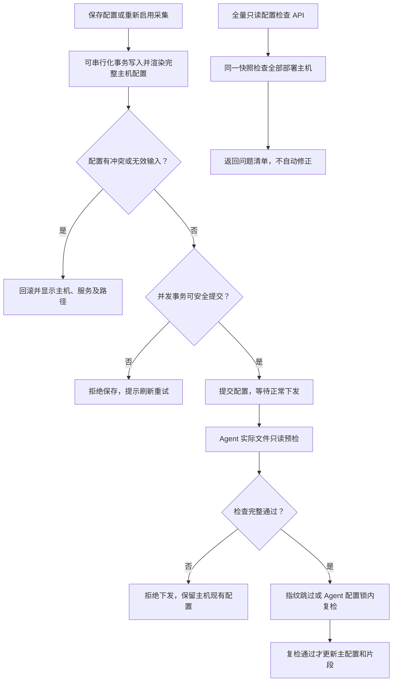
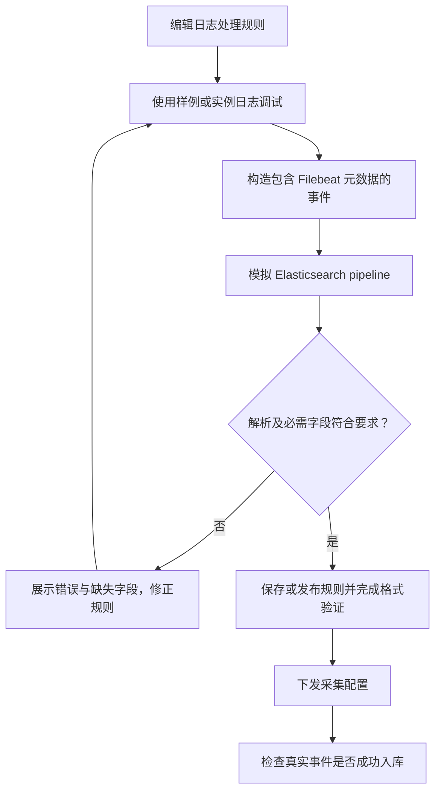
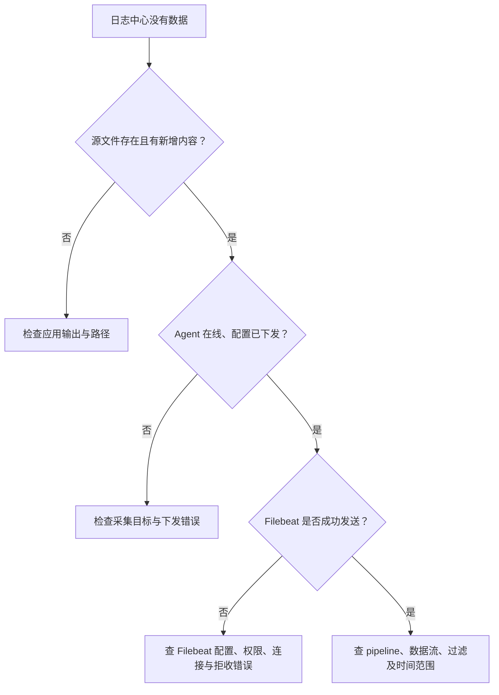
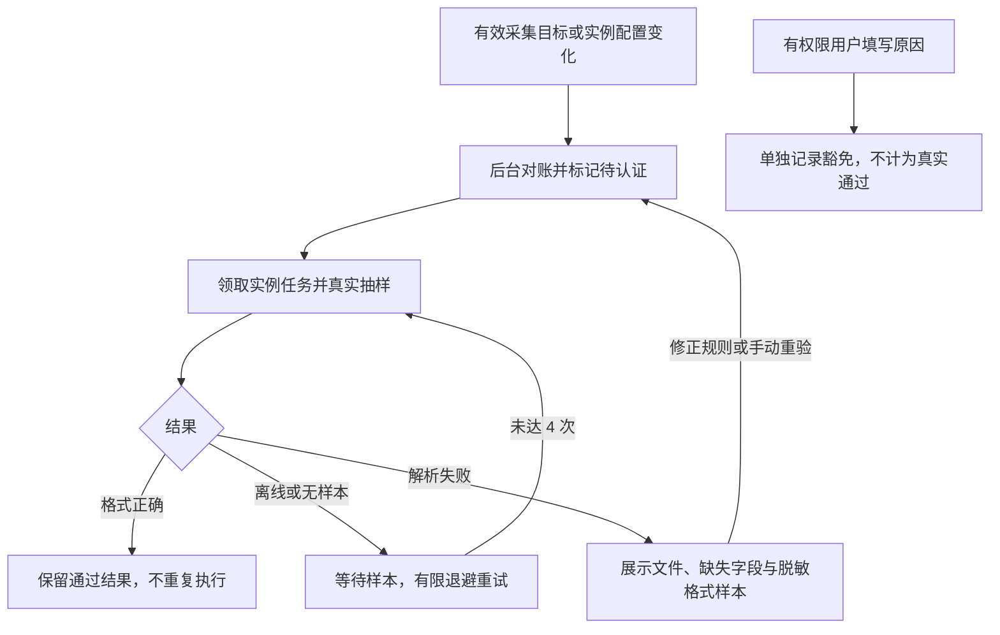
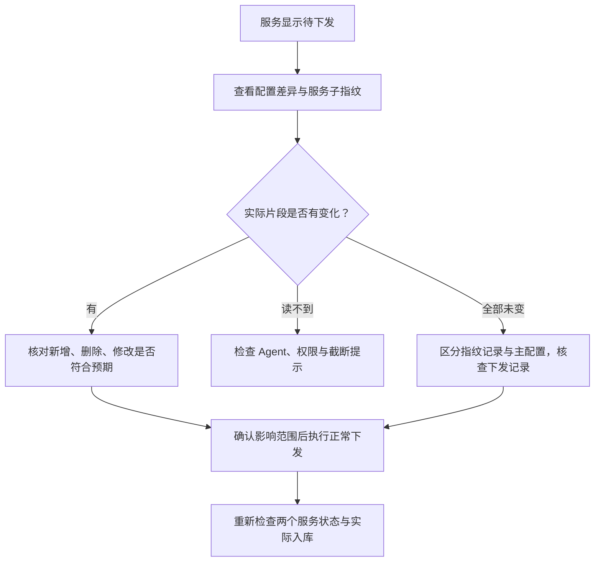

# 监控中心：日志管理

> **Agent 管配置，Filebeat 读文件并发送事件，Elasticsearch 存储与检索。配置下发成功不等于日志已经入库。**

## 总体流程

## 日志采集

**入口：监控中心 → 日志管理 → 日志采集。**
纳管 Filebeat，执行安装、启停、状态查询及配置下发。
前置条件是目标主机 Agent 在线，安装所需软件包、模板及配置有效。

1. 确认目标主机和软件状态。
2. 配置逻辑服务的日志定义与采集开关。
3. 下发配置后查看期望/已下发状态与安装或执行日志。
4. 去日志中心验证实际事件，不以“已下发”结束验收。

日志批量动作经 RabbitMQ 由 **api 角色**消费，因为 Agent 会话在该进程。
不能把这些动作转给没有实时会话的 scheduler 或 worker。

### 防止重复采集

同一主机上宏展开后的相同路径只能有一个启用的采集输入。
创建/编辑服务、保存部署模板、调整部署实例，以及重新开启服务或日志项采集时，
后端在可串行化事务提交前检查整台主机的配置；冲突直接拒绝保存并回滚。
并发保存若被数据库中止，提示刷新后重试，不把未完成的保存报告为成功。

存量配置可通过 `GET /monitor/log-targets/config-audit/` 全量检查，
覆盖已绑定实例但未纳管采集的主机，结果列出问题主机、冲突服务/实例及路径。
这是只读 API，没有新增页面按钮，不会自动关闭任何服务或修改主机配置。
检查失败不返回部分通过结果；修正后仍需正常下发，才能改变主机上正在运行的配置。
通配符交叉匹配、软硬链接等实际文件重叠不在数据库检查范围内。

**下发前还有 Agent 实际文件检查。** 后端将完整主机片段交给 Agent，
按物理文件身份检测不同 input 经通配符、软硬链接命中同一文件；检查失败、
Agent 离线或旧版本不支持检查时都禁止下发，不覆盖主机现有配置。
检查通过后，在实际写配置之前还会再次检查；主配置和片段统一应用，不单独先改 output。
数据库指纹相同也不能跳过文件检查。

允许离线编辑服务和模板。日志文件尚未产生或通配路径零匹配时，允许下发但显式提示未匹配；
权限错误、扫描超限、不支持的 `**` 递归通配、损坏链接等检查错误则拒绝下发。
该检查仅覆盖当时已存在文件，不能保证未来新增日志或链接变化不会形成重叠，也不会自动停采。
后端与 Agent 需配套升级，升级前已有 Filebeat 继续运行，但不能绕过检查下发新配置。

接口字段、并发失败语义和验证命令见 [日志采集架构](../LOG_COLLECTION_ARCHITECTURE.md#全量配置检查-api)。

## 日志存储

配置 Elasticsearch 集群连接与索引相关参数；检查连接、模板、pipeline 和 ILM 状态。
后端管理存储对象，Filebeat 直接向 Elasticsearch 发事件，日志正文不经过 RabbitMQ 搬运。

## 日志处理规则

规则用于多行、解析或字段处理。调试必须使用真实 Filebeat 事件形状，不能只造一条简化 JSON 就宣告链路通过。

**`message` 是原始日志文本，`log` 是元数据对象，不能用 `log` 覆盖 `message`。**
对 ES 字段类型的错误会导致拒收；必须看 Filebeat 错误与实际入库量。

## 日志保留档位

为服务选择保留策略，后端管理对应 ILM 与索引模板。
日志有效档位按“日志覆盖档位优先，否则服务默认档位”确定，并要求所选档位启用。
逐日志覆盖不依赖服务默认档位存在；两者都为空的日志仍需补选，不自动使用平台默认档位。
下发前校验每条日志的有效档位；为空或未启用时阻止下发，同一服务仅提示一次，
不按日志逐条重复刷屏。需检查服务默认档位及日志覆盖档位，不会自动补选档位或绕过校验。
日志配置列表读取不因缺失或停用档位而失败：仍返回日志及原始档位信息，允许用户查看和修正；
无法确定有效档位时 data stream 留空，不生成无保留策略的目标名称。读取与下发校验互不替代。
换档位会改变当前目标数据流，不意味着旧流立即消失；
非当前档位流由 API 的历史流回收维护检查，空流可立即回收，非空流等待原保留期满足。
回收不能绕过“停止旧写入、配置状态和归属检查”的保护。

## 日志中心

### 查询结果表格滚动

日志明细表格使用 Ant Design Vue 原生 `sticky`：表头吸附视口顶部，
表格尚未滚到底且存在横向溢出时，横向滚动条吸附视口底部，与正文及表头保持同步。
滚到表格底部时使用正文原生滚动条；表格离开当前视口或无需横向滚动时不显示吸底条。
时间列仍固定左侧、操作列仍固定右侧，查询、分页与列宽规则不变。
表格不设置固定高度或 `scroll.y`，长列表继续由整页纵向滚动，不引入表格内部的第二层纵向滚动。
该设置仅用于日志查询结果，不修改统计表格、共享服务树布局或全局页面滚动样式。

### 查询结果进入 Web SSH

日志查询结果操作列提供 **Web SSH 终端图标按钮**，复用主机列表的终端图标，不显示按钮文字，
颜色采用与同列其他操作一致的蓝色链接样式，
悬停提示“打开WebSSH 终端”，以新标签页打开该条日志对应主机的现有终端，不离开当前查询。
入口与源文件实时跟踪的启用开关无关，沿用 `assets:hosts:view` 权限和管理员语义；
只有日志中心查看权限的用户不显示此入口，Web SSH 的服务端鉴权仍独立执行。
终端是完整主机会话，不受日志查询的时间、关键词、级别和路径限制。

点击时通过现有主机列表 GET 查询日志的 `host_ip`，遍历搜索分页并精确匹配资产 IP，
不把模糊搜索的第一个结果当目标，也不把日志中的应用实例名当作 Agent 主机实例名。
仅唯一匹配且绑定 Agent、未在云端删除、Agent 在线的主机可进入；
使用资产主机 ID、主机实例名和 IP 构造现有 Web SSH 路由，不从日志指定登录用户或自动执行命令，
登录用户选择沿用终端页的规则。
缺 IP、无权限、未匹配、匹配歧义、离线、查询失败或弹窗被阻止均明确提示，不跳往其他主机。

为避免异步查询后被浏览器拦截，点击时先预留空白标签并立即断开 `opener`，
定位成功后才导航到终端；失败关闭空白标签，查询期间防止重复打开。
日志页失活或卸载时取消尚未完成的打开动作、关闭预留标签，迟到响应不再导航；
已经成功打开的终端标签独立运行，不随日志查询页关闭。

### 源文件实时跟踪（实验首版）

入口：日志中心 → 日志查询结果的**操作列 → 实时跟踪**，可直接跟踪该行来源，无需先打开详情；
查询结果详情中也保留同名入口。两处复用同一实时窗口与来源校验，操作列固定右侧，
启用跟踪入口时同步增加操作列和横向滚动宽度，避免挤压日志正文。
读取的是文件现在的原始 UTF-8 文本，
不是选中历史事件之后的回放；ES 时间、关键词、级别过滤不应用到源文件。
单窗口最多五标签；每标签独立连接、停止、继续、复制、清空和自动滚动。
窗口宽屏采用左右布局：左侧固定宽度展示跟踪状态、停止/继续、清空、自动滚动、源文件路径及提示，
右侧优先留给实时日志；长路径在左侧换行，长日志仅在右侧区域内滚动，不撑开窗口。
“复制”按钮单独放在右侧日志区右上角，与左侧停止/继续、清空操作分开。
视口不超过 900px 时切为上下排列，避免窄屏左右挤压。
复制点击时当前标签缓存中的全部纯文本（含换行与继续分隔提示），不是仅复制虚拟列表可见行，
不混入其他标签；跟踪中和停止后均可复制，不影响读取。
已淘汰的旧内容与超长行被截断的部分不在复制范围内；空内容提示无内容，剪贴板写入失败明确提示，
不显示虚假的复制成功。复制复用公共剪贴板工具，支持受限浏览器环境的既有降级路径。
停止保留内容，
按钮切换为“继续跟踪”；异常结束或断线后也可手动继续，无需关闭标签。
继续复用当前标签和有界缓存，但新建 WebSocket，重新进行首帧鉴权、来源校验和并发配额申请，
不复用旧连接或旧文件游标。显示区插入继续分隔提示，重新读取文件当前末尾（最多 200 行 / 256 KiB）；
停止期间可能有缺口，新快照也可能与上次内容重复，不承诺补齐或无缝续传。
关闭标签释放内容；按 Esc、点击右上角关闭或遮罩关闭整个窗口时，立即停止全部文件跟踪、
关闭 WebSocket 并清空标签与缓存，而不是仅隐藏窗口。Esc 在实时窗口打开期间使用捕获阶段监听，
即使焦点仍在底层详情抽屉也会关闭实时窗口，并阻止同次按键误关底层抽屉；
窗口关闭或卸载后移除监听，不影响其他页面。离页、KeepAlive 失活和组件卸载也关闭全部连接，
返回页面不恢复原连接。不自动重连。

默认开启，仅支持**单 API 进程**，后端和 Agent 需配套升级。
`LOG_LIVE_TAIL_MODE` 未设置、留空或为 `single-api-experimental` 时开启；
设为 `disabled` 时关闭，其他值返回配置无效错误。修改配置后需重启 API。
WebSocket 复用 HTTP 服务启动时解析的 `CORS_ALLOWED_ORIGINS`，不单独读取环境变量或维护第二份名单：
默认 `*` 允许合法 HTTP/HTTPS Origin，配置明确名单时只放行名单与同源请求，
无需为日志跟踪额外补配前端地址。空 Origin、`null`、凭据 URL、带路径/查询/片段的值均拒绝。
生产环境建议沿用明确的前端 Origin 名单；跨域放行不代表登录成功，JWT 首帧鉴权和日志中心权限
仍在启动读取之前执行，不使用 Cookie 或 URL Token 自动认证。生产压测尚未完成，不作为生产可用承诺。
多 API 副本没有全局配额或 Agent 会话归属路由，必须显式设为 `disabled`，
环境变量不提供多副本检测。默认开启不绕过 Origin、身份、角色权限和人数限制。

日志明细查询和分面统计的 GET 响应均通过 `data.live_tail_enabled` 返回同一后端启用判断。
前端默认隐藏入口，仅该字段严格为布尔 `true` 时在日志操作列和详情显示“实时跟踪”并挂载实时窗口；
关闭、状态未取得、字段缺失或查询失败时隐藏入口，不尝试连接来猜测是否开启。
重新查询发现关闭时卸载窗口，已有连接按离页相同的清理流程停止。
此字段只表示服务开关与初始化状态，不代替 WebSocket 的用户权限、来源和 Origin 校验。

**来源与权限**：

- 日志使用已有的 `service_id`、`instance`、`host_ip`、`log_name` 和真实 `log_path`，
  不新增、不要求事件中的 `host_id`，无需为实时跟踪重新下发采集配置或等待新日志。
- API 按服务 ID、应用实例名及主机 IP 联查当前启用的服务部署和主机资产，唯一匹配后取得
  数据库主机 ID 与 Agent `instance_name`。主机实例名全局唯一，应用实例名仅在同一主机内唯一，
  因此不能将日志中的应用实例名直接当作 Agent 路由。无匹配、歧义、云端已删除主机、
  已停用/删除的服务或部署、重复 Agent 路由身份均拒绝。
- 用当前启用的服务/部署/日志定义重算宏展开路径，具体路径必须唯一命中整台主机的普通日志输入，
  且服务 ID、应用实例名、日志名称同时匹配。按段支持 `*`、`?`、`[]`；不支持 `**`，
  请求必须是确切、规范的绝对路径。共享源、缺身份、配置改变、无匹配或歧义均拒绝。
- 沿用日志中心现有 `monitor:view`，不新增实时查看权限，也不叠加
  `assets:hosts:view` 或 `assets:applications:view`。admin 沿用平台管理账号语义。
  此授权包含已配置日志源的原始文件内容，可能比 ES 过滤后的内容更完整。
  当前没有单主机/单服务资源 ACL，本功能不承诺此类隔离；共享源不开放。
- 每十五秒重新查询账号状态、当前角色权限和来源配置，并检查 JWT 到期；失效立即结束。

点击入口时，前端检查服务、应用实例、主机 IP、日志名称及真实路径，提示实际缺少的字段，
不把普通记录笼统解释成共享源或旧日志。该提示发生在连接 API 之前，因此可能没有后端错误日志。
记录只要具备上述来源字段且仍能关联当前有效部署，就可以跟踪，无需补齐 ES 中的 `host_id`。
这不是历史主机身份恢复：已删除、改名或迁移后无法匹配当前关系的记录不会被猜测成其他目标。
缺少 `log_path` 时检查事件中的 `log.file.path`；仅当记录确实带有 `shared_source_id`
时才提示共享源历史标记，不表示系统当前仍在使用共享采集。

浏览器使用 `GET /ws/monitor/log-tail/` Upgrade；JWT **只放第一条 JSON 消息**，
形如 `{"token":"…","source":{"service_id":"7","host_ip":"10.0.0.1","instance":"app","log_name":"main","log_path":"/logs/app.log"}}`，
不放 URL、不写审计。最多三十二个待认证/校验连接，第一帧不超过 8 KiB、五秒超时。
普通 HTTP 成功信封不用于已升级的流；事件为 `ready/snapshot/data/changed/waiting/end/error`，
`data` 为 base64 原始 UTF-8 字节，前端流式解码，状态和正文分离。

**资源与清理**：API 原子预占包含启动中的连接；同账号同主机/路径或物理文件只能一连接。
同用户跨窗口最多五文件，同文件最多五用户；按 Agent 的设备号/inode 合并硬链接别名。
同主机最多二十连接/十文件，API 最多一百连接/五十文件。
Agent 安全打开后先回传身份，不读正文；API 再检查物理身份配额并确认 `start`。
轮转需要重新确认新身份，保持原路径名额，不默默切换或绕过新文件人数上限。
每次开始/结束以结构化 `live_tail_start/live_tail_end` 日志记录操作者、目标、时间及原因，不记正文。

每连接队列八帧、每帧最多 32 KiB，发送超时五秒，慢连接或拥塞停止并报告可能缺口。
Agent 每任务最多 256 KiB/s、整主机 1 MiB/s；API 接收预算 5 MiB/s，
base64 输出在 10 MiB/s 内。读游标落后超过 1 MiB 停止，不无限追赶。
初始只读末尾最多 256 KiB，再保留最多二百行，不扫描整个文件。
页面每 150ms 合并刷新，单标签最多五千行/5 MiB，单行 64 KiB；
固定行高虚拟窗口最多渲染三十六行，按纯文本显示，不解释 HTML/ANSI。
页面淘汰与长行截断有独立提示，不冒充传输丢失。

每连接最长三十分钟；API 每十五秒发 WebSocket ping、续 Agent 租约，
浏览器协议层 pong 驱动四十五秒断链检测，不依赖后台页面计时器。
停止/断链/超时均幂等释放名额并发 Agent stop；API 崩溃或 stop 未送达时，
Agent 会话关闭或四十五秒租约到期关闭文件。更详细的只读与轮转边界见
[Agent 架构](../DJ_AGENT_ARCHITECTURE.md#源文件实时跟踪协议)。

验收范围：已有原子配额、路径/权限校验、WebSocket→gRPC 事件与取消、原生读取/截断/轮转、
UTF-8 和前端缓存/标签测试。真实生产数据、满载共享通道延迟、网络隔离和长稳压测仍需部署验证；
未验证预算和普通 Agent 指令延迟前不得开启生产。

可选跨模块联通测试使用真实 Go Agent、真实 gRPC/WebSocket 和本地日志文件，数据库身份/配置使用
sqlmock，不接触生产资产。两个终端均先在仓库根执行
`export DJADMIN_LIVE_TAIL_E2E_COORD="$PWD/.live-tail-e2e-coordinate"`，
终端一运行 `cd autoadmin && make test PKG=./internal/logcollect TESTFLAGS='-run TestLiveTailRealAgentEndToEnd -count=1 -v'`，
终端二运行 `cd dj_agent && make test`。期望快照、追加、停止和 API 配额回收全部通过；
默认单元测试跳过该可选联通用例，必须两端同时运行。

按服务树选择范围，在页面内查看存储、查询和配置等能力。
左侧树面板与资产服务树使用同一套交互：顶部可放大 / 还原、收起 / 展开，
两栏间分隔条可拖动调宽。收起不会清空节点选择、搜索、筛选或展开状态，也不会重置右侧查询与页签；
面板宽度仅在当前页面实例内保留。窄屏自动上下排列，长列表在宽屏滚动时左侧树面板保持可见。
右侧日志趋势图与存储水位饼图随面板尺寸变化重新适配宽度，不重新发起查询。
**先确认服务及时间范围，再判断“查不到日志”。**

存储水位在环境节点按“项目 + 业务系统 + 环境”限定范围：逻辑服务统计只包含该树分支的服务，
包括尚无日志的服务；不会因其他分支使用相同环境码（例如 `poc`）而混入其服务。
已识别数据流采用相同范围过滤，总文档数、占用和服务分组统计保持一致。
环境树节点只提供业务系统 ID 与环境 ID；水位明细通过业务系统维度解析所属项目，
不能因节点未直接提供项目 ID 而退化为跨项目查询。
未识别流无法确认归属，只在没有项目或环境筛选的“全部逻辑服务”视图展示；
选择项目、业务系统、环境或服务后不混入这些流。未识别提示数量与当前可见明细一致。

### 格式认证自动化

服务及单条日志均开启采集、关联处理规则并绑定实例后，API 后台自动抽样，不需要记住操作入口。
新增实例、修改规则、路径、宏、实例运行变量或应用版本后自动重验；已通过的当前实例不重复认证。
真实抽样、规则样例测试、人工豁免是不同结论，规则样例不能替代生产实例认证。

日志中心显示待认证、认证中、已验证、不通过、等待样本、已豁免六类状态和真实实例覆盖数量。
单个实例通过不代表整个服务通过；豁免原因、操作人与时间可在认证弹窗查看。
临时错误最多自动尝试 4 次，用尽后明确提示，仍可手动重验；解析失败等待修复，不反复自动抽样。
关闭采集暂停自动认证并保留已有结果，解绑或删除实例则清理对应任务。
格式认证不自动下发配置、不直接阻断或停止采集，也不代表日志已经入库。
部署先执行 `000055_log_format_targets` 迁移；既有服务级认证不转成实例通过，启用目标由后台重新抽样。

详见 [实例级认证与失败语义](../LOG_COLLECTION_ARCHITECTURE.md#log-format-verification)。

### 配置指纹与待下发排查

**文档入口：文档中心 → 监控中心 → 日志管理 → 日志中心 → 配置指纹与待下发排查。**

> **“待下发”表示期望指纹与已下发记录不匹配，不等于已确认主机文件内容发生变化；“已同步”也不等于日志已入库。**

#### 指纹分别表示什么

| 类型 | 比较范围 | 用途 |
|---|---|---|
| 主机配置指纹 | 输出目标标识与该主机全部服务的采集片段 | 判断整台主机的配置下发记录是否与期望一致 |
| 服务配置子指纹 | 输出目标标识与本服务在该主机上的采集片段 | 判断本服务是否待下发，不因同机其他服务片段变化而连带变化 |
| 日志格式验证指纹 | 日志定义、路径、处理规则签名、宏及服务配置版本等 | 判断格式验证结果是否仍然有效，与主机下发指纹不是同一件事 |

配置指纹采用 SHA-256；输出目标标识包含 Elasticsearch 首个连接地址、用户名与 TLS 校验开关，
不包含密码。因此只修改密码不会自动触发指纹漂移，需要主动重新下发。
服务片段按路径排序后参与计算；数据目录标记文件 `.keep` 不参与服务子指纹，当前配置也不再生成它。

#### 为什么同一主机两个服务的状态不同

服务状态优先比较各自的服务子指纹：存在已下发子指纹且不匹配时为“待下发”；
缺少已下发子指纹时，才结合主机指纹判断是否尚未下发。
所以同一台 Filebeat 主机上的两个服务，可以一个已同步、另一个待下发。

“同机其他服务”仅表示文件归属，不表示文件有差异。
下发是主机级完整配置同步，必须包含其他服务片段，避免只下发当前服务时删除其他服务配置。
默认只展示本服务片段；需要查看完整主机范围时打开“显示同机其他服务片段”，统计仍是全主机范围。

#### 怎样判断真正的差异

“查看配置差异”通过 Agent 读取主机 `/etc/filebeat/inputs.d/*.yml`，与当前期望内容逐文件比较：

| 文件状态 | 含义 |
|---|---|
| 新增 | 期望有，主机没有 |
| 删除 | 主机有，期望没有 |
| 修改 | 两侧都有，但内容不同 |
| 未变 | 两侧内容一致，不是差异点 |
| 无法读取或截断 | 尚不能确认是否一致，先处理读取问题 |

该文件比较不包含主配置 `/etc/filebeat/filebeat.yml`；数据库中的已下发指纹也不是实时从主机文件重新计算的值。
当所有片段“未变”但仍待下发时，只能确认指纹记录不匹配，不能据此断言主配置发生了变化，
也不能仅凭哈希还原旧配置或确定历史原因。

#### 下发与排障边界

正常下发会同步主配置与主机完整采集片段；未变片段不会改写，但流程可能重启 Filebeat。
成功后保存主机指纹及服务子指纹，再刷新配置状态。
不要直接修改数据库指纹来消除提示，这会绕过真实下发与校验。
若成功下发后仍反复待下发，应核查实际下发结果、指纹保存链路及期望配置是否再次变化，
而不是反复重下发或将其他服务的“未变”文件当作原因。

## 删除与停止：必须分清

### 遗留共享采集源数据

共享采集源的创建、编辑和关联管理界面及 API 已移除；主机配置渲染器也不再生成共享 input。
既有数据库记录和 ES 历史数据保留，既有查询范围和水位识别仍可读取历史内容，但不会据此启动新采集。
已下发到主机的旧 input 不会被后台强制改写；对关联主机执行正常的完整日志配置下发后，该 input 才会从期望配置中移除。

共享源表和迁移保留，不删除或重建现有数据。遗留的撤销重试与历史流保留/回收逻辑继续运行；
删除逻辑服务时会清理其源关联并处理最后关联的停止任务。普通日志路径冲突需通过修正路径/宏或停用重复项解决，
当前不支持跨服务共享同一条新采集输入。

### 逻辑服务删除：集中流程图

**服务删除的主流程、失败重试、同编码重建和数据影响清单统一查看
[逻辑服务删除全流程](ASSETS.md#service-deletion)。**
文档中心左侧「资产管理 → 逻辑服务删除全流程」可直接进入，不在日志手册维护第二套删除流程。

删除包含服务归属范围内的 ES 数据流，不只是关闭采集；不会停止业务程序或删除主机源日志。
遗留源的最后一个关联在服务删除流程中移除后，API 仍建立源/代次精确匹配的 ES 写入屏障，
再由 Agent 持久化撤销旧 input。离线或失败时保持“待停止”并每 30 秒重试；这不会停止整机 Filebeat
或删除源文件。历史共享流文档仍可能被显式清理，清理前需核对其关联服务影响范围。

## 技术细节

[日志全链路、配置状态及删除边界](../LOG_COLLECTION_ARCHITECTURE.md) ·
[服务树操作](ASSETS.md#service-tree)
