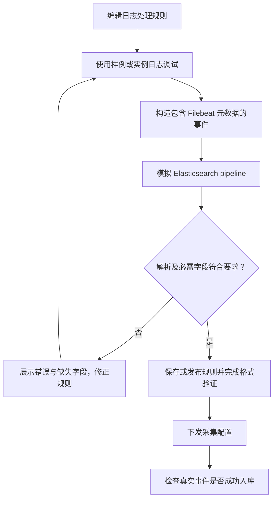
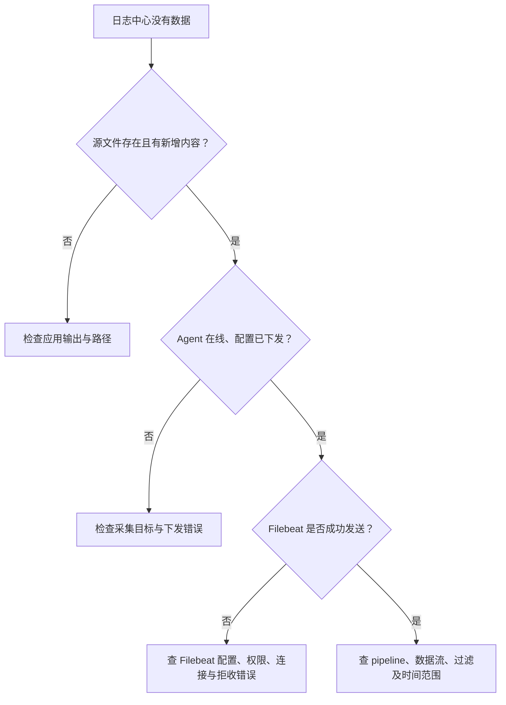
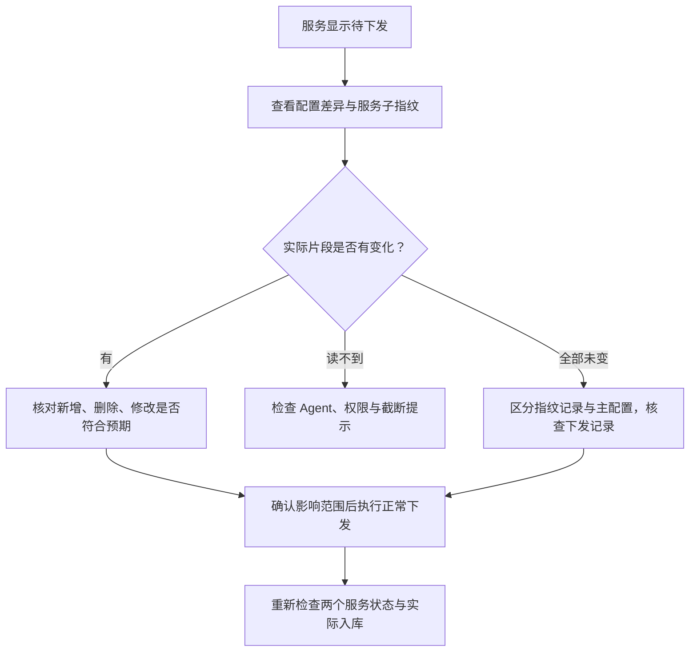
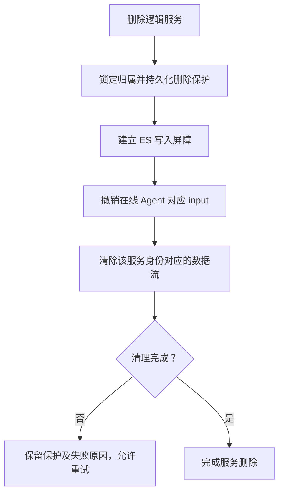

# 监控中心：日志管理

> **Agent 管配置，Filebeat 读文件并发送事件，Elasticsearch 存储与检索。配置下发成功不等于日志已经入库。**

## 总体流程

## 日志采集

**入口：监控中心 → 日志管理 → 日志采集。**
纳管 Filebeat，执行安装、启停、状态查询及配置下发。
前置条件是目标主机 Agent 在线，安装所需软件包、模板及配置有效。

1. 确认目标主机和软件状态。
2. 配置逻辑服务的日志定义与采集开关。
3. 下发配置后查看期望/已下发状态与安装或执行日志。
4. 去日志中心验证实际事件，不以“已下发”结束验收。

日志批量动作经 RabbitMQ 由 **api 角色**消费，因为 Agent 会话在该进程。
不能把这些动作转给没有实时会话的 scheduler 或 worker。

## 日志存储

配置 Elasticsearch 集群连接与索引相关参数；检查连接、模板、pipeline 和 ILM 状态。
后端管理存储对象，Filebeat 直接向 Elasticsearch 发事件，日志正文不经过 RabbitMQ 搬运。

## 日志处理规则

规则用于多行、解析或字段处理。调试必须使用真实 Filebeat 事件形状，不能只造一条简化 JSON 就宣告链路通过。

**`message` 是原始日志文本，`log` 是元数据对象，不能用 `log` 覆盖 `message`。**
对 ES 字段类型的错误会导致拒收；必须看 Filebeat 错误与实际入库量。

## 日志保留档位

为服务选择保留策略，后端管理对应 ILM 与索引模板。
换档位会改变当前目标数据流，不意味着旧流立即消失；
非当前档位流由 API 的历史流回收维护检查，空流可立即回收，非空流等待原保留期满足。
回收不能绕过“停止旧写入、配置状态和归属检查”的保护。

## 日志中心

按服务树选择范围，在页面内查看存储、查询和配置等能力。
左侧树面板与资产服务树使用同一套交互：顶部可放大 / 还原、收起 / 展开，
两栏间分隔条可拖动调宽。收起不会清空节点选择、搜索、筛选或展开状态，也不会重置右侧查询与页签；
面板宽度仅在当前页面实例内保留。窄屏自动上下排列，长列表在宽屏滚动时左侧树面板保持可见。
右侧日志趋势图与存储水位饼图随面板尺寸变化重新适配宽度，不重新发起查询。
**先确认服务及时间范围，再判断“查不到日志”。**

### 配置指纹与待下发排查

**文档入口：文档中心 → 监控中心 → 日志管理 → 日志中心 → 配置指纹与待下发排查。**

> **“待下发”表示期望指纹与已下发记录不匹配，不等于已确认主机文件内容发生变化；“已同步”也不等于日志已入库。**

#### 指纹分别表示什么

| 类型 | 比较范围 | 用途 |
|---|---|---|
| 主机配置指纹 | 输出目标标识与该主机全部服务的采集片段 | 判断整台主机的配置下发记录是否与期望一致 |
| 服务配置子指纹 | 输出目标标识与本服务在该主机上的采集片段 | 判断本服务是否待下发，不因同机其他服务片段变化而连带变化 |
| 日志格式验证指纹 | 日志定义、路径、处理规则签名、宏及服务配置版本等 | 判断格式验证结果是否仍然有效，与主机下发指纹不是同一件事 |

配置指纹采用 SHA-256；输出目标标识包含 Elasticsearch 首个连接地址、用户名与 TLS 校验开关，
不包含密码。因此只修改密码不会自动触发指纹漂移，需要主动重新下发。
服务片段按路径排序后参与计算；数据目录标记文件 `.keep` 不参与服务子指纹，当前配置也不再生成它。

#### 为什么同一主机两个服务的状态不同

服务状态优先比较各自的服务子指纹：存在已下发子指纹且不匹配时为“待下发”；
缺少已下发子指纹时，才结合主机指纹判断是否尚未下发。
所以同一台 Filebeat 主机上的两个服务，可以一个已同步、另一个待下发。

“同机其他服务”仅表示文件归属，不表示文件有差异。
下发是主机级完整配置同步，必须包含其他服务片段，避免只下发当前服务时删除其他服务配置。
默认只展示本服务片段；需要查看完整主机范围时打开“显示同机其他服务片段”，统计仍是全主机范围。

#### 怎样判断真正的差异

“查看配置差异”通过 Agent 读取主机 `/etc/filebeat/inputs.d/*.yml`，与当前期望内容逐文件比较：

| 文件状态 | 含义 |
|---|---|
| 新增 | 期望有，主机没有 |
| 删除 | 主机有，期望没有 |
| 修改 | 两侧都有，但内容不同 |
| 未变 | 两侧内容一致，不是差异点 |
| 无法读取或截断 | 尚不能确认是否一致，先处理读取问题 |

该文件比较不包含主配置 `/etc/filebeat/filebeat.yml`；数据库中的已下发指纹也不是实时从主机文件重新计算的值。
当所有片段“未变”但仍待下发时，只能确认指纹记录不匹配，不能据此断言主配置发生了变化，
也不能仅凭哈希还原旧配置或确定历史原因。

#### 下发与排障边界

正常下发会同步主配置与主机完整采集片段；未变片段不会改写，但流程可能重启 Filebeat。
成功后保存主机指纹及服务子指纹，再刷新配置状态。
不要直接修改数据库指纹来消除提示，这会绕过真实下发与校验。
若成功下发后仍反复待下发，应核查实际下发结果、指纹保存链路及期望配置是否再次变化，
而不是反复重下发或将其他服务的“未变”文件当作原因。

## 删除与停止：必须分清

### 遗留共享采集源数据

共享采集源的创建、编辑和关联管理界面及 API 已移除；主机配置渲染器也不再生成共享 input。
既有数据库记录和 ES 历史数据保留，既有查询范围和水位识别仍可读取历史内容，但不会据此启动新采集。
已下发到主机的旧 input 不会被后台强制改写；对关联主机执行正常的完整日志配置下发后，该 input 才会从期望配置中移除。

共享源表和迁移保留，不删除或重建现有数据。遗留的撤销重试与历史流保留/回收逻辑继续运行；
删除逻辑服务时会清理其源关联并处理最后关联的停止任务。普通日志路径冲突需通过修正路径/宏或停用重复项解决，
当前不支持跨服务共享同一条新采集输入。

不会为删一个服务停掉其他服务的 Filebeat，不会删主机源日志；不可通过“整机清空索引”代替服务归属校验。
离线节点依靠持久化撤销保护与写入屏障防止旧数据恢复写入，不把“暂时离线”当作安全完成证明。
遗留源的最后一个关联在服务删除流程中移除后，API 仍建立源/代次精确匹配的 ES 写入屏障，
再由 Agent 持久化撤销旧 input。离线或失败时保持“待停止”并每 30 秒重试；这不会停止整机 Filebeat
或删除源文件。历史共享流文档仍可能被显式清理，清理前需核对其关联服务影响范围。

## 技术细节

[日志全链路、配置状态及删除边界](../LOG_COLLECTION_ARCHITECTURE.md) ·
[服务树操作](ASSETS.md#service-tree)
