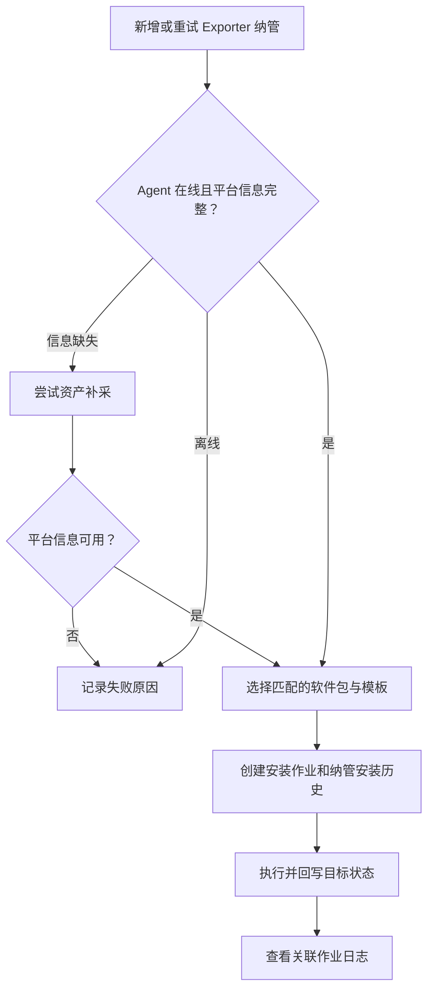
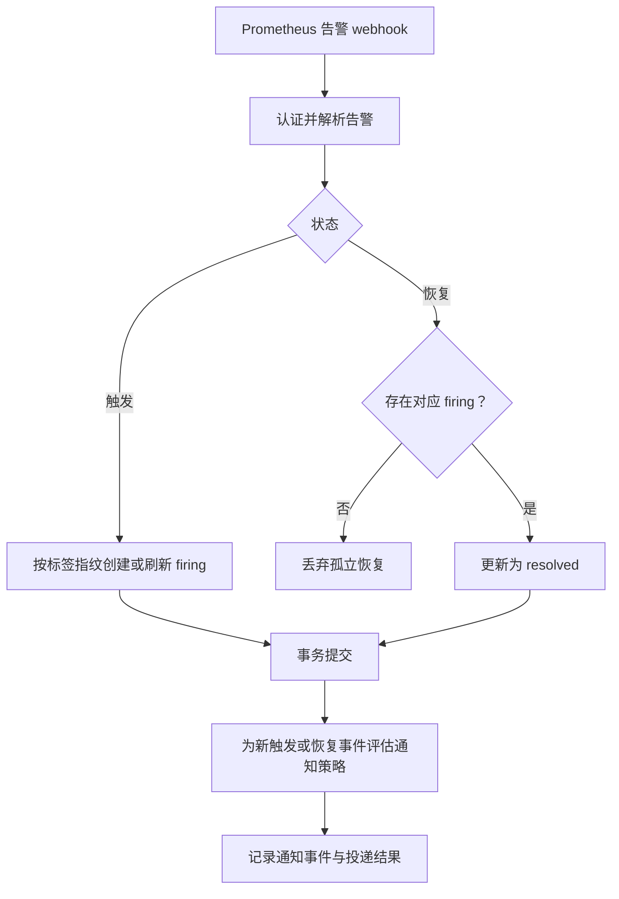
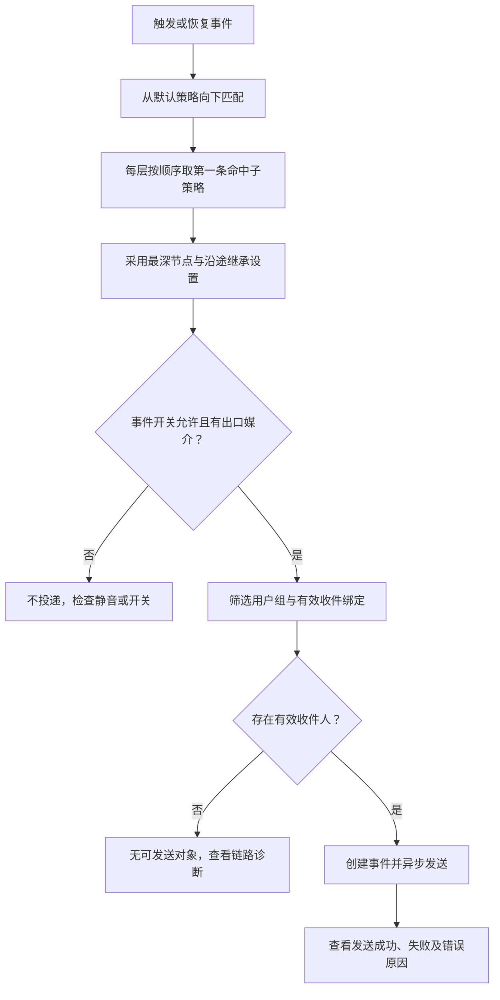

# 监控中心：监控告警与通知

> **指标查询、告警记录、通知投递是三段链路。看到告警不等于通知已发送，绑定邮箱也不等于策略会路由到它。**

## 智能监控

**入口：监控中心 → 监控告警 → 智能监控。**
查看 Prometheus 状态与 Exporter 纳管目标。纳管前确认主机 Agent 在线、
软件仓库有匹配平台的软件包、安装模板可用。

安装成功只是软件部署结果，仍需确认服务状态和 Prometheus 抓取结果。
Filebeat 不在 Exporter 列表中维护，去「日志管理 → 日志采集」。

## 告警规则

维护规则条件、持续时间、labels 和 annotations；表达式属于 Prometheus 规则语义。
优先写清 `summary`/`description`，它们是告警列表“问题”说明的来源。
规则表达式不会靠前端表格自行评估；先用 Explore 验证 PromQL，再核对上游规则及告警状态。

## 告警

查看当前告警与历史告警，按状态、级别、标签和时间定位。
当前数据来自 Prometheus；历史由 webhook 摄取并保存，二者不是同一个数据库列表。

规则快照会尝试从 Prometheus 补齐；读取规则失败不阻止历史摄取，但快照可能为空。
不要将“缺少快照”与“告警没有落库”混为一谈。

## Explore

输入 PromQL，通过后端代理请求上游 Prometheus。即时查询显示表格，范围查询显示图表。
即时结果分页在前端完成，翻页不重新查询上游；结果不是平台持久化的历史采样库。
自动补全失败时检查代理和 Prometheus label/series 接口，而不是修改业务权限绕过代理。

## 媒介

**入口：监控中心 → 通知管理 → 媒介。** 配置发送通道及连接参数，
用户在个人中心绑定该媒介的收件地址；两处作用不同。
测试发送失败时检查 SMTP、网络及凭据，配置示例和步骤见 [媒介操作说明](../../ops/ALERT_MEDIA_SETUP_GUIDE.md)。

## 通知策略

维护策略树的标签/业务树匹配、出口媒介、用户组限制和触发/恢复开关。

**三个容易混淆的设置：**

| 设置 | 含义 |
|---|---|
| 出口 `NULL` | 继承父级媒介 |
| 出口 `[]` | 显式静音 |
| 接收组 `[]` | 不限组，并不是禁止所有人接收 |

用户组限制收件人范围，角色控制操作权限。收不到通知时按
**策略命中 → 出口媒介 → 用户组 → 收件绑定 → 投递记录** 顺序检查，不只看邮箱有没有填写。

## 技术细节

[监控代理与目标安装](../MONITOR_PROMETHEUS_PROXY.md) ·
[告警摄取、策略及链路诊断](../ALERT_HISTORY_ARCHITECTURE.md) · [日志管理](LOGGING.md)
