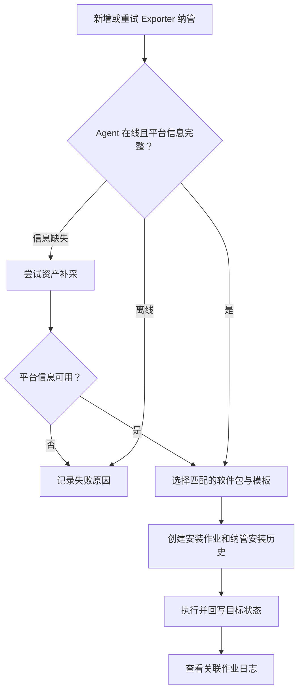
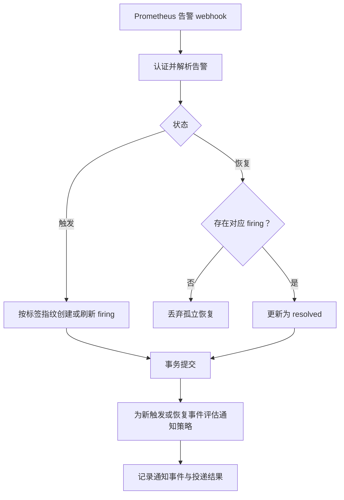
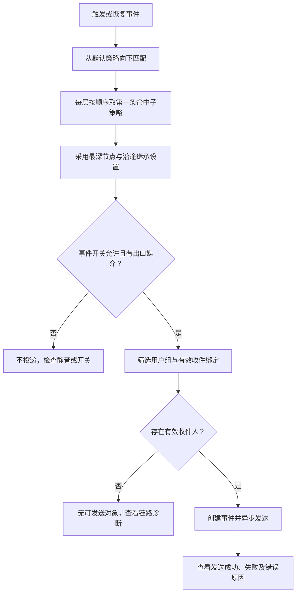

# 监控中心：监控告警与通知

> **指标查询、告警记录、通知投递是三段链路。看到告警不等于通知已发送，绑定邮箱也不等于策略会路由到它。**

### 查看配置与诊断

- 日志保留档位、处理与过滤规则、通知策略、软件包、告警媒介、日志存储集群共用各自的查看/编辑表单。查看者可以核对保留值与单位、规则方向、Playbook、邮件模板等原配置，密码仅回显已配置占位符；不能保存、发布或切换启停状态。保留档位表单同时显示引用数、分片滚动条件及预计占用。
- 通知策略列表返回所选媒介、接收组名称和 `scope_names`（项目、业务、逻辑服务路径；全局环境条件只显示环境名）。查看策略不请求媒介、用户组或服务树候选；处理/过滤规则用规则自带的应用名分组和回显。
- 日志中心从 `log-config` 响应的 `tier_names`、`filter_names` 回显本服务选择及模板继承项，区分「继承」「不过滤」与显式规则；层级汇总的 `tier_names` 仅包含所查服务的档位。查看者可核对结构化丢弃条件或原始处理器 JSON，不加载编辑候选、认证实例，不提供增删条件、保存或认证。
- 全部、项目、业务系统和环境层的配置表只汇总状态、支持下钻；采集开关、档位、过滤和丢弃条件只能在具体逻辑服务上修改。表外的范围下发需要独立执行权限和确认，只将已有差异下发给主机，不改服务配置。
- 样例试算、关联模板与引用服务、媒介模板预览、集群链路体检、Mapping、配置差异及软件包下载不被配置表单取代。处理规则的「解析试算」即使对编辑者也不提供发布；实际发送测试邮件、连接测试、下发和删除仍按各自的动作权限控制。

## 智能监控

**入口：监控中心 → 监控告警 → 智能监控。**
查看 Prometheus 状态与 Exporter 纳管目标。纳管前确认主机 Agent 在线、
软件仓库有匹配平台的软件包、安装模板可用。

安装成功只是软件部署结果，仍需确认服务状态和 Prometheus 抓取结果。
| 操作 | 需要关注 |
|---|---|
| 纳管并安装 | 受理不等于安装完成；下发失败时已创建的目标仍保留，可重试 |
| 启动 / 停止 | 查看逐台执行结果和错误原因 |
| 取消安装 | 取消管理记录不保证主机进程停止；迟到结果不会覆盖取消状态 |
| Filebeat | 在「日志管理 → 日志采集」维护，不在 Exporter 列表管理 |

[目标、安装历史和软件包的接口细节](../MONITOR_PROMETHEUS_PROXY.md#监控目标与软件包操作细节)

`monitor:view` 只提供查询。新增、修改/上传、删除分别需要
`monitor:create`、`monitor:update`、`monitor:delete`，安装、重试、取消、启停和通知测试
需要 `monitor:execute`。新增或删除监控目标可能安装/卸载服务，必须同时拥有对应资源动作
与执行权限。Filebeat 采集使用独立的 `monitor:log_collect:*` 动作权限，
日志数据清理另需 `monitor:logs:delete`，不能用监控查看权限替代。
Exporter 目标表的主机勾选、全选与顶部批量栏仅在拥有 `monitor:execute` 时展示；
仅授予 create/update/delete 而缺少 execute 时也不提供勾选。日志采集页的同类入口使用
`monitor:view`、`monitor:log_collect:view` 与 `monitor:log_collect:execute` 的交集。
只读用户仍可搜索、切换分组、筛选、翻页及查看状态；权限收回时立即清空已有勾选，避免残留批量操作上下文。
完整矩阵与升级要求见 [登录认证与权限](ACCESS.md#只读与动作权限矩阵)。

## 告警规则

维护规则条件、持续时间、labels 和 annotations；表达式属于 Prometheus 规则语义。
优先写清 `summary`/`description`，它们是告警列表“问题”说明的来源。
规则表达式不会靠前端表格自行评估；先用 Explore 验证 PromQL，再核对上游规则及告警状态。

## 告警

查看当前告警与历史告警，按状态、级别、标签和时间定位。
当前数据来自 Prometheus；历史由 webhook 摄取并保存，二者不是同一个数据库列表。

规则快照会尝试从 Prometheus 补齐；读取规则失败不阻止历史摄取，但快照可能为空。
不要将“缺少快照”与“告警没有落库”混为一谈。

## Explore

输入 PromQL，通过后端代理请求上游 Prometheus。即时查询显示表格，范围查询显示图表。
即时结果分页在前端完成，翻页不重新查询上游；结果不是平台持久化的历史采样库。
自动补全失败时检查代理和 Prometheus label/series 接口，而不是修改业务权限绕过代理。

## 媒介

**入口：监控中心 → 通知管理 → 媒介。** 配置发送通道及连接参数，
用户在个人中心绑定该媒介的收件地址；两处作用不同。
列表「状态」列使用以巡检中心为基准的默认尺寸「启用 / 停用」文字开关，直接展示媒介是否启用；具有 `monitor:update` 权限时可直接切换，
只有查看权限时开关只读。单行保存期间显示 loading 并阻止重复提交，成功后使用服务端返回的状态更新显示；
失败保持原状态并明确提示错误。开关控制媒介全局启用状态，影响使用该媒介的全部用户，不修改个人绑定状态。
开关通过既有 `PATCH /monitor/media/:id/` 提交 `{"enabled":true}` 或 `{"enabled":false}`，
后端仅更新启用状态与更新时间，不回写 SMTP 配置、密码、名称或说明；完整编辑请求仍按原有规则校验保存。
无表结构或迁移变更。
测试发送失败时检查 SMTP、网络及凭据，配置示例和步骤见 [媒介操作说明](../../ops/ALERT_MEDIA_SETUP_GUIDE.md)。

邮箱媒介的「消息模板」可分别设置告警触发、恢复两个事件的主题和正文；空白字段使用系统默认。
「样例预览」显示尚未保存的草稿且不发信；保存后可从列表的「测试」选择触发或恢复模板发送样例邮件，
也可以继续使用手填模式检查 SMTP。变量和投递语义见 [邮件消息模板](../ALERT_HISTORY_ARCHITECTURE.md#邮件消息模板)。

## 通知策略

「通知管理 → 维护窗口」按时段、服务树、主机和告警标签抑制正式通知，不改变通知策略或监测本身。
点击「添加范围」，每行多选主机或服务树节点。选项目即包含整个项目，也可展开到业务、环境或逻辑服务。任一行命中即可，标签对所有行生效。
点击名称或操作列打开同一张表单。可编辑时只显示「编辑」，否则显示「查看」，只读表单不提供保存按钮；删除独立鉴权。生效中可调整范围和结束时间，不可修改开始时间。删除窗口不删除历史抑制记录。时间边界、重叠窗口、到期补发与独立权限见
[维护窗口](../ALERT_HISTORY_ARCHITECTURE.md#维护窗口暂停通知不停止告警)。

维护策略树的标签/业务树匹配、出口媒介、用户组限制和触发/恢复开关。

**三个容易混淆的设置：**

| 设置 | 含义 |
|---|---|
| 出口 `NULL` | 继承父级媒介 |
| 出口 `[]` | 显式静音 |
| 接收组 `[]` | 不限组，并不是禁止所有人接收 |

用户组限制收件人范围，角色控制操作权限。收不到通知时按
**策略命中 → 出口媒介 → 用户组 → 收件绑定 → 投递记录** 顺序检查，不只看邮箱有没有填写。

## 技术细节

[监控代理与目标安装](../MONITOR_PROMETHEUS_PROXY.md) ·
[告警摄取、策略及链路诊断](../ALERT_HISTORY_ARCHITECTURE.md) · [日志管理](LOGGING.md)
