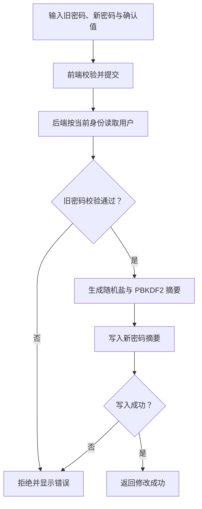
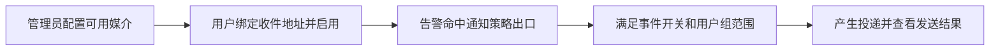

# 个人中心

> **个人时区控制界面时间显示，不改变后端 UTC 存储，也不改变定时任务的 cron 调度时区。**

## 入口与功能

右上角用户菜单 → 个人中心。

| 页面区域 | 功能与重点 |
|---|---|
| 基本资料 | 修改手机号码、时区；角色信息仅用于查看 |
| 修改密码 | 提交旧密码与新密码，旧密码校验不通过则拒绝 |
| 告警媒介 | 选择已有媒介，维护自己的收件地址及启用状态 |
| 头像 | 上传支持的图片，受文件大小和扩展名约束 |

## 修改密码流程

修改成功不等于服务端撤销所有已签发 JWT，完整会话边界见 [登录认证与权限](ACCESS.md)。

## 接收告警需要哪些条件

**只绑定邮箱不保证收到所有告警。** 收不到时从通知链路诊断查看策略、媒介、组限制与投递状态。
安全退出会清理本浏览器存储并回到登录页，不等于全端令牌撤销。

## 技术细节

[通知策略与排障](MONITORING.md#policies) · [头像与静态文件](../SYSTEM_MANAGEMENT_AUDIT.md#user-avatar)
