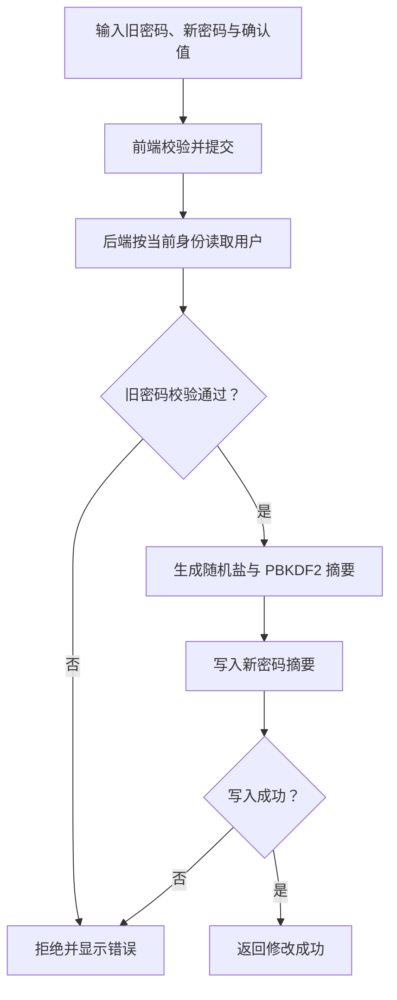
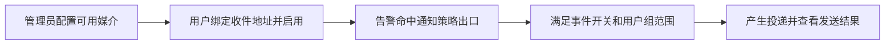

# 个人中心

> **个人时区控制界面时间显示，不改变后端 UTC 存储，也不改变定时任务的 cron 调度时区。**

## 入口与功能

右上角用户菜单 → 个人中心。

| 页面区域 | 功能与重点 |
|---|---|
| 基本资料 | 修改手机号码、时区；角色信息仅用于查看 |
| 修改密码 | 提交旧密码与新密码，旧密码校验不通过则拒绝 |
| 告警媒介 | 选择已有媒介，维护自己的收件地址及启用状态 |
| 头像 | 上传支持的图片，受文件大小和扩展名约束 |

## 时区选择与显示

时区选项来自浏览器 `Intl.supportedValuesOf('timeZone')` 的完整枚举，并补充 `UTC`；
不再按相同偏移合并城市。枚举标识及别名取决于浏览器的时区数据库版本，不展开全部历史别名；
已保存且浏览器支持的时区标识即使不在枚举中也原样加入，不自动改写用户设置。
选择框支持按 IANA 标识（如 `Asia/Shanghai`、`Asia/Hong_Kong`）或 UTC 偏移搜索。

标签显示 `UTC±HH:mm · IANA 标识`，偏移按计算时刻的真实时区规则生成，
包含夏令时以及半小时、四分之一小时偏移；进入页面、读取当前用户设置或展开列表时刷新。
顶部用户时区标签随时钟刷新，跨夏令时切换后不会继续显示固定标准时偏移。
选择保存 IANA 标识，而非当时的 UTC 偏移。
浏览器不支持枚举或当前标识无效时，页面明确提示错误并禁用时区选择，不以少量静态选项冒充完整列表。

## 个人资料保存与权限

所有已登录用户均可通过 `POST /sys/usercenter/updateUserInfo/` 修改自己的手机号和时区，
不需要用户管理权限或额外的个人资料权限码。目标 ID 只取已验证登录凭证，
请求中的其他用户 ID、角色、账号状态等字段不参与更新；管理员用户管理接口仍单独检查权限。

请求允许提交 `phonenumber`、`timezone` 中的一项或两项，未提交的字段保持不变。
后端校验非空 IANA 时区（拒绝依赖服务器设置的 `Local`），并内嵌 Go 标准时区数据库。
写入只更新提交的自助字段；两项一起提交时在同一事务内完成，失败全部回滚，
不会通过整行写回覆盖管理员并发调整的账号状态等信息。响应 `data.user` 不包含密码。
无表结构或存量数据迁移要求。

手机号和时区都是表单草稿，选择时区不发送保存请求、不写用户缓存、不广播时区变化；
页面时间显示仍使用用户 store 中已保存的时区。只有点击「保存」并通过表单校验后，
才将手机号和时区通过该自助接口一次提交，不调用管理员修改用户接口。
成功后同步本地用户缓存并广播时区变化；失败明确提示，不更新缓存、不广播，
保留表单草稿供用户重试。

## 修改密码流程

修改成功不等于服务端撤销所有已签发 JWT，完整会话边界见 [登录认证与权限](ACCESS.md)。

## 接收告警需要哪些条件

**只绑定邮箱不保证收到所有告警。** 收不到时从通知链路诊断查看策略、媒介、组限制与投递状态。
安全退出会清理本浏览器存储并回到登录页，不等于全端令牌撤销。

## 技术细节

[通知策略与排障](MONITORING.md#policies) · [头像与静态文件](../SYSTEM_MANAGEMENT_AUDIT.md#user-avatar)
