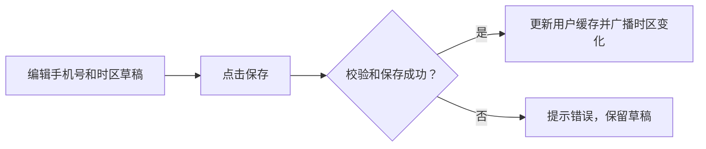
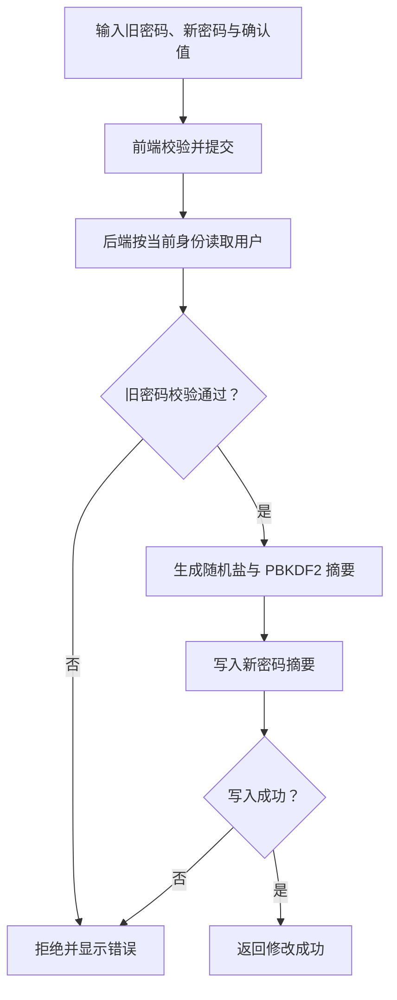
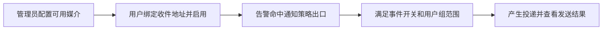

# 个人中心

> **个人时区控制界面时间显示，不改变后端 UTC 存储，也不改变定时任务的 cron 调度时区。**

## 入口与功能

右上角用户菜单 → 个人中心。用户菜单悬停时紧贴头像入口下方并右对齐，短暂移出入口再进入菜单不会收起。
选项单行展示，「安全退出」单独分隔；点击菜单留白不会关闭菜单，选择菜单项后才关闭。

| 页面区域 | 功能与重点 |
|---|---|
| 基本资料 | 修改手机号码、时区；角色信息仅用于查看 |
| 修改密码 | 提交旧密码与新密码，旧密码校验不通过则拒绝 |
| 告警媒介 | 选择已有媒介，维护自己的收件地址及启用状态 |
| 头像 | 原图不超过 5 MiB；自动缩放、压缩，最终图片二进制不超过 1 MiB，存入数据库 |

头像上传成功后，个人中心预览和右上角顶栏头像同步更新，无需刷新网页；失败保留旧头像。

## 时区选择与显示

选择 IANA 时区（可按名称或 UTC 偏移搜索）；界面按该时区及夏令时显示，服务端仍存 UTC。
浏览器不支持时区枚举或当前标识无效时会提示错误，并禁用选择。
[时区选项和显示规则](../SYSTEM_MANAGEMENT_AUDIT.md#时区选择与显示)

## 个人资料保存与权限

已登录用户可修改自己的手机号和时区，无需用户管理权限；只选择时区不会立即保存。
[接口、校验和并发边界](../SYSTEM_MANAGEMENT_AUDIT.md#个人资料保存与权限)

## 修改密码流程

修改成功不等于服务端撤销所有已签发 JWT，完整会话边界见 [登录认证与权限](ACCESS.md)。

## 接收告警需要哪些条件

**只绑定邮箱不保证收到所有告警。** 收不到时从通知链路诊断查看策略、媒介、组限制与投递状态。
自身绑定列表可通过带「启用 / 停用」文字的开关直接修改状态，保存中显示 loading，失败保持原状态。
收件邮箱逐行展示。在添加或编辑绑定弹窗内可逐个添加、编辑、删除邮箱；删除确认列出对应邮箱。
操作只修改草稿，至少保留一个邮箱，点击弹窗「保存」或「添加」后才提交；取消弹窗不影响原绑定。
`PATCH /sys/usercenter/alertMediaBindings/:id/` 只接受布尔 `enabled`，锁定和更新均限定当前登录用户，
不替换绑定列表、不改收件地址；其他用户的绑定返回不存在。媒介已停用时不能启用绑定，但仍可停用已有绑定。
新增/编辑绑定表单的开关只修改草稿，仍随表单提交；链路诊断中的同款开关只读。
诊断节点使用「媒介绑定：媒介名称」定位对应配置，问题摘要也显示媒介名称，不把内部绑定 ID 当作用户可读标题。
个人链路只显示不限接收组或自己所属组可接收的通知策略；其他组专用策略不会出现在列表与故障提示中。
若没有任何适用策略，会明确显示「暂无对当前用户生效的通知策略」，而不是把自己不属于其他组当成故障。
策略匹配条件用中文与实际节点名称展示，例如「项目『某项目』且标签『severity』等于『critical』」，
不再要求用户阅读 JSON 或猜测服务树编号。上级策略的匹配范围也会保留；只有整个路径都无条件才显示「不限」。
安全退出会清理本浏览器存储并回到登录页，不等于全端令牌撤销。

## 技术细节

[通知策略与排障](MONITORING.md#policies) · [头像与静态文件](../SYSTEM_MANAGEMENT_AUDIT.md#user-avatar)
