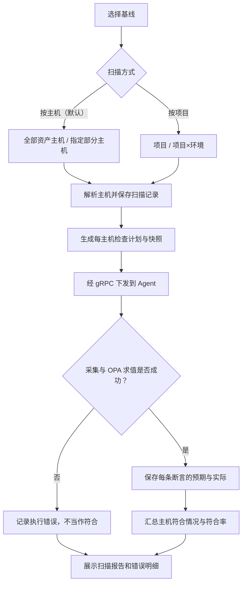

# 安全中心：基线扫描

> **这是操作系统配置合规扫描，不是漏洞/CVE 扫描，不自动修复配置，也不等于应用巡检。**

## 菜单入口与步骤

安全中心 → 基线扫描。先维护基线标准，再建立类目与策略，最后按项目/环境选择目标执行扫描。

1. 创建并启用基线标准。
2. 添加类目，编写 OPA 采集与断言策略，填写修复建议。
3. 默认“按主机”：不要求项目、环境，主机留空表示全部资产主机，也可多选部分主机。
   或切换“按项目”：选择项目及可选环境，扫描该范围内全部主机，不显示主机多选。
   切换扫描方式会清空旧主机选择；主机加载失败或范围为空不能提交。
   确认目标范围、Agent 在线状态后发起扫描，离线主机执行时会记录错误，不当作符合。
4. 查看逐主机、逐策略报告，对比预期值与实际值。

## 扫描流程

## 报告重点

- 策略配置引用的采集字段必须存在，保存时会校验。
- 不符合是规则结论，执行错误是输入或执行条件问题，处理方式不同。
- 类目和修复建议作为扫描快照保存；后来编辑基线不改写旧报告。
- 条目明细选择“通过”时隐藏“消息”和“修复建议”列，减少空白；切回“全部”或“不符合”时恢复，两列数据仍保留。
- 详情概要显示项目和具体环境清单；选择全项目扫描也列出涉及的环境，不只显示“全部环境”。
  按主机扫描概要显示“不限定项目、不限定环境”，不推断资产的项目归属。
  环境筛选同时过滤主机符合率和条目明细，多环境主机在对应环境均可查看但不重复计数。
  新扫描保存项目名称及逐主机环境快照；已有无快照记录按当前资产关联展示并显式标注，无法确认的归属显示“未记录环境”。
- 巡检与基线共享 OPA 内核，但使用独立的记录与聚合，不混表。
- 本模块不自动联动 Prometheus 告警，也不承诺已经有趋势、豁免或历史对比等规划能力。

## 技术细节

[基线模型与报告聚合](../BASELINE_ARCHITECTURE.md) · [OPA 执行逻辑](INSPECTION.md)
