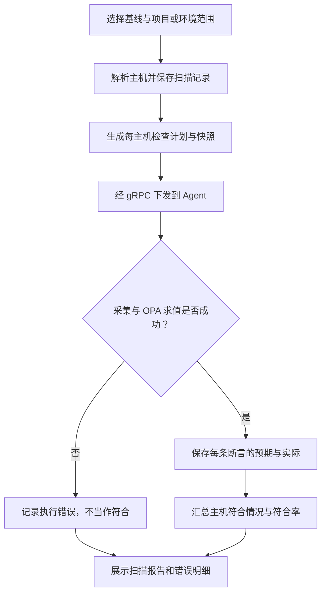

# 安全中心：基线扫描

> **这是操作系统配置合规扫描，不是漏洞/CVE 扫描，不自动修复配置，也不等于应用巡检。**

## 菜单入口与步骤

安全中心 → 基线扫描。先维护基线标准，再建立类目与策略，最后按项目/环境选择目标执行扫描。

1. 创建并启用基线标准。
2. 添加类目，编写 OPA 采集与断言策略，填写修复建议。
3. 确认目标范围、Agent 在线状态后发起扫描。
4. 查看逐主机、逐策略报告，对比预期值与实际值。

## 扫描流程

## 报告重点

- 策略配置引用的采集字段必须存在，保存时会校验。
- 不符合是规则结论，执行错误是输入或执行条件问题，处理方式不同。
- 类目和修复建议作为扫描快照保存；后来编辑基线不改写旧报告。
- 巡检与基线共享 OPA 内核，但使用独立的记录与聚合，不混表。
- 本模块不自动联动 Prometheus 告警，也不承诺已经有趋势、豁免或历史对比等规划能力。

## 技术细节

[基线模型与报告聚合](../BASELINE_ARCHITECTURE.md) · [OPA 执行逻辑](INSPECTION.md)
