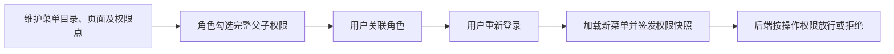
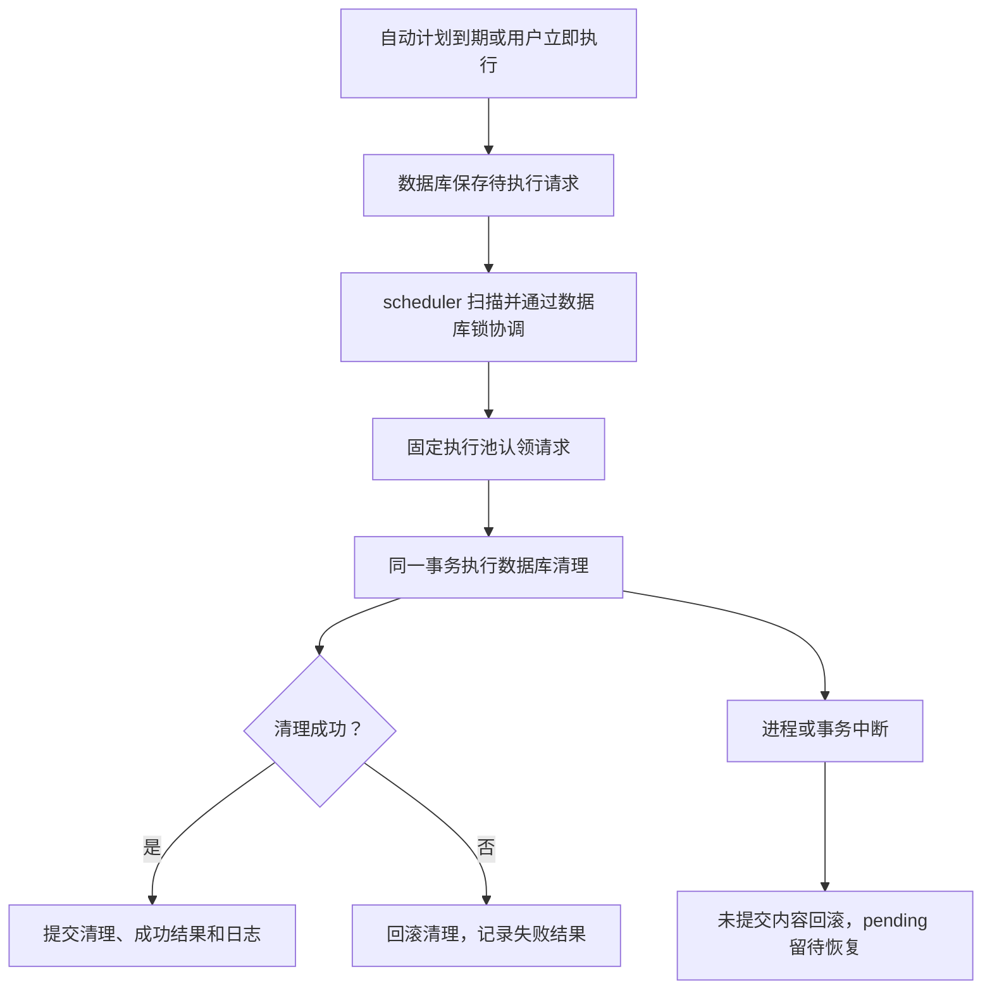
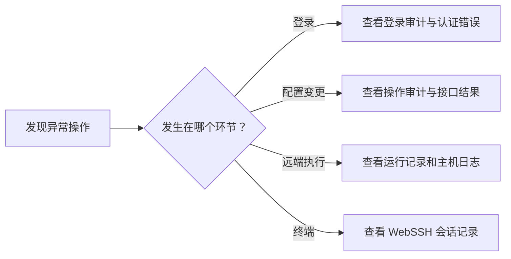

# 系统管理

> **角色决定操作权限，用户组决定通知收件范围；定时任务是数据库持久化调度，不是 RabbitMQ 清理消息。**

## 用户管理

维护用户资料、启用状态与角色。新建或调整用户后核对角色归属；
改变权限后让用户重新登录更新会话。停用不会自动撤销所有旧 JWT，详见 [认证边界](ACCESS.md)。

## 用户组

维护通知策略可选择的收件组。用户在组里并不获得管理权限；
要能操作菜单仍需分配角色和权限点。

用户组页面与后端按动作使用相同权限：新增要求 `system:usergroups:create`；
编辑组信息、添加或移出成员要求 `system:usergroups:update`；删除组要求 `system:usergroups:delete`。
仅有 `system:usergroups:view` 时只展示组列表和成员，不显示新增、编辑、删除、添加成员区或成员表操作列。
成员表只显示用户名及有权限时的操作列，不单独展示内部 ID；行标识和成员变更请求仍使用 `user_id`。
不以角色名称判断只读；每个处理函数及删除／移出确认回调均校验相应动作权限，撤权后不能继续提交。
添加成员还需 `system:users:view` 才能读取平台用户候选；没有该权限不请求用户列表，
但仍可按组更新权限编辑组信息或移出现有成员。撤权后关闭失效的编辑入口并丢弃迟到的候选查询结果。

成员表的「移出」动作复用公共居中确认弹窗，展示目标组名、用户名和各自 ID，
说明仅移除成员关系、不删除平台用户，以及对通知收件范围的影响。
取消不发送更新请求；确认后才以保留成员列表更新原用户组，成功后刷新组列表与成员数量。
确认期间即使切换到另一个组，也只更新打开确认框时的目标组，不把成员变更写入当前选中组。
更新失败不显示移出成功；表格操作列固定右侧并配合横向滚动，提示显示在按钮上方。

## 角色管理

给角色分配菜单目录、页面与操作权限，再将角色分配给用户。
权限分配弹窗宽度为 720px，窄屏不超过视口减去两侧各 16px 留白；顶部距离视口 24px。
权限树区域最大高度为当前动态视口高度减去 200px，超出时仅在树区域内滚动，
标题与底部「保存／取消」保持在滚动区域外。默认仍展开全部节点，父子权限独立勾选，
界面布局不改变已有选中项和授权提交内容。

**只有子页面、没有父目录授权时入口可能不可见。** 能打开列表不代表可以新增、删除或执行。

## 菜单管理

目录 `M` 负责分组，页面 `C` 负责导航，按钮权限点用于操作授权。
页面 path、组件映射和真实路由需要一致；菜单管理不能凭空生成不存在的业务页面。
首页和文档中心是公共静态入口，不需要在角色授权中额外勾选。

## 系统参数

参数列表仅在具有 `sys:config:update` 权限时展示「操作」列，与编辑、重置默认值按钮使用同一权限条件；
无此权限时隐藏整列及表头，不按角色名称判断。权限变化后列配置同步更新，
只读用户仍可查看当前值、默认值、属性及说明。显示时操作列固定在右侧、宽度为 180，表格启用横向滚动。
参数自身标记为只读时，有更新权限的用户仍看到禁用的编辑和重置按钮。

按参数类型修改并保存，错误值会被拒绝。密钥以掩码展示，
未修改掩码时原值保留，不能把掩码当成真实密钥使用。
调度总开关需要通过应用接口修改，不能直接改数据库绕过待执行项取消和游标重置。

## 定时任务

一条任务对应持久化计划和已实现的清理 handler。
修改 cron 前先确认调度时区：**五字段 cron 按持久化时区解释，当前初始化为 UTC**；
页面时间显示按用户时区转换。

| 操作/场景 | 最重要的结果 |
|---|---|
| 立即执行 | `submitted` 只代表请求已持久化，继续等本次结果 |
| scheduler 停机后恢复 | 错过多轮自动计划合并补执行一次 |
| 停用或改执行配置 | 取消尚未开始的旧请求，已执行事务允许完成 |
| 重新启用 | 从未来计划开始，不补停用期间 |
| 关闭自动总开关 | 取消自动等待项；启用任务的手动执行仍可用 |
| 多 scheduler | 共享数据库，通过行锁协调，不靠进程内锁 |

任务编辑及全局开关可能等待正在运行的清理事务，不能理解为无等待强制中断。
历史日志流回收属于 API 的维护循环，不是这里新增的一条清理任务。

## 操作日志与登录日志

操作审计用于追踪变更请求，登录审计用于追踪认证结果；WebSSH 会话记录有独立的内容查看/下载接口。
按用户、对象、时间和结果定位问题；审计列表不是作业逐主机执行日志，后者去「运行记录中心」。
请求方法按实际 HTTP 请求记录，不伪装或改写：GET 查询不进入操作审计，POST 内容校验、
样例试算和真实变更仍按现有规则记录。查询接口的方法修正只影响新请求，历史 POST 记录原样保留，
不批量清理或改写已有审计数据。
操作日志详情中，请求参数与返回结果各最多保存 16 KiB（16384 字节）的脱敏文本，超出部分标记
`[truncated]`。两侧标题右侧均可复制当前展示内容，截断标记也会保留；空内容和复制失败均有提示。
保存上限只影响新记录，不补齐历史截断内容，也不改变接口实际返回给浏览器的结果。

## 技术细节

[认证与权限](ACCESS.md) · [系统参数、审计与菜单模型](../SYSTEM_MANAGEMENT_AUDIT.md) ·
[持久化调度与锁边界](../SCHEDULER_ARCHITECTURE.md)
