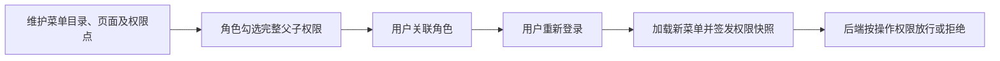
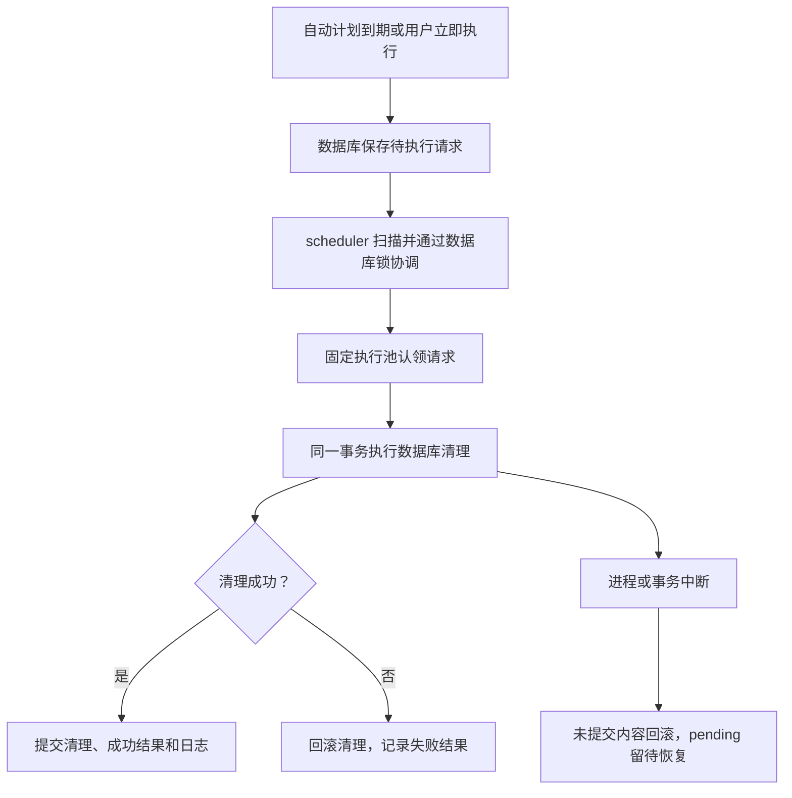
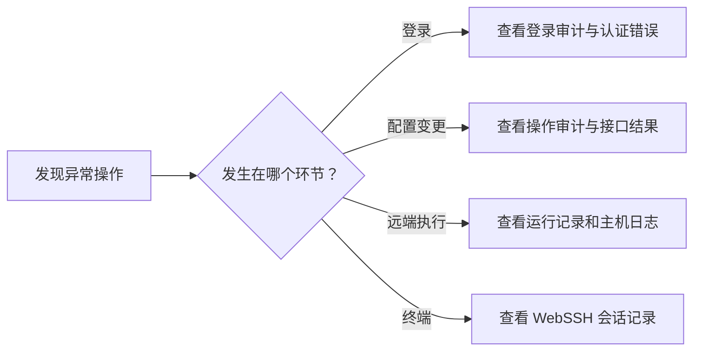

# 系统管理

> **角色决定操作权限，用户组决定通知收件范围；定时任务是数据库持久化调度，不是 RabbitMQ 清理消息。**

## 用户管理

维护用户资料、启用状态与角色。新建或调整用户后核对角色归属；
改变权限后让用户重新登录更新会话。停用不会自动撤销所有旧 JWT，详见 [认证边界](ACCESS.md)。

## 用户组

维护通知策略可选择的收件组。用户在组里并不获得管理权限；
要能操作菜单仍需分配角色和权限点。

## 角色管理

给角色分配菜单目录、页面与操作权限，再将角色分配给用户。

**只有子页面、没有父目录授权时入口可能不可见。** 能打开列表不代表可以新增、删除或执行。

## 菜单管理

目录 `M` 负责分组，页面 `C` 负责导航，按钮权限点用于操作授权。
页面 path、组件映射和真实路由需要一致；菜单管理不能凭空生成不存在的业务页面。
首页和文档中心是公共静态入口，不需要在角色授权中额外勾选。

## 系统参数

按参数类型修改并保存，错误值会被拒绝。密钥以掩码展示，
未修改掩码时原值保留，不能把掩码当成真实密钥使用。
调度总开关需要通过应用接口修改，不能直接改数据库绕过待执行项取消和游标重置。

## 定时任务

一条任务对应持久化计划和已实现的清理 handler。
修改 cron 前先确认调度时区：**五字段 cron 按持久化时区解释，当前初始化为 UTC**；
页面时间显示按用户时区转换。

| 操作/场景 | 最重要的结果 |
|---|---|
| 立即执行 | `submitted` 只代表请求已持久化，继续等本次结果 |
| scheduler 停机后恢复 | 错过多轮自动计划合并补执行一次 |
| 停用或改执行配置 | 取消尚未开始的旧请求，已执行事务允许完成 |
| 重新启用 | 从未来计划开始，不补停用期间 |
| 关闭自动总开关 | 取消自动等待项；启用任务的手动执行仍可用 |
| 多 scheduler | 共享数据库，通过行锁协调，不靠进程内锁 |

任务编辑及全局开关可能等待正在运行的清理事务，不能理解为无等待强制中断。
历史日志流回收属于 API 的维护循环，不是这里新增的一条清理任务。

## 操作日志与登录日志

操作审计用于追踪变更请求，登录审计用于追踪认证结果；WebSSH 会话记录有独立的内容查看/下载接口。
按用户、对象、时间和结果定位问题；审计列表不是作业逐主机执行日志，后者去「运行记录中心」。

## 技术细节

[认证与权限](ACCESS.md) · [系统参数、审计与菜单模型](../SYSTEM_MANAGEMENT_AUDIT.md) ·
[持久化调度与锁边界](../SCHEDULER_ARCHITECTURE.md)
