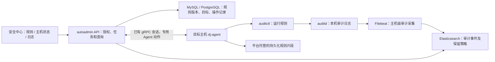

# Linux audit 规则管理与日志查询方案

> 状态：设计草案，未实现。日期：2026-11-27。
> 本文是待评审方案，不代表现有产品已支持。下发、采集及生产规模上线前必须经过隔离环境和试点验证。

## 1. 目标与边界

在「安全中心 → Linux 审计」管理敏感文件的审计规则，并查询规则产生的事件，例如排查 `/etc/passwd` 的写入和属性变更。
保留目标主机现有的 Linux audit 和 auditd；平台不替换 auditd、不启动第二个争抢审计事件的守护进程。

首期建议：

- 支持选主机、维护文件或目录的写入和属性变更规则、查看及下发、逐台撤销和查询日志。
- 支持只读查看主机上实际加载的规则；非平台创建的规则标记为外部规则，只读展示，不自动接管、修改或删除。
- 平台创建的规则分配不复用的短 audit key，供事件关联；规则删除后保留事件和变更历史。
- 不做任意 auditctl 命令、任意 shell、全部 audit 语法、用户态事件规则管理、内容差异比对或自动告警。
- 新规则只能记录生效之后被 audit 捕获的事件；现有历史记录是否可查取决于原有规则、日志保留和采集配置。

文件写入相关事件并不必然证明文件内容发生了变化。audit 能提供的用户、进程、路径、操作结果等字段随事件而变化；
缺失的 AUID、路径或进程信息显示未知，不能推断。AUID 未设置时不能显示为操作人 root。
对文件替换、重命名、软链接、目录监控、挂载变化及规则重叠必须先在目标系统实测；
未经验证前，不承诺单个文件 watch 能覆盖全部修改方式。

## 2. 总体链路

Agent 会话只存在于持有连接的 **api 角色**，不能把直接下发放到普通 worker 或 scheduler。
首期按单 Agent Gateway API 实例设计；多 API 副本要先解决会话归属路由、任务领取与重复执行，再启用批量下发。
大批量操作使用持久化任务与逐主机结果，HTTP 成功仅表示任务已接受；并发和超时通过试点确定，不承诺无损或固定延迟。

## 3. 规则、目标和状态

### 平台数据

建议独立维护规则、不可变规则版本、规则与主机绑定、逐主机部署任务及操作审计：

- 规则版本记录规则 ID、全局不复用的 audit key、路径、目标类型、监控动作、版本号和创建人；
  key 受 audit 长度限制，使用短 ASCII 编码；不从名称或 IP 推导，也不因改名、删规则而复用。
- 任务固定目标主机 ID 与规则版本，记录操作人、动作、提交及完成时间、失败原因、实际核验结果。
  主机名和 IP 只作快照，不充当唯一身份。保留任务历史和历史版本，避免重试及规则编辑导致历史归属变化。
- **期望状态**与每台主机**实际状态**分开：草稿、待下发、执行中、已生效、已撤销、失败、冲突或待处理；
  分开记录持久化配置、内核运行规则及最近核验时间。规则已加载不代表事件一定能命中，也不代表日志已采集。
- 离线或旧版 Agent 不视为成功；保留失败原因并允许有权限的用户重试。
  所有任务携带版本和操作 ID；重复执行幂等，迟到结果不能覆盖更新版本或撤销结果。
- 删除规则前必须确认平台规则已从所有目标的运行态和持久化配置中撤销；
  主机离线、不可变或撤销失败时阻止最终删除并显示未完成目标。单台撤销只影响该台，历史日志不删除。

同一主机同一目标规则的增删改串行；任务重复投递、Agent 重启或 API 中断后先读取实际状态并对账，再决定重试。
跨数据库、远端文件和内核操作不能做成一个原子事务：任何中间失败都要保留具体阶段和可重试状态，
不能仅因数据库保存或命令退出成功就显示「已生效」。

### 权限与 API

- 查询规则、主机状态和日志只使用 GET，参数走 URL；创建、编辑、下发、撤销及删除为写操作。
  列表资源删除统一使用批量删除接口，单条删除也传一个 ID。
- 规则查看、创建、修改、删除、主机下发/撤销、审计日志查看分别授权。
  同时改变资源与主机时，后端和前端必须按实际能力使用 AND；查看权限不能触发下发。
- 限制用户可访问的主机及审计数据范围；登录用户、操作记录和拒绝原因按现有审计约定保留。
  新权限和菜单同步 MySQL/PostgreSQL 迁移，不因拥有查看权限自动授予写入或执行权限。
- 非管理员覆盖：菜单可见、列表和详情可读；仅查看不能下发；缺少任一必需动作权限拒绝；完整授权可操作。

## 4. Agent 下发与持久化

复用现有 Agent `custom` 动作及 `Gateway.Execute` 通道，但新增专门的 audit 查看、应用和撤销动作，
不复用 Exporter 命令。下发参数是有类型且经后端和 Agent 双重校验的规则版本与主机任务，
不是可执行命令字符串。调用系统工具时固定程序及参数，不使用 shell。

每台主机先执行只读预检：确认 Linux 发行版/架构、auditctl 和 auditd、规则加载机制、权限、
当前 audit 状态、平台文件归属及路径条件；核对 `auditctl -l` 和文件中其他规则、过滤规则及不可变状态。
审计关闭、规则被更早的排除规则覆盖或存在不可安全区分的重叠时，明确提示风险或拒绝，
不得仅凭「规则已添加」声称监控有效。

### 应用流程

1. 校验规则版本、绝对路径、允许的操作、key 长度和输入边界；拒绝不受支持的路径、架构及规则。
2. 生成本平台拥有的精确规则和对应持久化片段。只修改带明确归属的托管文件；
   外部同名文件、内容被修改或归属不明时停止并报告冲突，不覆盖。
3. 以受控方式更新持久化片段，并对当前内核增量添加对应规则；两步各自核验并记录结果。
   文件写入采用安全打开、临时文件与原子替换、必要的落盘同步，不跟随非预期软链接。
4. 重新读取运行规则和持久化内容，确认精确匹配，且该发行版实际配置在启动时会加载平台片段。
   否则只报告相应阶段结果，不能标记「运行及重启后均生效」。

不调用 `auditctl -D` 清空全局规则，也不默认执行可能重载全量规则的 `augenrules --load`。
不同发行版的 auditd、`augenrules`、加载顺序及 `-e 2` 配置必须预检；无法安全确认持久化加载方式时拒绝部署。
`auditctl -s` 为不可变模式时，首期不修改运行或持久化配置；平台可保存草稿，但下发明确失败并提示需先在维护窗口处理。

### 撤销与失败恢复

- 只按完整规则定义、平台版本及归属撤销目标主机上的对应规则与持久化片段，不能按 key 批量清除其他规则。
  无法证明归属、规则被外部改动或与其他规则共享时停止并提示人工处理。
- 持久化和运行态任一步失败，都保留两者的观察结果及详细错误；可恢复时对账重试，不承诺自动回滚成功。
  现有规则、auditd 服务、其他配置和已有事件不受清理。
- 不自动启停 auditd、不修改全局 audit 失败策略、队列大小或不可变标志；
  服务不存在、权限不足、审计未启用及配置锁定均明确报告。
- 检查并行下发、安装期间外部改动、重复请求和重启恢复；Agent 本地按主机规则集串行，
  防止旧任务覆盖新版本或撤销后重新生效。

## 5. 日志采集与事件查询

项目已有 Filebeat → Elasticsearch 应用日志链路，但现有服务级输入、字段守卫和生命周期不等同于主机级审计采集；
不能给 audit 日志伪造服务归属，也不能让普通服务下发或删除动作覆盖、撤销或清理审计输入。
先设计独立主机级来源、权限、索引/数据流、保留策略及解析规则，并与现有完整配置渲染、文件身份检查、
Agent 配置锁和撤销流程集成，确保同一源文件不会被两个 input 重复采集。

- 发现并核验 auditd 实际 `log_file` 和写盘状态，按受控路径采集；auditd、Filebeat 读取权限、
  轮转方式及 ES 可用性分别显示。禁止关闭原有 auditd 或擅改它的日志路径。
- 审计事件可能由 `SYSCALL`、`PATH`、`CWD`、`PROCTITLE` 等多条记录组成，且可能交错、乱序；
  不能只按相邻行或只取含 key 的那一行。必须按主机不可变身份与原始 audit 时间戳、序号关联，
  保留原始记录；跨主机、重启及序号复用不得误合并。
- 先验证目标 Filebeat/auditd 模块在交错、延迟和轮转场景下的行为；若不足，设计有界事件聚合、
  超时输出及不完整标记，不声称普通多行拼接即可无损还原。
- 索引包含 key、主机 ID、事件时间、用户/AUID、进程、路径、操作及结果；按实际存在的字段展示。
  查询按主机、key、时间分页，用户时区只影响显示；ES 异常、采集停滞或部分事件明确提示。
- 审计日志可能包含命令参数和敏感信息；日志权限、保留期限、访问审计和脱敏策略必须在试点前确定。
  本机轮转与 ES 保留独立配置；记录队列溢出、采集滞后或缺口，不能承诺无损。
- 禁止将用户输入拼接进 ES 查询或执行命令；限制时间跨度、页大小和查询成本。

可评估 [go-libaudit](https://github.com/elastic/go-libaudit) 的规则和日志解析能力，
但不能假定其覆盖所有 auditctl 语法，需验证许可证、版本、架构与 `CGO_ENABLED=0` 构建。
不采用启动时清空全部 audit 规则的守护进程替代现有 auditd。

## 6. 交互与验收

- 规则列表：名称、监控对象、key、目标数、期望状态与已生效/失败数；
  同一表单用于查看和编辑，保存规则与实际下发分开。
- 主机详情：运行规则、持久化规则、最近核验时间、任务版本、失败或冲突原因；
  删除前列出受影响主机并使用公共删除确认。操作列按现有固定列、滚动和 Tooltip 规范实现。
- 事件列表：主机、时间、路径、动作/结果、进程、UID/AUID；提供完整事件记录。
  有无事件与配置是否生效分开表达；日志查询失败不显示为「没有事件」。
- 首期只支持已安装并在线的 Agent；规则生效与采集开通是独立的能力和状态，
  不因其中一项成功而把整个链路标成成功。

### 实施顺序

1. [ ] **隔离机可行性验证**：覆盖主要发行版、架构、systemd 加载方式，确认规则添加/精确删除、
   文件替换、`-e 2`、既有规则冲突、关机重启和日志字段；只在获授权的隔离机执行写操作。
2. [ ] **规则闭环**：数据库双方言迁移、权限、只读发现、版本与逐主机任务、Agent 增删核验及重试；
   验证审计原有规则不被改变。
3. [ ] **日志闭环**：设计并实现主机级采集，验证轮转、交错事件、断线、延迟、解析失败、
   原始记录和按主机/key 的查询；不影响既有服务日志采集。
4. [ ] **页面与权限**：规则、下发明细、日志、只读/动作权限；覆盖只读与缺失任一必需权限。
5. [ ] **小规模试点**：测量主机性能、规则量、事件量、队列丢失、采集延迟及 ES 成本，
   由试点结果确定并发与保留期；未经验证不扩大到全量主机。
6. [ ] **上线文档**：实现后将最终逻辑并入安全中心、Agent 和日志架构文档；
   完成 Go 双模块 `make vet && make test`、SQL `make derive → make generate → make facade`、
   前端定向测试/构建以及涉及权限的路由守卫测试。

## 7. 实施前待确认

- 首批 Linux 发行版、版本、架构及 Agent 覆盖范围。
- 监控对象是仅固定文件，还是首期同时支持目录；文件替换等覆盖语义以隔离机验证结果确定。
- 主机级审计日志的独立保留期限、敏感字段处理及哪些角色可以查看。
- 主机离线或不可变时的人工处理流程，以及生产批量下发窗口。
- 多 API 部署是否存在；若存在，先确定会话路由方案，不默认当前任务可跨实例执行。
