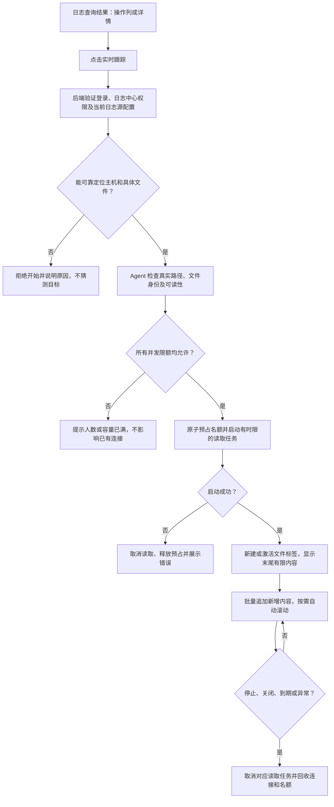
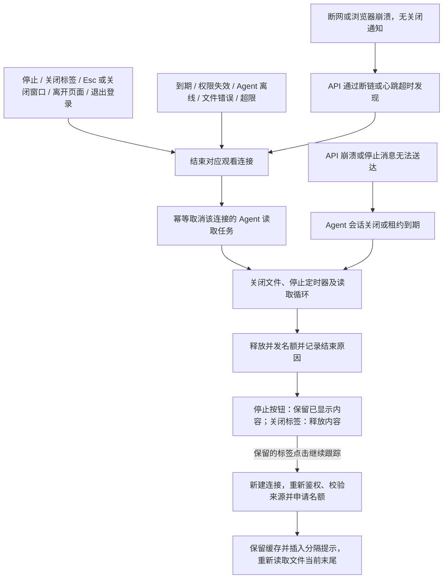

# 日志中心源文件实时跟踪设计（简化首版）

> 状态：实验首版已实现，默认开启，仅支持单 API；生产压测尚未完成，不表示生产可用。
> 日期：2026-10-29。
> 用户已确认的限制：同一主机同一文件最多 5 个用户；同一用户最多同时跟踪 5 个不同文件。
> 最终实现与已知边界见 [日志管理](../architecture/modules/LOGGING.md#源文件实时跟踪实验首版)
> 和 [Agent 架构](../architecture/DJ_AGENT_ARCHITECTURE.md#源文件实时跟踪协议)。
> 本文的建议预算仍需部署压测，未完成验收项不能作为上线承诺。

## 1. 目标与范围

用户在日志查询结果操作列点击“实时跟踪”（或从详情中的同名入口进入），直接查看该来源文件现在的新增内容，
不需要登录服务器、查找路径或打开终端。

实时跟踪读取源文件，不轮询 Elasticsearch，不改变 Filebeat 采集与 ES 历史查询链路。
不修改源文件、不启动 Shell、不提供任意命令执行，不新增任务队列、数据库任务表或后台告警。

### 首版范围

- 一个实时日志窗口，最多 5 个文件标签；每个标签有独立连接、状态和缓存。
- 首次显示有界的文件末尾内容，随后追加新增内容。
- 提供停止跟踪、自动滚动和清空显示；停止后保留已显示内容，关闭标签后释放内容。
- 支持正常文件截断和同名文件轮转；异常、超限、断线明确提示。
- 每个观看连接对应一个独立 Agent 读取任务，不实现多人共享读取、跨用户历史缓冲和分发中心。
  同一文件 5 人观看时最多有 5 个读取任务，资源预算按实际任务计算，不能按“只读取一份”估算。

不做多文件混流、历史回放、复杂筛选、下载、后台持续跟踪、自动断线重连和断线补齐。
实时跟踪不是无损采集工具，完整历史仍以实际采集入库的数据为准。

### 与查询结果的关系

- 跟踪的是来源文件现在的输出，不是从选中的历史记录开始回放。
- ES 查询的时间范围、级别和关键词不自动用于过滤源文件；窗口明确标识“原始文件内容”。
- 原始文件可能包含未入库、被采集过滤或属于其他服务的内容，权限不能直接等同于 ES 查询权限。
- 路径必须是确切文件，不对通配模式直接跟踪，不推测轮转文件对应的“当前日志”。
  选择 `application.log.1` 就针对这个路径，不能擅自改为 `application.log`。

## 2. 使用流程图

重复点击同一文件时，当前页面激活已有标签；其他页面已占用同账号同文件名额时，
明确提示“你已在其他窗口跟踪该文件”，不新开第二个读取任务。

## 3. 数据链路与接入边界

- 请求由持有目标 Agent 会话的 **api 角色**处理，不转交 scheduler、worker 或 RabbitMQ。
- 首版按单 API 进程持有全部目标 Agent 会话部署，不新增分布式配额基础设施。
  未设置、留空或设置 `LOG_LIVE_TAIL_MODE=single-api-experimental` 时开启，
  `LOG_LIVE_TAIL_MODE=disabled` 时关闭。多 API 副本部署在完成会话归属路由、全局原子配额之前必须关闭；
  不能用“每副本各放行 5 人”代替全局上限。
- 目标解析等纯查询使用 GET；WebSocket 使用 GET Upgrade，不新增 POST 查询或持久化会话资源。
- 浏览器 WebSocket 的鉴权凭证传递方式在实现前明确；不得把长期 JWT 直接拼入 URL，
  不记录凭证，校验允许的 Origin，认证完成前不允许读取文件或占用正式跟踪名额。
  Origin 使用 HTTP 同一份启动配置，默认 `*` 放行合法 HTTP/HTTPS Origin，明确名单时按名单与同源校验；
  不再增加实时日志专用的跨域配置，放行握手也必须完成 JWT 首帧及文件权限校验。
  未认证连接必须有独立的小容量上限和短超时，不能成为绕过正式配额的资源入口。
- gRPC 新增开始、数据、状态、停止及租约续期语义，使用唯一跟踪 ID 关联。
  消息名和字段在实现阶段定稿；现有文件读取请求不是持续订阅，不直接当作 tail 使用。
- Agent 以 Go 文件 API 只读跟踪，不借用 WebSSH 或拼接 `sh -c tail ...`。
- WebSocket 为结构化事件：就绪、快照、追加、文件变化、结束、错误；数据与状态分开，
  结束包含明确原因。首次快照与后续增量必须按同一读取游标有序衔接。
- 一次跟踪只有一个终态；停止、异常和超时并发发生时，清理必须幂等。

## 4. 目标定位与权限

当前查询使用已有的 `service_id`、`host_ip`、应用 `instance`、`log_name` 和 `log_path`，
实际路径优先来自 Filebeat 的 `log.file.path`。不新增事件 `host_id`，
也不要求用户为实时跟踪重新下发采集配置；目标由后端关联当前部署和资产得出。

后端必须解析并校验：

1. 日志源归属及其服务、部署或共享源身份。
2. 通过服务 ID、应用实例名和主机 IP 唯一关联真实主机资产，取得数据库主机 ID 与用于
   Agent 会话路由的主机 `instance_name`；应用实例名仅在同一主机内唯一，不能混用两种实例名。
3. 当前配置允许的具体路径及 Agent 返回的实际文件身份。
4. 当前用户有日志中心现有的 `monitor:view`，账号有效且未停用；
   不新增独立实时权限或叠加资产菜单权限，来源配置及路径归属仍须完整校验。
   该授权包含原始日志内容，可能比 ES 过滤结果更完整；当前不提供按主机/服务划分的资源 ACL。

不得仅凭 IP 或可复用的服务编码匹配记录，不信任浏览器提交的任意主机和路径，
也不能将 ES 中的字段直接当成授权依据。当前证据无法可靠定位时拒绝开始，
明确提示“无法可靠定位源文件”，不添加猜测或历史数据兼容分支。
新旧记录统一使用同一条关联查询，不按有无 `host_id` 分叉；已删除、停用或变更后不再匹配的
部署拒绝跟踪，不承诺恢复历史时刻的资产关系。

文件配额按“主机 ID + 经过校验的文件身份”归一化；软硬链接别名不能绕过人数限制。
跟踪期间仍保留最初获准的路径，轮转后新文件也必须重新校验路径、类型及权限边界，
不能因同名替换或链接变更转而读取未授权文件。

带共享采集源历史标记的记录首版拒绝跟踪，不通过关联服务的权限开放整份共享文件。
审计记录操作者、目标、开始与结束时间、结束原因，不额外持久化日志正文。

## 5. 并发、流量与缓存限制

### 5.1 已确认的人数限制

| 范围 | 上限 | 计数与拒绝语义 |
|---|---|---|
| 同一主机同一文件 | 5 个用户 | 第 6 人拒绝；已有观看者不受影响 |
| 同一用户同时跟踪的不同文件 | 5 个 | 跨主机、浏览器和标签页合并计算；第 6 个拒绝 |

首版建议同账号同文件只允许 1 个活动连接，因此该文件最多 5 个观看连接、5 个读取任务。
同一物理文件的不同别名不得重复占用不同文件名额。
所有限额由后端原子执行，启动中的预占也计数；启动失败、取消和超时均回收。
文件轮转沿用原跟踪名额，不重新申请一份。

### 5.2 建议的首版资源预算（未经压测）

| 范围 | 建议初值 | 超限行为 |
|---|---|---|
| 单主机 | 最多 10 个不同文件、20 个活动连接 | 任一达到上限后拒绝新增；独立读取任务最多 20 个 |
| 单 API 服务 | 最多 50 个不同文件、100 个活动连接 | 任一达到上限后拒绝新增 |
| 初始末尾读取 | 最多 200 行且最多 256 KiB | 只展示范围内内容，说明初始内容已截取；禁止扫描整个文件 |
| 单个读取任务 | 最多 256 KiB/s | 有界限速；持续追不上则停止并报告缺口，不无限追赶 |
| 单主机所有跟踪任务合计 | 最多 1 MiB/s | 共享总预算，不能将每任务限额简单叠加 |
| API 实时日志入站 / 出站 | 最多 5 MiB/s / 10 MiB/s | 总预算限制；持续拥塞时终止受影响连接并提示 |
| 单个数据包 | 最大 32 KiB | 分块发送；UTF-8 跨块解码不产生乱码 |
| 单行展示 | 最大 64 KiB | 标记超长行截断；继续按字节有界处理，不无限缓存到换行 |
| 单个观看连接的待发送数据 | 最多 256 KiB | 队列满或发送超时则停止此连接，不拖累其他观看者 |
| 单标签页面缓存 | 最多 5000 行或 5 MiB | 先达到哪个按哪个淘汰最早内容，并提示仅保留最近内容 |
| 页面刷新 | 每 100～200ms 批量追加 | 虚拟列表只渲染可见行；隐藏标签也不能积压无限更新 |

上述预算同时生效，不保证所有并发连接都能达到各自最高速率。
5 个标签最多约 25 MiB 是日志内容预算，不是浏览器总内存承诺，还需计算字符串、索引和渲染开销。
暂停自动滚动不暂停缓存淘汰；清空显示只清页面内容，不清空文件、不停止跟踪。
后台标签页不应仅因 JavaScript 定时器被浏览器节流就被误判断线，应区分传输心跳与页面渲染。

Agent 和 API 的收发必须有界、可取消，不允许在共享会话分发回调里等待慢 WebSocket，
也不能持有全局锁等待网络。小块发送和限速不自动等于连接隔离，
必须通过并发压测证明 tail 满载时普通 Agent 指令仍可响应；不满足就不能上线。

## 6. 关闭与回收流程图

每个观看连接独立读取，因此某个人停止时立即取消其任务，不等待最后一个观看者。
其他人自己的读取任务继续，最后一人退出后自然不再有该文件的读取任务。
文件数名额在最后一个对应活动连接结束后释放。

| 情况 | 建议语义 |
|---|---|
| 点击停止 | 停止当前标签；保留已显示内容供阅读 |
| 点击继续跟踪 | 停止或异常结束后复用当前标签，新建连接并重新校验；保留缓存，插入分隔提示后读取当前末尾，可能有缺口或重复 |
| 点击复制 | 复制当前标签缓存的全部纯文本及换行，不限于可见行；不包含已淘汰或已截断内容，不影响跟踪，空内容和失败明确提示 |
| 关闭文件标签 | 停止当前标签并释放其缓存 |
| Esc、关闭按钮或遮罩关闭整个实时窗口 | 立即停止全部跟踪并清空标签与缓存；焦点留在底层抽屉时 Esc 仍生效，关闭后移除键盘监听 |
| 离开日志中心页面 | 停止当前页面所有跟踪；页面缓存/KeepAlive 失活也清理，返回不恢复原连接 |
| 刷新、关闭标签页或退出登录 | 尽力主动关闭；未送达时由服务端检测回收 |
| 单次跟踪时长 | 建议最长 30 分钟；到期停止，允许手动重新开始 |
| 心跳 / 读取任务租约 | 建议每 15 秒续期，连续 45 秒无有效续期则回收；续期只允许活动且授权的连接 |
| 文件没有新增日志 | 正常等待，不因无日志自动关闭 |
| 暂停滚动、切换文件标签或浏览器标签页 | 不主动停止，仍受缓存、时长和心跳限制 |
| 登录到期或授权失效 | 停止；不能只在首次连接鉴权后永久有效 |

连接状态至少区分：连接中、跟踪中、等待文件、已停止、异常结束。
发生断线后不自动重连、不预留永久名额；手动开始或继续需要重新校验权限、目标及全部限额，
明确说明断线期间可能有内容缺口、新快照可能重复，不承诺游标续传或零丢失。

## 7. 文件变化与失败语义

- 仅跟踪普通文本文件；目录、设备、管道和压缩文件不支持，权限不足或格式不支持明确报错。
- 初次文件不存在时拒绝开始；跟踪中轮转导致暂时不存在时，进入“等待文件”，
  建议最长等待 60 秒，并受总时长和租约约束，到期仍未出现则停止。
- 检测到文件截断时提示并从头继续；正常改名后新建同名文件时，有界读完旧文件剩余内容，
  再校验并跟踪新文件。旧文件持续写入导致无法切换时，不无限等待读完，终止并说明原因。
- 快速多次轮转、删除和 copytruncate 的竞态可能造成缺口；首版不扫描归档文件补齐，
  不宣称严格等价于无损采集。
- 读取错误、持续落后、队列满和发送超时都产生明确结束原因，不静默丢新数据。
  一个慢观看者只影响自身任务，不停止其他人的任务。
- 页面淘汰已展示的旧内容与传输缺口必须用不同提示，不能混为“正常缓存清理”。
- 日志按纯文本渲染，不解释为 HTML 或可执行终端控制指令；界面状态时间使用用户保存的时区，
  不擅自改写原始文件内的时间文本。

## 8. 实施与验收清单

已完成实现项与尚待部署验收项分别标记；完成实现不等于完成生产压测：

- [x] 定稿可靠的日志源定位、稳定身份字段和原始文件访问权限；无法确认目标时拒绝读取。
- [x] 定稿 WebSocket 凭证传递、Origin 校验、授权失效检查与未认证连接预算。
- [x] 实现原子配额、预占回滚、Agent 开始/停止/租约协议及幂等清理。
- [x] 实现有界末尾读取、截断/轮转处理、限速和明确的错误事件。
- [x] 实现最多 5 个标签、批量更新、虚拟列表、字节与行数双限额和完整离页清理。
- [ ] 同一文件并发 6 个用户：仅 5 个成功；同一用户并发 6 个文件：仅 5 个成功。
- [ ] 重复标签页、路径别名和同时抢占最后一个名额不能绕过限制；启动失败不泄漏名额。
- [ ] 多 GiB 文件初始读取不全文件扫描；长时间不换行、超长行及 UTF-8 分块均有界且正确提示。
- [ ] 持续高频写入、慢浏览器、断网、页面后台节流、轮转和多连接达到上限时内存保持有界。
- [ ] 正常停止后建议 5 秒内完成清理；强制崩溃或隔离网络后建议在 45 秒租约加 5 秒清理余量内回收。
  测量活动任务、打开文件数、队列大小、goroutine 和计数，不能只看弹窗是否关闭。
- [ ] 在 tail 满载时重复测量普通 Agent 指令耗时和超时率，对照未启用 tail 的基线；
  上线前确定并记录允许的延迟增幅、CPU、内存及吞吐阈值，不以“未崩溃”代替通过。
- [ ] 按实测结果确定资源预算；未验证预算和共享通道影响之前不启用生产功能。
- [x] 实现后将最终入口、数据流、失败和回收语义同步到日志管理及 Agent 架构文档。

## 9. 现有依据

- [日志管理手册](../architecture/modules/LOGGING.md)：现有 Filebeat → ES 采集与查询职责。
- [日志采集架构](../architecture/LOG_COLLECTION_ARCHITECTURE.md)：日志源、路径与归属规则。
- [Agent 架构](../architecture/DJ_AGENT_ARCHITECTURE.md)：主机身份及共享会话边界。
- [API 与文档约定](../architecture/CONVENTIONS.md)：查询使用 GET，未上线方案放 plans。
- [日志查询](../../autoadmin/internal/logcollect/elasticsearch.go)：当前返回的记录字段和真实路径处理。
- [Filebeat 配置渲染](../../autoadmin/internal/logcollect/log_config_render.go)：服务身份与文件路径写入。
- [Agent 文件请求](../../autoadmin/internal/agent/file.go)及[协议](../../proto/agent_channel.proto)：已有有界文件读取，尚无专用实时跟踪订阅。
- [前端已有实时日志连接](../../fronted/src/views/automation/logs/center/controller.js)：连接与展示经验，
  不直接复制其中的鉴权方式或错误处理。
