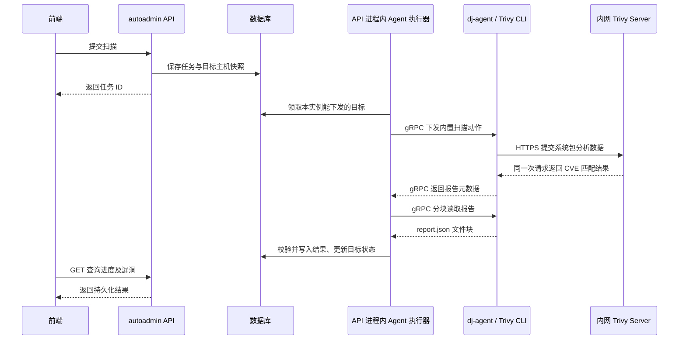

# Trivy 主机漏洞扫描集成方案

> 状态：设计草案，未实现。目标规模：约 500 台虚拟机。

## 1. 一期范围与部署决策

在「安全中心 → 漏洞扫描」新增 Linux 系统包 CVE 扫描。基线扫描仍负责配置合规，二者的结果和统计独立。
首期支持手动选机、查看覆盖率和漏洞结果、补丁后复扫。不覆盖 Windows、自编译软件、容器镜像或语言依赖；
不做自动打补丁、自动回退到本地扫描或定时扫描配置页面。

使用 [Trivy 官方 rootfs Client/Server 模式](https://trivy.dev/docs/latest/guide/references/modes/client-server/)：

- **主机上**：保留 `dj-agent`，独立安装固定版本的 Trivy CLI。CLI 读取本机系统包及发行版信息，将分析数据交给 Trivy Server，不上传整个根文件系统。
- **中心侧**：独立部署内网 Trivy Server，由其从受控源更新漏洞库并做 CVE 匹配。主机不下载漏洞库，不新增入站端口。
- **网络前提**：VM 能出站访问内网 Trivy Server 的 HTTPS 地址。现有 Agent gRPC 不代理这条流量。不能访问的网段先不纳入试点；通过 gRPC 回传包清单并在中心扫描是另一个方案，需单独验证匹配准确性。

容量参考：v0.76.2 Linux x86_64 CLI 下载约 53 MB，解压约 176 MB；2026-11-20 测得漏洞库下载约 142 MB、解压约 1.78 GB。集中部署后，库刷新流量不再乘以 500。实际空间还需计入缓存、报告和更新临时文件；以试点版本测量为准。

## 2. 执行链路与进程分工



| 角色          | 现状                                              | 一期改动                                                                                                   |
| ------------- | ------------------------------------------------- | ---------------------------------------------------------------------------------------------------------- |
| `api`       | REST API、Agent gRPC 长连接、日志采集批量任务消费 | HTTP handler 只鉴权、持久化任务并返回 ID；同进程的后台执行器负责有界下发、取报告和入库，不占用原 HTTP 请求 |
| `scheduler` | 从数据库领取并直接执行现有定时清理任务            | 一期不改。后续定时扫描只创建与手动扫描相同的任务，不直连 Agent                                             |
| `worker`    | 自动化失联作业对账，不是通用任务队列消费者        | 一期不改。若报告解析影响 API 延迟，再通过可持久化的报告引用交给 worker；它不直接读取 Agent 文件            |
| Trivy Server  | 独立服务                                          | 管理漏洞库、返回匹配结果，不存储 djadmin 的扫描任务和报告                                                  |

现有角色见 [Agent 架构](../architecture/DJ_AGENT_ARCHITECTURE.md#7-后端进程说明)。Agent 会话仅在持有连接的 API 实例内。
一期按单个 Agent Gateway 实例部署；若试点已经多副本，先解决任务到会话归属实例的路由再上线。
数据库租约只防止重复领取，不能让别的进程访问该长连接。无需改造现有 RabbitMQ 路由。

## 3. Agent 接入与报告契约

1. 后端复用 [`Gateway.Execute`](../../autoadmin/internal/agent/gateway.go)，按基线扫描的方式发送
   `Type=custom`、`Action=scan_host_vulnerabilities`，带服务端生成的任务标识、固定扫描配置标识及超时。不新增 gRPC 消息。
2. Agent 在[内置动作分发](../../dj_agent/internal/executor/builtin_actions.go)注册处理器，用 `exec.CommandContext` 运行固定路径和参数，不走 shell。
   Server URL、CA 和认证由部署配置提供；不允许调用方指定 URL、执行用户、文件路径、命令参数或环境变量。内网服务启用 TLS 和认证，凭据不进入任务参数、日志或报告。
3. CLI 完成后将报告写入私有任务目录，完成写入后才发布文件。`result_data_json` 只回任务标识、大小、SHA-256、CLI 版本等元数据；不把整份报告放进 `stdout`。中心漏洞库更新时间由中心侧监测，不从客户端本地缓存推断。
4. 后端通过 [`ReadFileChunk`](../../autoadmin/internal/agent/file.go) 读取**同一 Agent** 的报告。路径从受控目录与校验后的任务标识派生，不信任返回的任意路径。
   限制单份报告大小、读取超时及临时文件保留期，验证完整性后解析 `Results[].Vulnerabilities[]`。
   **报告校验通过且事务入库后才标记成功**；回传中断优先重取同一报告，不立即重扫。Trivy Server 不回调平台，也不提供按平台任务 ID 查报告的接口。

命令形态（路径和 URL 仅为示例，认证参数按部署配置注入）：

```bash
/opt/dj-agent/tools/trivy rootfs --server https://trivy.internal \
  --scanners vuln --pkg-types os --format json --output "$REPORT_FILE" /
```

## 4. 任务状态与数据

- 复用[基线架构](../architecture/BASELINE_ARCHITECTURE.md)预留的 `security_scan.scan_type=cve`，为逐主机执行状态与 CVE 明细划分独立存储，不写入基线结果表。查询支持按项目/环境、主机、CVE、级别和修复版本筛选。
- 创建时固定目标集合。逐主机记录排队、运行、取报告、成功、失败、跳过或取消；明确区分离线、客户端缺失、发行版不支持、服务不可达、超时和报告异常。
- 用持久化租约回收失联任务，入库按任务与主机幂等，防止迟到结果覆盖取消或较新的尝试；每台主机最多一个扫描在运行。取报告可恢复时不重扫，报告确实丢失再按有限重试策略重扫。
- 漏洞明细保留 CVE、包名、架构、发行版、安装版本、修复版本（可能缺失）、严重级别、扫描时间。聚合结果使用各主机**最近一次有效扫描**，另外展示最近一次尝试的状态；仅同等覆盖范围的有效复扫可以消除旧发现。空报告只有在确认目标发行版及扫描覆盖有效后才显示「未发现漏洞」。

## 5. 前端与 API

- **漏洞结果（默认）**：按 CVE 聚合，显示严重级别、受影响主机数、软件包和可修复主机数；点击查看每台主机和对应安装/修复版本。支持切换按主机查看，区分「最近一次有效结果」和「本轮未验证」。
- **扫描任务**：沿用[基线选机交互](../../fronted/src/views/security/baseline/index.vue)，支持按主机或项目／环境选范围，提交前预览目标和可扫描数。详情分开显示**处理进度**（已到终态／目标数）与**扫描覆盖**（成功且覆盖有效／目标数），支持补扫失败或跳过的主机，补扫创建新任务。运行期轮询摘要和当前页，终态后停止。
- 查询（含目标预览、列表、进度及详情）统一用 GET，后端分页；创建、取消、补扫是写操作，动作权限独立于查看权限。前后端使用同一权限条件，结果返回与扫描目标解析均受资产范围约束。按[开发约定](../architecture/CONVENTIONS.md)落实接口和权限回归。

## 6. 落地与验收

- [ ] **单机打通**：从实际 VM 网段访问中心服务，通过 Agent 下发，并成功校验、解析及入库报告；确认客户端不下载漏洞库。验证旧 Agent、CLI 缺失、无权限、服务不可达和超时均不会显示「未发现漏洞」。
- [ ] **10–20 台试点**：覆盖主要发行版、架构与网段，抽样核对发行版公告及修复版本；测量扫描耗时 P95、报告大小、客户端 CPU/IO、中心吞吐及漏洞库更新影响。
- [ ] **扩到 100 台**：验证 API 重启、Agent 重连、大报告分块、回传重试与重复交付，确认同主机不重复并发且未覆盖目标不会计成成功。
- [ ] **扩到 500 台**：初始全局上限 20 个目标，同一主机 1 个，分网段错峰。根据试点调整并发与超时，检查 API 延迟和中心服务余量，再决定是否拆分 worker 报告处理或加入定时触发。
